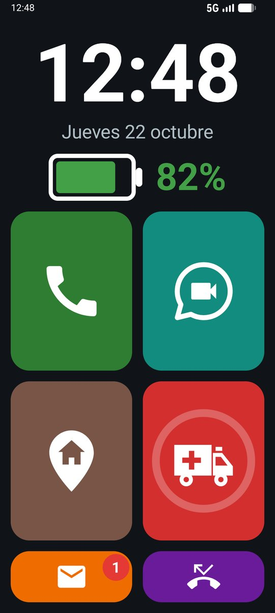
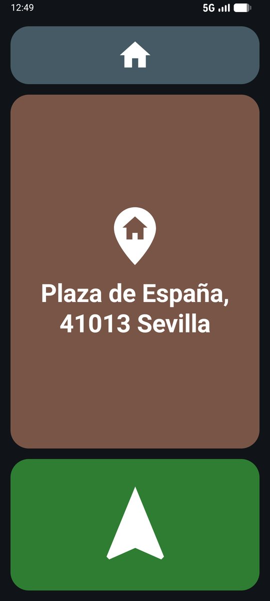
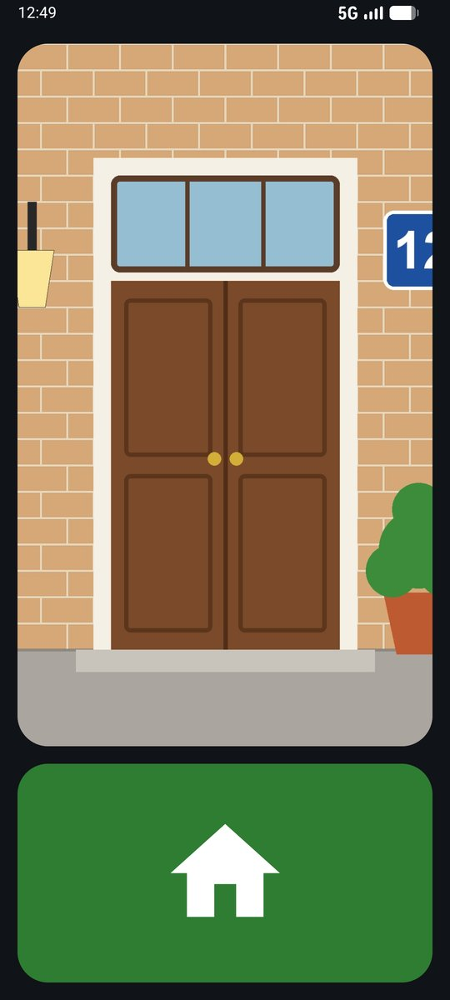
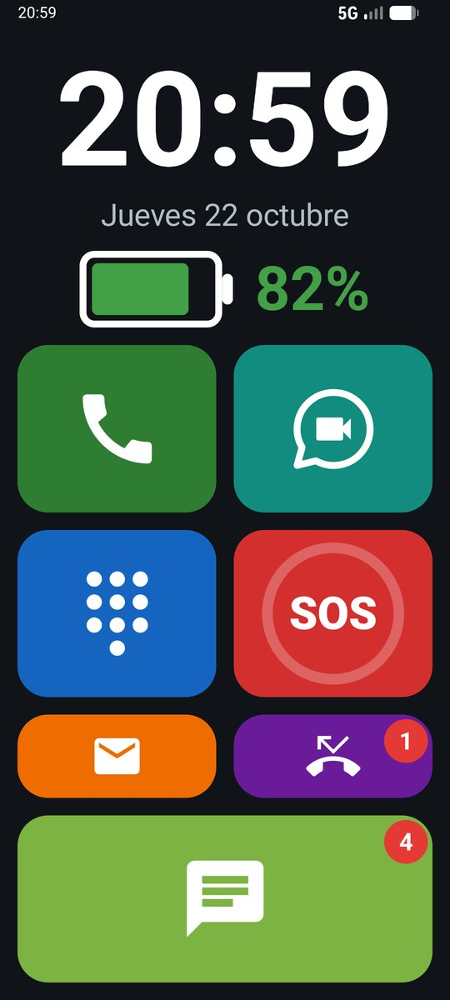
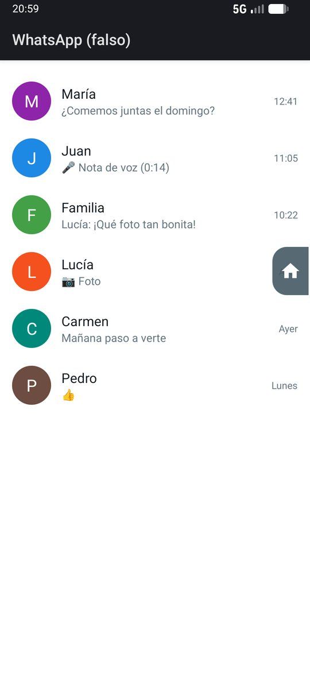
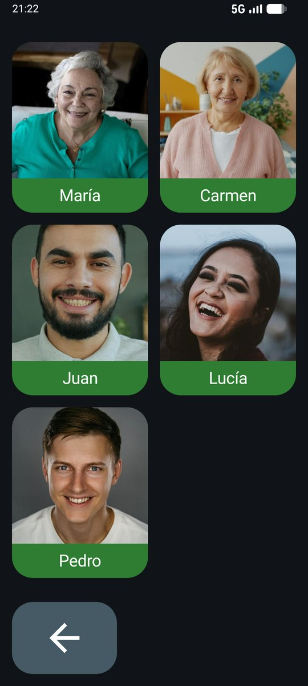

# LlamaditApp

**Un móvil Android que se usa solo con imágenes.** LlamaditApp convierte un teléfono Android en un dispositivo sencillo para personas que no saben leer o que se pierden con un móvil normal: fotos grandes de las personas para llamarlas, un botón SOS, el reloj y la batería en grande, y nada más. Un cuidador lo configura todo desde un panel oculto protegido con PIN.

<p align="center">
  
</p>

## Qué hace

| Función | Cómo la usa la persona |
|---|---|
| 📞 **Llamar** | Toca la foto de la persona. Nada más. |
| 🎥 **Videollamada de WhatsApp** | Toca la foto y la videollamada empieza sola, sin pasar por WhatsApp. |
| 💬 **WhatsApp completo** | Opcional: un botón aparte abre WhatsApp entero (chats, audios, fotos y vídeos), con un número rojo de mensajes nuevos y una pestaña con una casa para volver. |
| 🔢 **Teclado** | Números enormes para marcar a mano. |
| 🆘 **SOS** | Mantiene pulsado el botón rojo 2 segundos: llama al contacto de confianza y le envía su ubicación por SMS (y 3 actualizaciones más, cada 10 minutos). |
| 📲 **Llamadas entrantes** | Pantalla propia con la foto en grande: verde para coger, rojo para colgar. Un solo toque, sin deslizar. También para las videollamadas de WhatsApp. |
| ✉️ **Mensajes** | Lista de SMS con la foto de quien escribe; se pueden leer en grande y borrar. |
| 📵 **Llamadas perdidas** | Un número rojo avisa de que alguien ha llamado; tocar la llamada la devuelve. |
| 🕐 **Reloj y batería** | Siempre en grande en la pantalla principal. |
| 🏠 **Volver a casa** | Botón opcional: la dirección de casa en grande (para enseñarla a la policía o a un vecino) y una flecha que abre la ruta a pie de Google Maps con voz. Al llegar, la foto del portal. El cuidador puede recibir un SMS con la ubicación al pulsarlo y cada 10 minutos de camino. |
| 🧩 **Diseño a medida** | El cuidador mueve, agranda u oculta los botones y elige el dibujo del SOS (letras, ambulancia, cruz…). |
| 👥 **Contactos desde Google** | Opcional: el cuidador gestiona los contactos (nombre, foto y teléfono) desde cualquier ordenador en contacts.google.com, y llegan solos al móvil. |
| 🔊 **Volumen** | Los botones solo cambian el volumen del teléfono, con un panel enorme que se entiende sin leer. El móvil siempre vibra al recibir una llamada. |
| 📍 **¿Dónde está?** | Un familiar autorizado envía un SMS con la palabra `UBICACION` y recibe la posición en Google Maps y el nivel de batería. Solo cuando se pide: no hay seguimiento continuo. |
| 🔒 **Modo quiosco** | La persona no puede salir del launcher, ni desconfigurar el móvil, ni abrir otras apps. Tras reiniciar, arranca directamente en LlamaditApp. |

Y por debajo, sin que la persona haga nada: Wi-Fi (salvo que el cuidador lo active) y Bluetooth apagados, pantalla siempre en vertical, apps innecesarias ocultas, sin pantalla de bloqueo y actualizaciones del sistema de madrugada.

Más detalles en **[docs/FUNCIONES.md](docs/FUNCIONES.md)**.

## Así se ve

| Llamar | Videollamada | Llamada entrante |
|:---:|:---:|:---:|
|  |  |  |
| Toca la foto para llamar | Toca la foto y empieza la videollamada de WhatsApp | Verde para coger, rojo para colgar |

| SOS | Mensajes | Llamadas perdidas |
|:---:|:---:|:---:|
|  |  |  |
| Mantener pulsado 2 s: llama y envía la ubicación | Los SMS, con la foto de quien escribe | Toca una para devolver la llamada |

| Teclado | Volumen | Panel del cuidador |
|:---:|:---:|:---:|
|  |  |  |
| Números enormes | Un panel que se entiende sin leer | Oculto y con PIN, solo para el cuidador |

| Diseño a medida | Volver a casa | Al llegar |
|:---:|:---:|:---:|
|  |  |  |
| Botones movidos, ocultos y con otro dibujo en el SOS | La dirección en grande y la flecha de la ruta | La foto del portal y la casa para volver |

| WhatsApp completo | Dentro de WhatsApp | Botón para volver |
|:---:|:---:|:---:|
|  |  |  |
| Con el número de mensajes nuevos | Una pestaña pequeña con una casa vuelve a LlamaditApp | Casa arriba o flecha abajo, a elegir |

Todas las pantallas, explicadas una a una, en **[docs/FUNCIONES.md](docs/FUNCIONES.md)**.

<sub>Capturas del emulador con contactos inventados; fotos de Unsplash (créditos en [FUNCIONES.md](docs/FUNCIONES.md)).</sub>

## Requisitos

- Un móvil **Android 8.0 o superior** con tarjeta SIM. Probado a fondo en un **Samsung Galaxy A16** (Android 16).
- Un **ordenador** (Windows, macOS o Linux) con las herramientas de Android (`adb`), solo para la puesta en marcha.
- El móvil debe estar **recién restablecido de fábrica** o sin ninguna cuenta (Google, Samsung…) en el momento de activar el modo quiosco. Es una exigencia de Android, no de la app.
- Opcional: **WhatsApp** (no WhatsApp Business) para las videollamadas.
- Opcional: **datos móviles** para la ruta de *Volver a casa* (o el mapa de la ciudad descargado en Google Maps) y para los contactos desde una cuenta de Google.

## Instalación

**👉 [Guía de instalación paso a paso, con capturas](docs/GUIA-INSTALACION.md)**: desde un móvil de fábrica hasta entregarlo listo, pensada para quien no sabe de informática.

En Windows basta con descargar el **[instalador](https://github.com/alvsanmun/LlamaditApp/releases/latest/download/Instalador-LlamaditApp-Windows.zip)**, conectar el móvil por USB y hacer doble clic en `Instalar LlamaditApp.bat`: descarga solo lo necesario, instala la app y activa el modo quiosco.

**¿Ya tienes LlamaditApp en el móvil?** 👉 **[Actualizar a la última versión](docs/ACTUALIZAR.md)**, sin restablecer el móvil y sin perder los contactos ni la configuración (por ejemplo, de la 1.1 a la 1.3).

Resumen para quien ya conoce `adb` ([guía técnica](docs/INSTALACION.md)):

```bash
adb install LlamaditApp.apk
adb shell dpm set-device-owner com.launcherfacil.app/.kiosk.AdminReceiver
adb shell appops set com.launcherfacil.app WRITE_SETTINGS allow
adb shell cmd notification allow_listener com.launcherfacil.app/com.launcherfacil.app.whatsapp.WhatsAppCallListener
```

Después: mantener pulsado el **reloj 5 segundos** → crear el PIN del cuidador → configurar contactos, SOS y WhatsApp → repasar la [configuración recomendada](docs/CONFIGURACION.md).

## Documentación

- [Funciones en detalle](docs/FUNCIONES.md): qué ve la persona y qué puede ajustar el cuidador.
- [Guía de instalación paso a paso, con capturas](docs/GUIA-INSTALACION.md): para quien no sabe de informática.
- [Actualizar a la última versión](docs/ACTUALIZAR.md): sin restablecer el móvil ni perder nada.
- [Instalación técnica con adb](docs/INSTALACION.md).
- [Configuración recomendada de Android](docs/CONFIGURACION.md): ajustes del teléfono, la SIM, WhatsApp y los móviles de los familiares para que todo funcione bien.
- [Solución de problemas](docs/PROBLEMAS.md).
- [Compilar el proyecto](docs/DESARROLLO.md): para desarrolladores.
- [Traducir la app](docs/TRADUCIR.md): cómo añadir o revisar un idioma.

## Idiomas

La persona que usa LlamaditApp no necesita leer, pero el panel del cuidador y los SMS del SOS sí tienen texto. Están traducidos a **español, inglés, catalán, gallego, euskera, portugués, francés, italiano y alemán**. La app usa el idioma del teléfono; si no está traducido, se muestra en inglés. En Android 13 o superior se puede elegir otro idioma solo para la app (*Ajustes → Aplicaciones → LlamaditApp → Idioma*).

¿Hablas otro idioma o quieres revisar una traducción? Consulta **[docs/TRADUCIR.md](docs/TRADUCIR.md)**.

## Privacidad

LlamaditApp **no tiene servidor ni envía datos a ningún sitio**. La ubicación solo sale del móvil por SMS, cuando la pide un contacto autorizado o cuando se pulsa SOS, y va directamente al teléfono de ese familiar. No hay cuentas, ni publicidad, ni analítica.

## Tecnología

Kotlin + Jetpack Compose. Android 8.0+ (minSdk 26, targetSdk 35). La app es *Device Owner* (modo quiosco con Lock Task), la app de Teléfono predeterminada (`InCallService`) y lee las notificaciones de WhatsApp para mostrar sus llamadas con la pantalla propia.

## Licencia

Copyright (C) 2026 alvsanmun

LlamaditApp es **software libre**: puedes usarlo, estudiarlo, modificarlo y redistribuirlo bajo los términos de la **[GNU Affero General Public License, versión 3](LICENSE)** o, a tu elección, cualquier versión posterior. Se distribuye con la esperanza de que sea útil, pero **sin ninguna garantía**; consulta el archivo [LICENSE](LICENSE) para más detalles.

- Si distribuyes una versión modificada, debes publicar también su código fuente bajo la misma licencia.
- Te pedimos, además, que uses **otro nombre y otro `applicationId`** para tu versión, para que no se confunda con esta ni choque con ella al instalarse.
- Las fotos de personas de `docs/img/capturas/` son de [Unsplash](https://unsplash.com) y tienen su propia licencia (créditos en [FUNCIONES.md](docs/FUNCIONES.md)); **no están cubiertas por la AGPLv3**.
- Las librerías de Android (AndroidX, Jetpack Compose) y los iconos de Material Design se usan bajo la licencia Apache 2.0, compatible con la AGPLv3.
