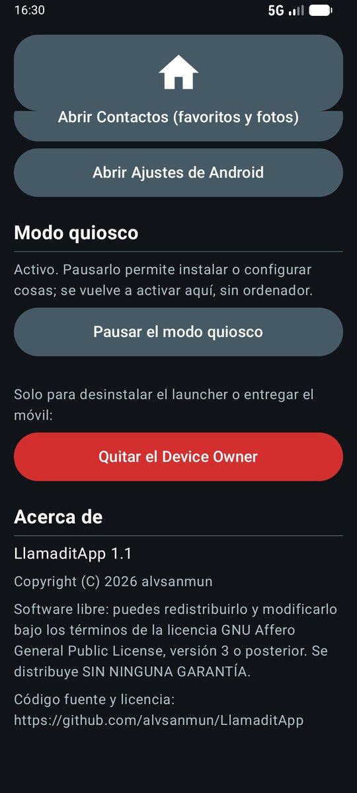
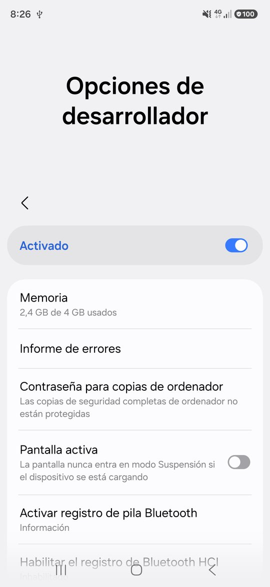
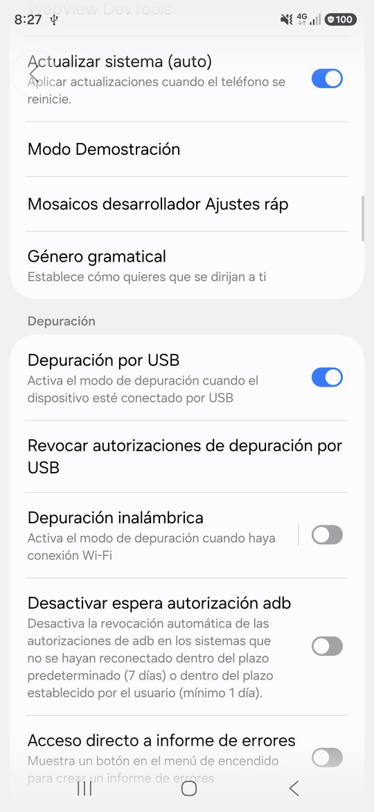
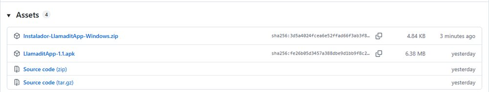
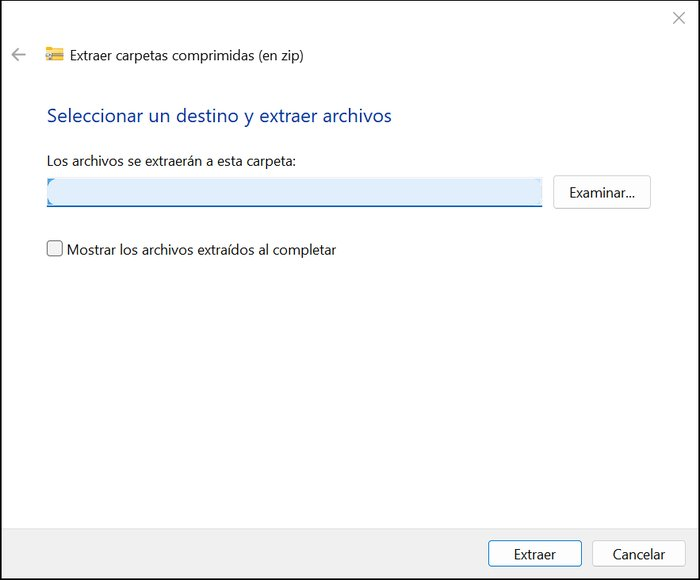
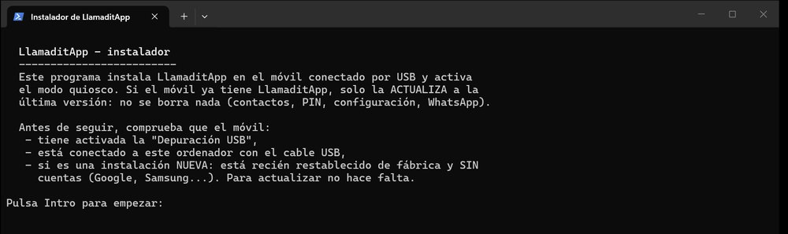
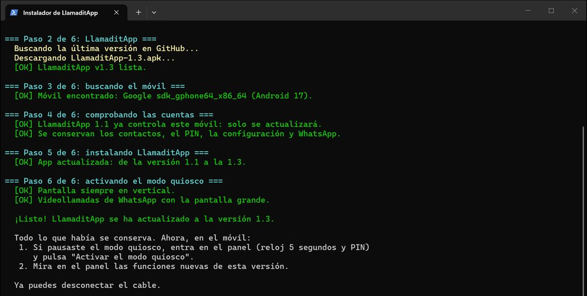
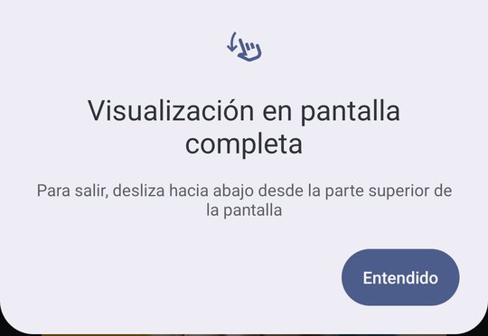
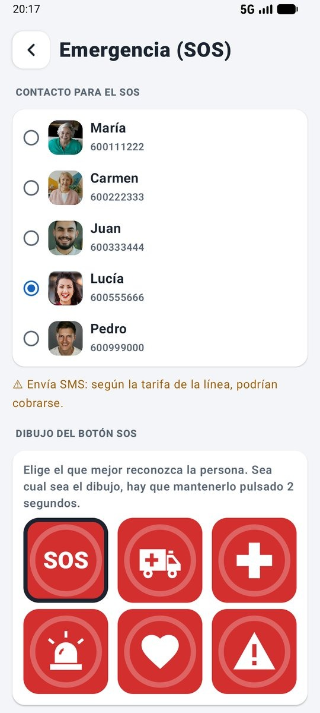
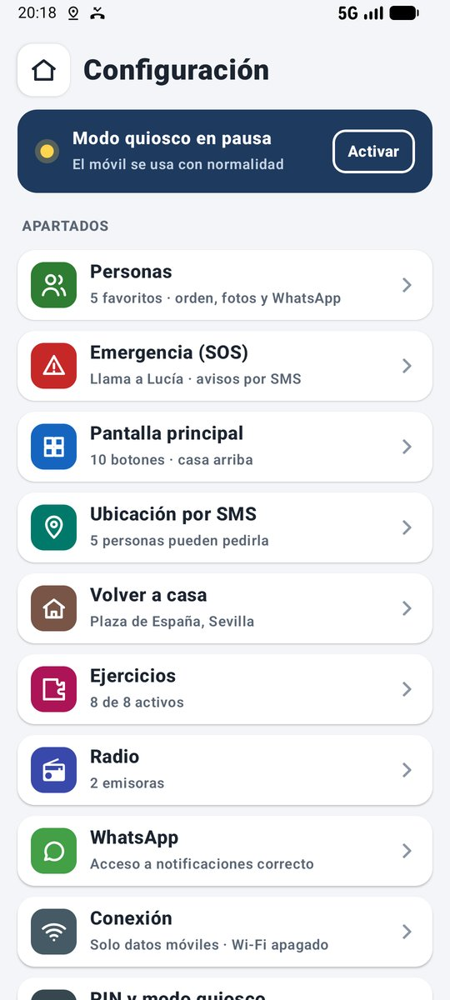

# Actualizar LlamaditApp a la última versión

Si el móvil ya tiene LlamaditApp instalada (por ejemplo, la versión 1.1) y quieres pasar a la última, **no hace falta restablecerlo de fábrica**. Se actualiza en unos 10 minutos con el mismo instalador de Windows, y **se conserva todo**:

- los contactos, sus fotos y su orden;
- el PIN del cuidador y toda la configuración del panel (contacto del SOS, quién puede pedir la ubicación, palabras clave…);
- WhatsApp y sus videollamadas;
- el modo quiosco: LlamaditApp sigue controlando el móvil.

Se puede saltar versiones: de la 1.1 se pasa directamente a la última.

> ⚠️ **No hagas nada de esto para actualizar:** no restablezcas el móvil, no pulses **Quitar el Device Owner** en el panel y no desinstales la app. Perderías la configuración y tendrías que instalarlo todo desde cero.

**Lo que necesitas:**

- Un ordenador con **Windows** e internet.
- El **cable USB** del móvil.
- El móvil con **más de la mitad de batería**.
- El **PIN del cuidador**.

---

## Índice

1. [Mira qué versión tienes y pausa el modo quiosco](#1-mira-qué-versión-tienes-y-pausa-el-modo-quiosco)
2. [Comprueba que la "Depuración USB" sigue activada](#2-comprueba-que-la-depuración-usb-sigue-activada)
3. [Descarga el instalador nuevo](#3-descarga-el-instalador-nuevo)
4. [Conecta el móvil y ejecuta el instalador](#4-conecta-el-móvil-y-ejecuta-el-instalador)
5. [Comprueba el móvil y activa otra vez el modo quiosco](#5-comprueba-el-móvil-y-activa-otra-vez-el-modo-quiosco)
6. [Configura las novedades](#6-configura-las-novedades)
7. [Si algo sale mal](#7-si-algo-sale-mal)

---

## 1. Mira qué versión tienes y pausa el modo quiosco

1. En el móvil, **mantén pulsado el reloj 5 segundos** y escribe el **PIN** del cuidador.
2. Baja hasta el final del panel. En **Acerca de** pone la versión instalada (en la captura, **LlamaditApp 1.1**). La última versión está siempre en la [página de descargas](https://github.com/alvsanmun/LlamaditApp/releases/latest).
3. Un poco más arriba, en **Modo quiosco**, pulsa **Pausar el modo quiosco**. Así el móvil puede mostrar los avisos que hagan falta durante la actualización. Al terminar lo volverás a activar.

> Si ya tienes la **versión 1.7 o posterior**, el panel es distinto: **Pausar** está en la tarjeta azul de arriba de la portada, y la versión, en el apartado **PIN y modo quiosco**, al final (**Acerca de**).
>
> En las versiones desde la 1.9, al pausar el móvil pasa a su **pantalla de inicio normal**. Para volver a LlamaditApp, toca el aviso **Modo quiosco en pausa** o abre su icono en la lista de apps.

<table><tr>
<td></td>
</tr><tr>
<td align="center">① <b>Acerca de</b>: la versión. ② <b>Pausar el modo quiosco</b>. ⛔ El botón rojo, <b>no</b>.</td>
</tr></table>

---

## 2. Comprueba que la "Depuración USB" sigue activada

Es la opción que dejaste activada al instalar LlamaditApp. Normalmente sigue así, pero conviene comprobarlo:

1. En el panel, pulsa **Abrir Ajustes de Android**.
2. Ve al final de Ajustes → **Opciones de desarrollador** y comprueba que **Depuración por USB** está **activada**.
3. **Solo en Samsung:** en **Ajustes → Seguridad y privacidad**, el **Bloqueador automático** tiene que estar **desactivado**; si no, el móvil no deja instalar desde el ordenador.

<table><tr>
<td></td>
<td></td>
</tr><tr>
<td align="center">① <b>Opciones de desarrollador</b></td><td align="center">② <b>Depuración por USB</b> activada</td>
</tr></table>

Si no aparecen las **Opciones de desarrollador** (puede pasar tras una actualización grande de Android), actívalas otra vez como en el [paso 5 de la guía de instalación](GUIA-INSTALACION.md#5-activar-la-depuración-usb).

Pulsa el botón de **inicio** del móvil para volver a LlamaditApp.

---

## 3. Descarga el instalador nuevo

Aunque ya tengas el instalador de otra vez, descárgalo de nuevo: el actual explica mejor la actualización.

1. En el ordenador, abre la [página de la última versión](https://github.com/alvsanmun/LlamaditApp/releases/latest) y pulsa **Instalador-LlamaditApp-Windows.zip**.
2. En la carpeta **Descargas**, haz clic con el botón derecho en el archivo → **Extraer todo…** → **Extraer**.
3. Se abre la carpeta **LlamaditApp-Instalador-Windows**.

<table><tr>
<td></td>
<td></td>
</tr><tr>
<td align="center">① Descargar el instalador</td><td align="center">② Extraer todo</td>
</tr></table>

---

## 4. Conecta el móvil y ejecuta el instalador

1. Conecta el móvil al ordenador con el cable USB. Si el móvil pregunta qué hacer con el USB, elige **Transferir archivos**.
2. En la carpeta del instalador, haz **doble clic** en **Instalar LlamaditApp.bat**. Si Windows avisa con "Windows protegió su PC", pulsa **Más información → Ejecutar de todas formas**.
3. Lee la primera pantalla y pulsa **Intro**.

4. Si en el móvil aparece **"¿Permitir depuración USB?"**, marca **Permitir siempre desde este ordenador** y pulsa **Permitir**.
5. El instalador descarga la última versión, **detecta que LlamaditApp ya está instalada** y solo la actualiza. Al final dice de qué versión a cuál ha pasado:

Fíjate en las líneas **"ya controla este móvil: solo se actualizará"** y **"App actualizada: de la versión 1.1 a la 1.3"**. Pulsa **Intro** para cerrar la ventana y desconecta el cable.

---

## 5. Comprueba el móvil y activa otra vez el modo quiosco

1. LlamaditApp se reinicia sola con la versión nueva. Si aparece el aviso **"Visualización en pantalla completa"**, pulsa **Entendido** (es un aviso de Android que sale una sola vez).

2. Entra en el panel (reloj 5 segundos y **el mismo PIN de siempre**). Desde la versión 1.7 el panel es nuevo: claro y por apartados. Comprueba que siguen los contactos (**Personas**), el contacto del SOS (**Emergencia**) y lo demás.
3. En la tarjeta azul de arriba de la portada, que dice **Modo quiosco en pausa**, pulsa **Activar**. Si vienes de una versión de la 1.9 o posterior, abre LlamaditApp y pulsa directamente **Activar el modo quiosco**. La versión nueva sale en el apartado **PIN y modo quiosco**, al final (**Acerca de**).

<table><tr>
<td></td>
<td></td>
</tr><tr>
<td align="center">① La configuración sigue igual</td><td align="center">② <b>Activar</b> en la tarjeta azul</td>
</tr></table>

✅ **Listo.** La pantalla principal se queda igual que antes; las funciones nuevas vienen **desactivadas** hasta que el cuidador las active.

---

## 6. Configura las novedades

Lo nuevo de las últimas versiones, todo desde el panel del cuidador:

| Novedad | Dónde se explica |
|---|---|
| **Aviso de batería baja** (1.9): el dibujo del móvil y el cargador al bajar del porcentaje que elijas | [Guía, paso 9.8](GUIA-INSTALACION.md#98-batería-baja-opcional) |
| **Pastillas** (1.9): a cada hora, la foto de cada caja y cuántas tomar; la persona contesta con el botón verde (tomada) o el rojo (no se la toma) y tú lo ves en la actividad y en el **historial de tomas**, con la foto de cada caja (1.9.1) | [Guía, paso 9.9](GUIA-INSTALACION.md#99-pastillas-opcional) |
| **Periódicos** (1.9): 42 periódicos y revistas gratuitos por secciones, con foto, en grande y con voz; la noticia entera se abre sin avisos de cookies ni anuncios que la tapen | [Guía, paso 9.10](GUIA-INSTALACION.md#910-periódicos-opcional) |
| **Cámara y fotos** (1.9): hacer fotos con la cámara de atrás o la de delante y verlas, con botones muy sencillos. Se activan en **Pantalla principal**, también a distancia | [Guía, paso 9.7](GUIA-INSTALACION.md#97-cámara-y-fotos-opcional) |
| **Pausa del modo quiosco** (1.9): el móvil queda como uno normal, con su pantalla de inicio, hasta que lo actives; pausar y activar son inmediatos | [Funciones](FUNCIONES.md#panel-del-cuidador) |
| **Añadir personas sin salir de LlamaditApp** (1.8): formulario propio con foto, nombre, teléfono y WhatsApp; ya no se abre la app Contactos | [Guía, paso 8](GUIA-INSTALACION.md#8-añadir-los-contactos-con-su-foto) |
| **Gestión a distancia** (1.8, opcional): el cuidador ve dónde está el móvil, lo hace sonar y cambia la configuración desde la **app del cuidador** (Android) o desde el ordenador, con el proyecto de Firebase de su familia | [Gestión a distancia](GESTION-A-DISTANCIA.md) |
| **Panel del cuidador nuevo** (1.7): claro y por apartados, con el estado del modo quiosco y lo que falta por revisar; **Personas** con fotos y etiquetas, ordenar arrastrando y añadir personas sin poner la estrella | [Guía, paso 9](GUIA-INSTALACION.md#9-configurar-el-panel-del-cuidador) |
| **Juegos con diseño nuevo** (1.7): menú con dibujos, tandas de 5 partidas con premio y cálculo con manzanas y tres respuestas | [Funciones, ejercicios](FUNCIONES.md#12-ejercicios) |
| **Radio** (1.6): los logotipos de las emisoras que elige el cuidador; suena también con la pantalla apagada y calla durante las llamadas. Es lo único que usa internet | [Guía, paso 9.6](GUIA-INSTALACION.md#96-radio-opcional) |
| **Configurar sin que se corte** (1.6): mientras el cuidador añade la cuenta de Google o instala WhatsApp, el modo quiosco queda en pausa hasta salir del panel; botón **Instalar WhatsApp** | [Guía, paso 10](GUIA-INSTALACION.md#10-whatsapp-opcional) |
| **Ejercicios** (1.5): ocho ejercicios para la memoria, la atención y el cálculo, con niveles que suben solos | [Guía, paso 9.5](GUIA-INSTALACION.md#95-ejercicios-opcional) |
| **WhatsApp completo** (1.4): un botón aparte para usar los chats, audios, fotos y vídeos, con una pestaña con una casa para volver | [Guía, paso 9.4](GUIA-INSTALACION.md#94-whatsapp-completo-opcional) |
| **Botón para volver** (1.4): la casa grande de arriba o una flecha abajo a la izquierda | [Guía, paso 9.1](GUIA-INSTALACION.md#91-adaptar-la-pantalla-principal) |
| **Pantalla principal a medida** (1.3): mover, agrandar u ocultar botones, y otro dibujo para el SOS (ambulancia, cruz, corazón…) | [Guía, paso 9.1](GUIA-INSTALACION.md#91-adaptar-la-pantalla-principal) |
| **Volver a casa** (1.3): dirección en grande, ruta a pie con voz y foto del portal al llegar | [Guía, paso 9.2](GUIA-INSTALACION.md#92-volver-a-casa-opcional) |
| **Wi-Fi opcional** (1.3) | [Guía, paso 9.3](GUIA-INSTALACION.md#93-wi-fi-opcional) |
| **Contactos desde una cuenta de Google** (1.3) | [Guía, paso 8, opción B](GUIA-INSTALACION.md#opción-b-desde-una-cuenta-de-google) |
| **Avisos por SMS de "Volver a casa"** y aviso del coste de los SMS (1.3) | [Funciones: Volver a casa](FUNCIONES.md#11-volver-a-casa) |

Y algunos [consejos](FUNCIONES.md#consejos), como descargar el mapa de la ciudad en Google Maps para que la ruta a casa funcione sin datos.

La lista completa de cambios de cada versión está en la [página de versiones](https://github.com/alvsanmun/LlamaditApp/releases).

---

## 7. Si algo sale mal

| El instalador dice… | Qué hacer |
|---|---|
| "No encuentro el móvil" | Comprueba el cable (mejor el original) y que la **Depuración USB** está activada (paso 2). Prueba otro puerto USB del ordenador. |
| Se queda esperando y el móvil pregunta **"¿Permitir depuración USB?"** | Pulsa **Permitir** en el móvil. Si no aparece la pregunta, comprueba que pausaste el modo quiosco (paso 1). |
| "Ya hay otra versión instalada con una firma distinta" (`UPDATE_INCOMPATIBLE`) | La app del móvil no salió de la [página oficial](https://github.com/alvsanmun/LlamaditApp/releases) (por ejemplo, la compiló alguien por su cuenta). No se puede actualizar encima: habría que quitar el Device Owner, desinstalarla e instalar de nuevo, y se perdería la configuración del panel. |
| "El móvil ya tiene una versión más nueva" | No hay nada que actualizar. |
| La instalación falla en un Samsung | Desactiva el **Bloqueador automático** (paso 2) y vuelve a abrir el instalador. |
| "Windows protegió su PC" | **Más información → Ejecutar de todas formas**. |

**Para quien ya usa `adb`:** basta con descargar el APK de la última versión y ejecutar `adb install -r LlamaditApp-1.3.apk`. El `-r` reinstala conservando los datos.

¿Otro problema? Mira [Problemas frecuentes](PROBLEMAS.md) o abre una [incidencia en GitHub](https://github.com/alvsanmun/LlamaditApp/issues).

---

Capturas del emulador de Android actualizando de la versión 1.1 a la 1.3, con contactos inventados; las de los menús de Ajustes, de un Samsung Galaxy A16.
