# Funciones de Launcher Fácil

Launcher Fácil tiene dos partes:

- **Lo que ve la persona**: solo imágenes, colores y botones grandes. No hace falta leer.
- **El panel del cuidador**: oculto y protegido con PIN. Aquí sí hay texto.

---

## 1. Pantalla principal

  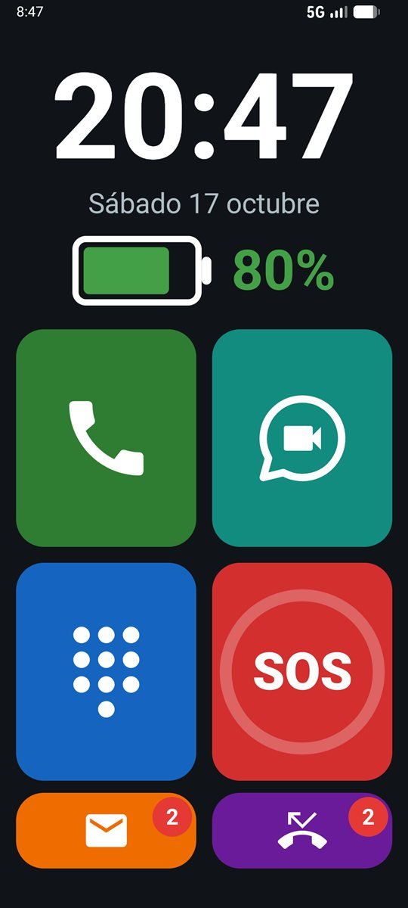

- **Reloj**: hora en grande y fecha en el idioma del teléfono.
- **Batería**: verde por encima del 50 %, ámbar por encima del 20 %, roja por debajo. Un rayo indica que está cargando.
- Los botones pequeños de abajo muestran un **número rojo** cuando hay mensajes nuevos o llamadas perdidas.

Desde cualquier pantalla, la **casa** grande de arriba vuelve a la pantalla principal. Tras hacer una llamada o videollamada, al colgar se vuelve también a la pantalla principal.

## 2. Llamar

  

Cuadrícula con las **fotos de los contactos favoritos** (★). Tocar una foto = llamar. El nombre aparece pequeño, solo como ayuda para el cuidador. Si un contacto no tiene foto, sale una silueta.

Los contactos, sus fotos y quién es favorito se gestionan en la app **Contactos** del sistema, que se abre desde el panel del cuidador. El orden se elige en el panel.

## 3. Videollamada de WhatsApp

  

Las mismas fotos, en el mismo orden, pero solo de las personas marcadas como "Tiene WhatsApp". Una cámara pequeña en la esquina indica que es videollamada. Tocar la foto **inicia la videollamada directamente**, sin pasar por los chats de WhatsApp.

- Solo videollamadas: las llamadas de voz se hacen con el botón verde normal.
- Durante la videollamada se ve la pantalla de WhatsApp, con su botón rojo para colgar. Al colgar se vuelve sola a Launcher Fácil.
- Requiere WhatsApp (no WhatsApp Business) instalado y con la sesión iniciada.

## 4. Teclado

  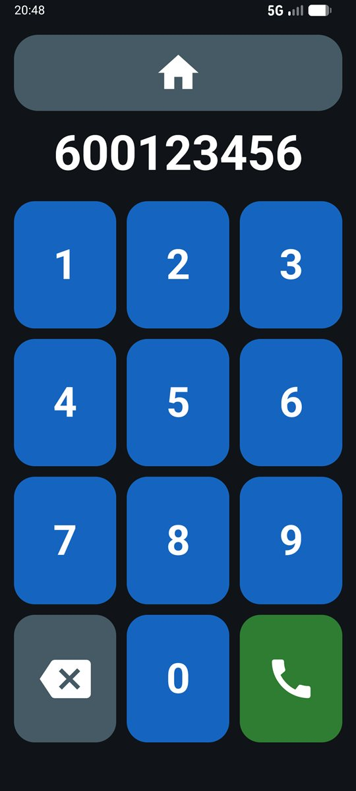

Números enormes, un botón para borrar (mantenerlo pulsado borra todo) y el verde para llamar. Hacen falta al menos 3 cifras (con menos, Android lo interpreta como un código especial).

## 5. SOS

  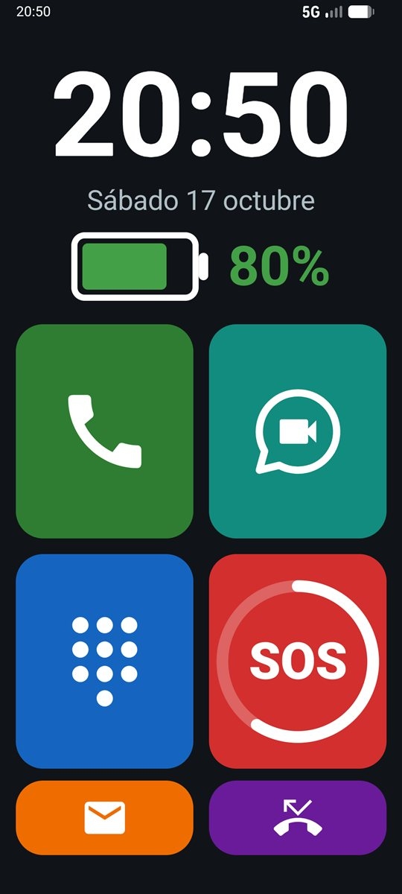

Para emergencias. **Hay que mantenerlo pulsado 2 segundos** (un anillo se va llenando), así no se activa sin querer. Al activarse:

1. **Llama en el acto** al contacto de confianza (el elegido en el panel o, si no se ha elegido, el primero de la lista).
2. A la vez le **envía un SMS** con un enlace de Google Maps a la posición del teléfono y el nivel de batería:
   > SOS: necesito ayuda. Estoy aquí: https://maps.google.com/?q=… (±10 m, 10:45) · Batería 64 %
3. Le envía **3 actualizaciones más, cada 10 minutos** (30 minutos en total). Después se para solo.

Si no hay ningún contacto favorito, abre el marcador con el **112** ya escrito (Android no permite que una app llame al 112 sin un toque más).

## 6. Llamadas entrantes

  
  
  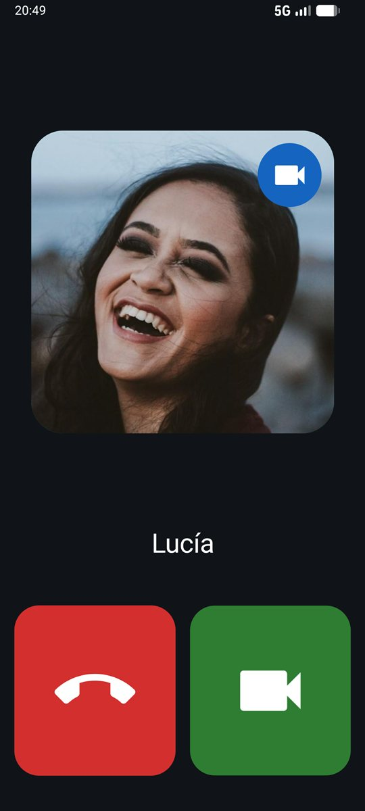

Launcher Fácil es la app de Teléfono del móvil, así que todas las llamadas usan su propia pantalla:

- **Foto grande** de quien llama (o una silueta si no está en la agenda).
- **Verde** (que late) para contestar, **rojo** para rechazar. Un solo toque, sin deslizar.
- Durante la llamada: **altavoz** y un botón rojo grande para **colgar**.
- La pantalla se apaga al acercar el teléfono a la oreja.
- El teléfono **siempre vibra** al recibir una llamada, con cualquier volumen. Los botones de volumen no silencian una llamada que está sonando.

Las **videollamadas de WhatsApp** entrantes también se muestran con esta pantalla: verde para contestar y rojo para rechazar.

## 7. Mensajes (SMS)

  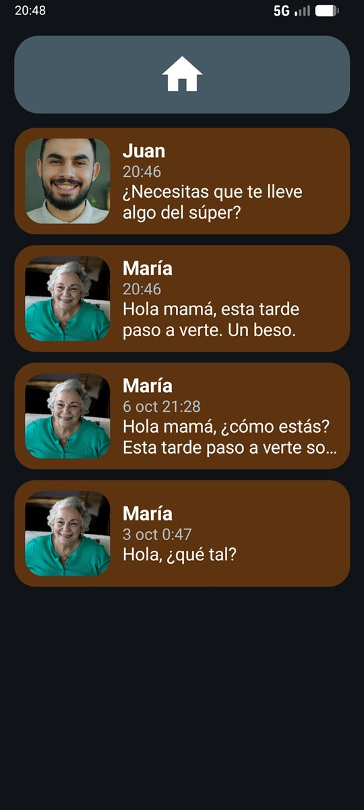
  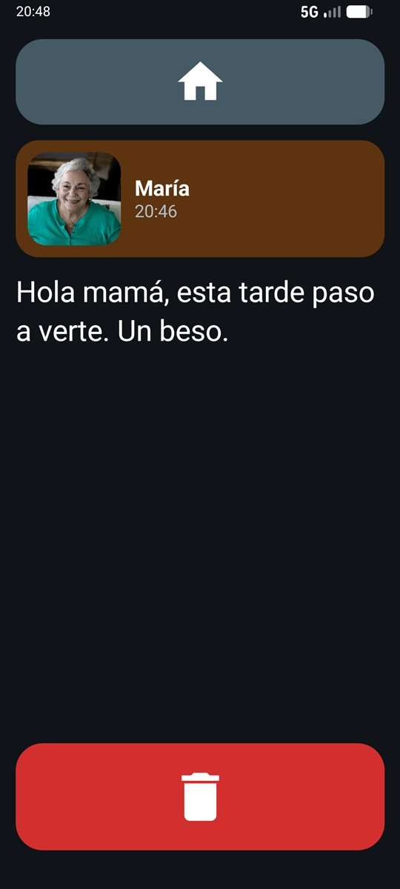

Lista de los SMS recibidos con la foto de quien escribe. Al tocar uno se lee en grande, con una papelera para quitarlo de la lista. Las peticiones de ubicación de los familiares no aparecen.

> Los mensajes "borrados" solo desaparecen de Launcher Fácil. Siguen en la app de mensajes del sistema, que es la única que puede borrarlos del teléfono.

## 8. Llamadas perdidas

  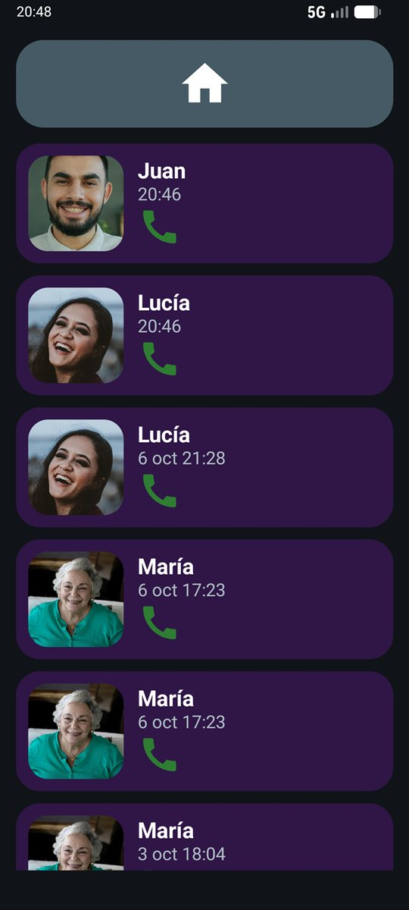
  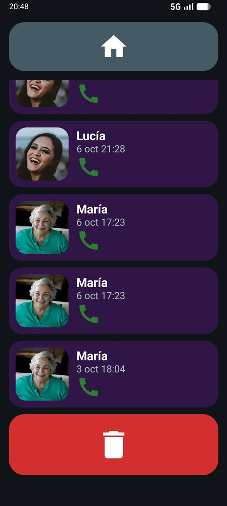
  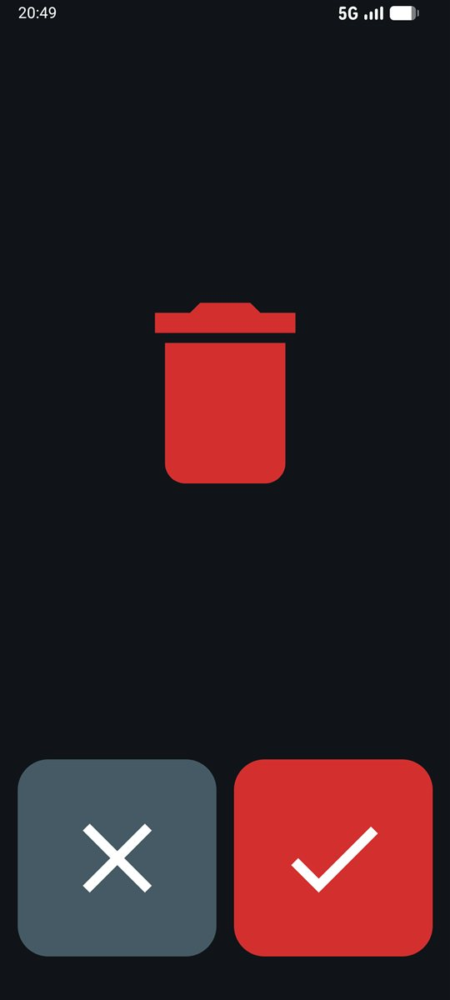

Lista de las llamadas perdidas con foto, nombre y hora. **Tocar una devuelve la llamada.** Al final hay una papelera roja grande para borrar todo el historial de llamadas perdidas, con una confirmación sin texto: ✗ (no) o ✓ (sí).

## 9. Volumen

  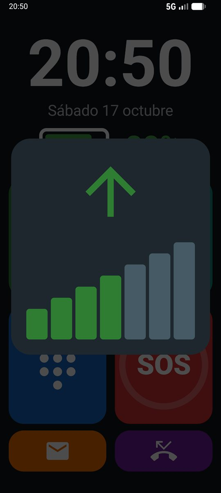

Los botones laterales solo cambian el **volumen del timbre** (o, durante una llamada, el de la voz). Aparece un panel enorme con una flecha verde hacia arriba o ámbar hacia abajo y una escalera de barras. Bajando del todo, el timbre queda en silencio y el móvil **solo vibra**: nunca queda totalmente mudo. El sonido de vídeos y música está a cero.

## 10. Localización bajo demanda

Un familiar autorizado envía al teléfono un SMS con una palabra clave (por defecto `UBICACION` o `DONDE ESTAS`; da igual mayúsculas, tildes o signos). Launcher Fácil le responde automáticamente con un SMS:

> Ubicación: https://maps.google.com/?q=40.416775,-3.703790 (±12 m, 10:45) · Batería 64 %

- Solo responde a los **contactos favoritos autorizados** en el panel. Los demás se ignoran sin responder.
- Funciona con la pantalla apagada.
- En el teléfono no se ve nada: la persona no se entera.
- **No hay seguimiento continuo**: el teléfono solo busca su posición cuando alguien la pide.

## 11. Modo quiosco

- La persona **no puede salir** de Launcher Fácil: no hay botón de inicio, ni de apps recientes, ni panel de notificaciones.
- Solo se pueden abrir Launcher Fácil, WhatsApp (para las videollamadas) y las pantallas de llamada del sistema.
- Tras reiniciar o quedarse sin batería, el móvil **arranca directamente** en Launcher Fácil y sin pantalla de bloqueo.
- **Solo datos móviles**: el Wi-Fi está apagado y bloqueado, y el modo avión no se puede activar (dejaría el teléfono sin llamadas ni SOS).
- **Bluetooth apagado** y bloqueado (no se usa y gasta batería).
- **Pantalla siempre en vertical**, también en las videollamadas.
- **Apps innecesarias ocultas** (navegador, mapas, tiendas, juegos…): no se ven ni gastan batería.
- **Actualizaciones del sistema** de madrugada (de 2:00 a 4:00), automáticas.

---

## Panel del cuidador

  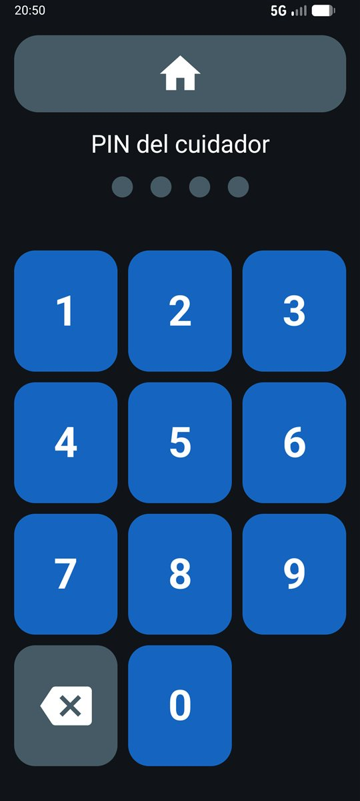
  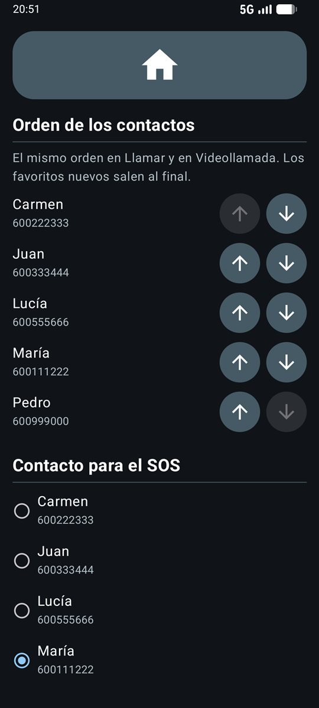
  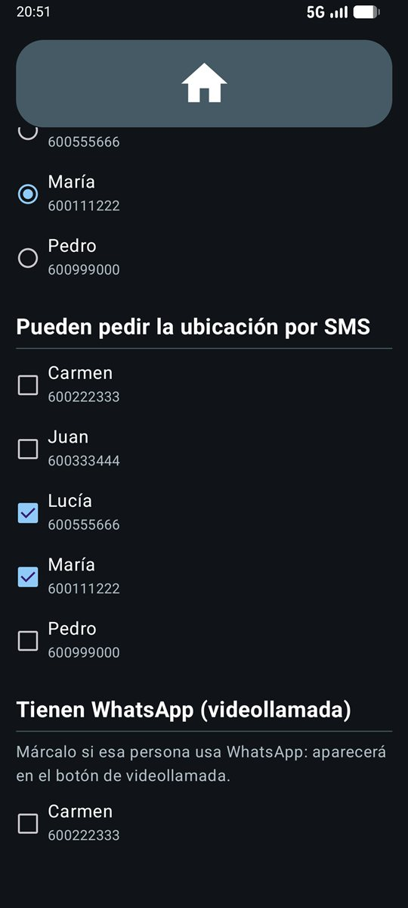
  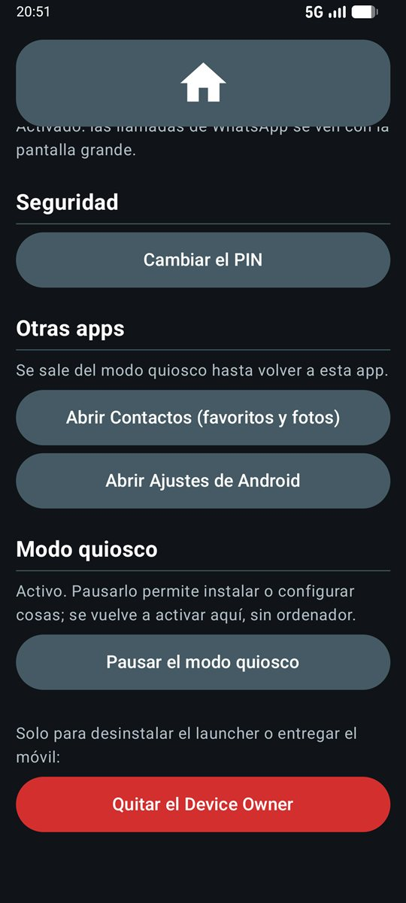

**Cómo entrar:** mantener pulsado el **reloj 5 segundos** (el teléfono vibra) e introducir el PIN de 4 cifras. La primera vez se crea el PIN (dos veces). El panel se cierra solo al apagar la pantalla.

| Sección | Para qué sirve |
|---|---|
| **Orden de los contactos** | Flechas ↑ y ↓ para elegir el orden. Es el mismo en Llamar y en Videollamada. Los favoritos nuevos salen al final. |
| **Contacto para el SOS** | A quién llama y avisa el botón SOS. |
| **Pueden pedir la ubicación por SMS** | Qué favoritos pueden pedir la ubicación. |
| **Tienen WhatsApp (videollamada)** | Marcar quién usa WhatsApp: aparecerá en el botón de videollamada. |
| **Palabras clave** | Las palabras que deben enviar para pedir la ubicación, separadas por comas. |
| **Llamadas de WhatsApp** | Activar el "acceso a notificaciones", necesario para ver las videollamadas entrantes con la pantalla propia. |
| **Seguridad** | Cambiar el PIN. |
| **Otras apps** | Abrir **Contactos** (añadir personas, fotos y favoritos ★) o los **Ajustes de Android**. El quiosco se pausa mientras tanto y vuelve al regresar. |
| **Modo quiosco** | **Pausar** (el móvil se usa con normalidad, por ejemplo para instalar algo) y **Activar** de nuevo, sin ordenador. |
| **Quitar el Device Owner** | Solo para desinstalar Launcher Fácil o entregar el móvil a otra persona. Volver a activar el quiosco exige un ordenador. |

> ⚠️ **Apunta el PIN en un sitio seguro.** En la versión final no hay otra forma de entrar al panel: si se olvida, solo queda restablecer el teléfono de fábrica.

---

Capturas hechas en el emulador de Android con contactos inventados. Fotos de los contactos: [Daniel Lara](https://unsplash.com/es/fotos/t9tDSXN2U2E), [Vitaly Gariev](https://unsplash.com/es/fotos/4HNK1yce-Vg), [Igor Rodrigues](https://unsplash.com/es/fotos/6IGd3-F3Cao), [Sergey Mikheev](https://unsplash.com/es/fotos/H982yXJ7vOk) y [Vitaly Gariev](https://unsplash.com/es/fotos/IihDS3WZGlY) en Unsplash (licencia de Unsplash).
