# Funciones de LlamaditApp

LlamaditApp tiene dos partes:

- **Lo que ve la persona**: solo imágenes, colores y botones grandes. No hace falta leer.
- **El panel del cuidador**: oculto y protegido con PIN. Aquí sí hay texto.

---

## 1. Pantalla principal

  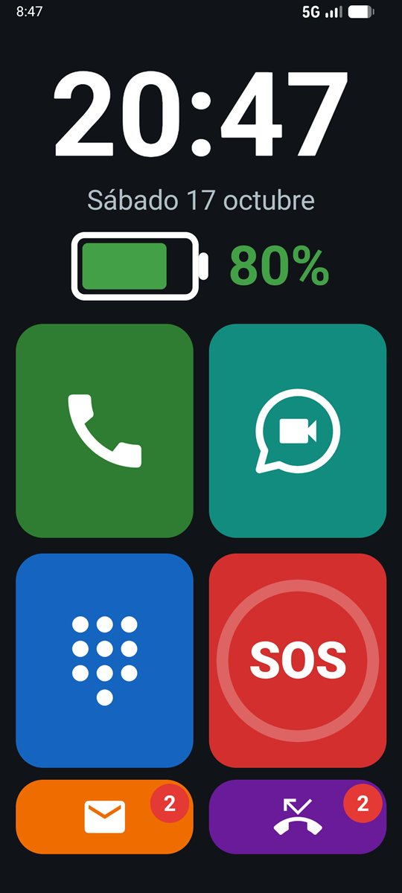

- **Reloj**: hora en grande y fecha en el idioma del teléfono.
- **Batería**: verde por encima del 50 %, ámbar por encima del 20 %, roja por debajo. Un rayo indica que está cargando.
- Los botones pequeños de abajo muestran un **número rojo** cuando hay mensajes nuevos o llamadas perdidas.
- No hay barra de navegación abajo: la pantalla entera es para los botones. Si alguien desliza desde el borde inferior, la flecha de "atrás" aparece unos segundos y se vuelve a esconder.

Desde cualquier pantalla, la **casa** grande de arriba vuelve a la pantalla principal o, si el cuidador lo prefiere, una **flecha** fija abajo a la izquierda, como el botón Atrás de Android pero más grande.

  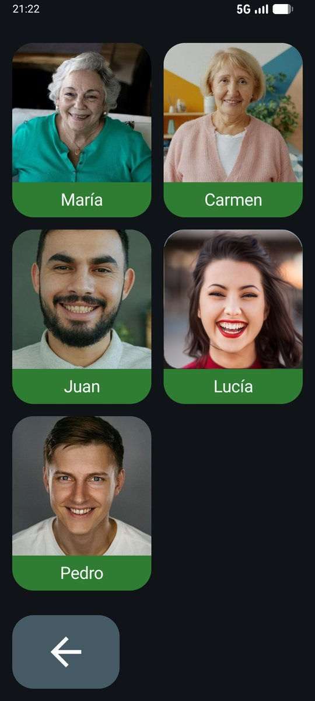

 Tras hacer una llamada o videollamada, al colgar se vuelve también a la pantalla principal.

### Diseño a medida

  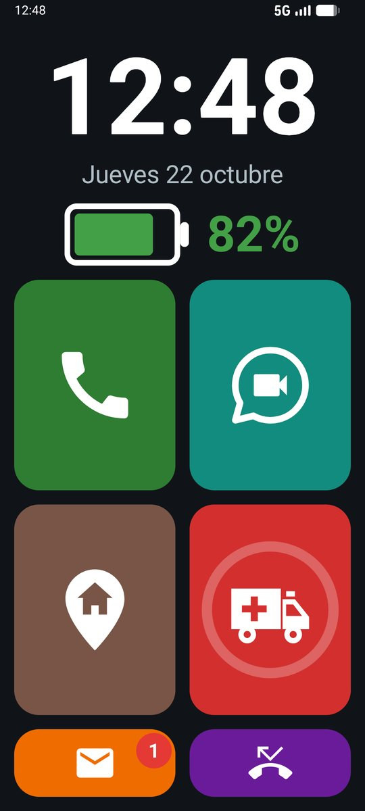

El cuidador puede adaptar la pantalla a la persona desde el panel:

- **Mover** cualquier botón, el reloj y la batería.
- Hacer cada botón **pequeño**, **mediano** o **grande**, y **ocultar** los que no use. En la captura, el teclado está oculto y se ha añadido el botón marrón de *Volver a casa*.
- Cambiar el **dibujo del botón SOS** por una ambulancia, una cruz, una sirena, un corazón o una señal de peligro, para quien no reconozca las letras.
- El **reloj siempre se ve**, porque mantenerlo pulsado es la entrada al panel del cuidador.

## 2. Llamar

  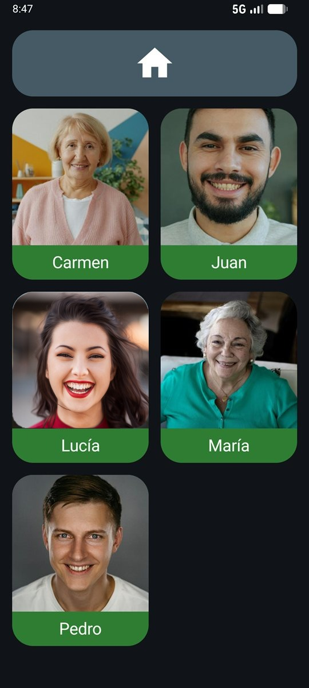

Cuadrícula con las **fotos de los contactos favoritos** (★). Tocar una foto = llamar. El nombre aparece pequeño, solo como ayuda para el cuidador. Si un contacto no tiene foto, sale una silueta.

Los contactos, sus fotos y quién es favorito se gestionan en la app **Contactos** del sistema, que se abre desde el panel del cuidador. El orden se elige en el panel.

## 3. Videollamada de WhatsApp

  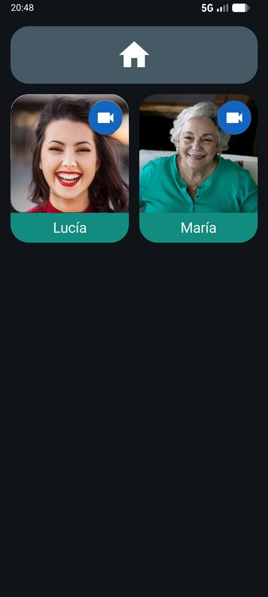

Las mismas fotos, en el mismo orden, pero solo de las personas marcadas como "Tiene WhatsApp". Una cámara pequeña en la esquina indica que es videollamada. Tocar la foto **inicia la videollamada directamente**, sin pasar por los chats de WhatsApp.

- Solo videollamadas: las llamadas de voz se hacen con el botón verde normal.
- Durante la videollamada se ve la pantalla de WhatsApp, con su botón rojo para colgar. Al colgar se vuelve sola a LlamaditApp.
- Requiere WhatsApp (no WhatsApp Business) instalado y con la sesión iniciada.

### WhatsApp completo (opcional)

  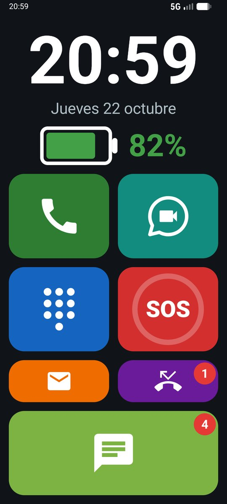
  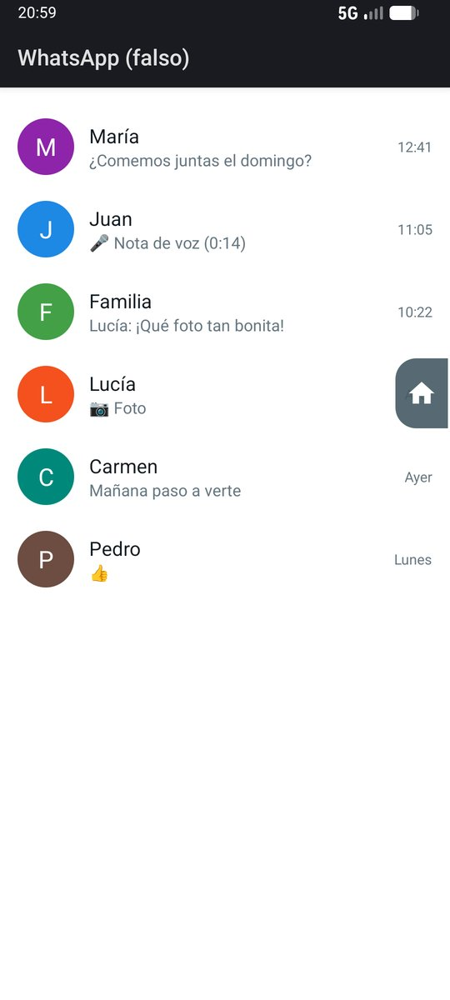

Un botón aparte, verde claro con un bocadillo, para quien quiera usar **WhatsApp entero**: chats, notas de voz, fotos y vídeos. Lleva un **número rojo** con los mensajes sin leer, que baja solo al leerlos.

- Al tocarlo se abre WhatsApp, con el sonido de audios y vídeos activado.
- Mientras se usa, una **pestaña pequeña con una casa**, pegada al borde derecho de la pantalla, vuelve a LlamaditApp con un toque. Es pequeña y semitransparente para tapar lo mínimo, y está por debajo de la barra de arriba de WhatsApp y por encima del teclado.
- Si entra una llamada mientras tanto, la pestaña se esconde para no tapar la pantalla de la llamada; al colgar se vuelve a la pantalla principal.
- Dentro del modo quiosco no se abren enlaces web ni otras apps desde WhatsApp.
- La pestaña necesita el permiso "Mostrar sobre otras aplicaciones": lo da el instalador, o el cuidador desde el panel. Sin él, WhatsApp se abre igual y se sale con la flecha de atrás.

## 4. Teclado

  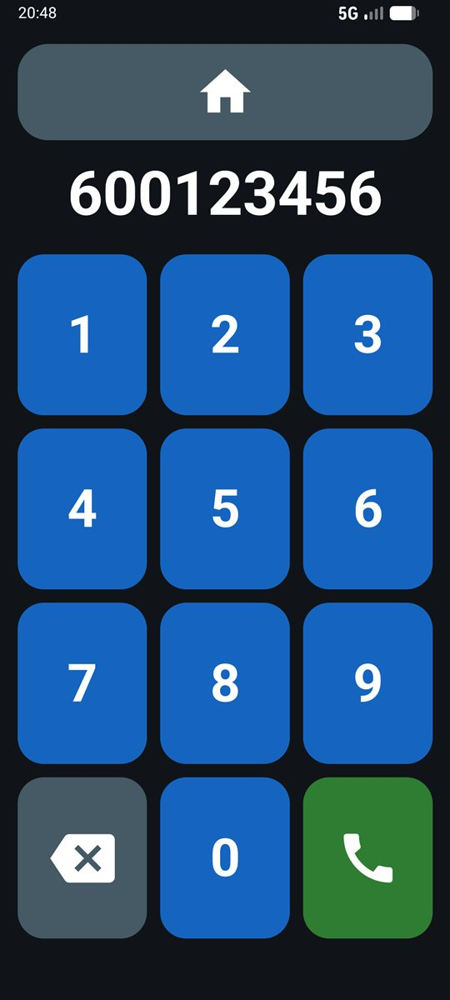

Números enormes, un botón para borrar (mantenerlo pulsado borra todo) y el verde para llamar. Hacen falta al menos 3 cifras (con menos, Android lo interpreta como un código especial).

## 5. SOS

  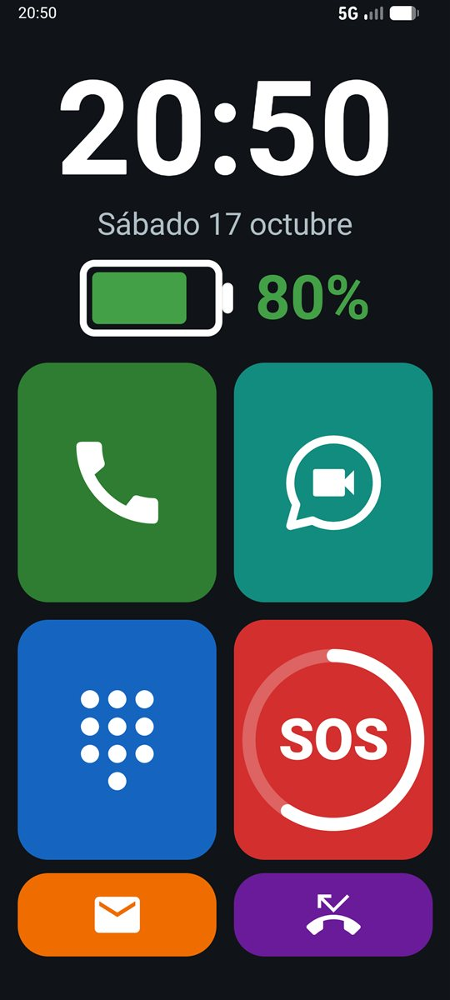

Para emergencias. **Hay que mantenerlo pulsado 2 segundos** (un anillo se va llenando), así no se activa sin querer. Al activarse:

1. **Llama en el acto** al contacto de confianza (el elegido en el panel o, si no se ha elegido, el primero de la lista).
2. A la vez le **envía un SMS** con un enlace de Google Maps a la posición del teléfono y el nivel de batería:
   > SOS: necesito ayuda. Estoy aquí: https://maps.google.com/?q=… (±10 m, 10:45) · Batería 64 %
3. Le envía **3 actualizaciones más, cada 10 minutos** (30 minutos en total). Después se para solo.

Si no hay ningún contacto favorito, abre el marcador con el **112** ya escrito (Android no permite que una app llame al 112 sin un toque más).

## 6. Llamadas entrantes

  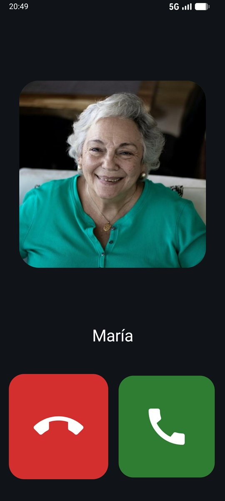
  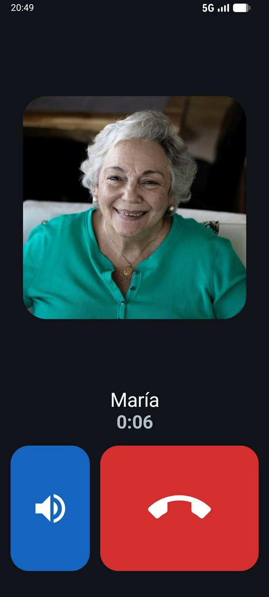
  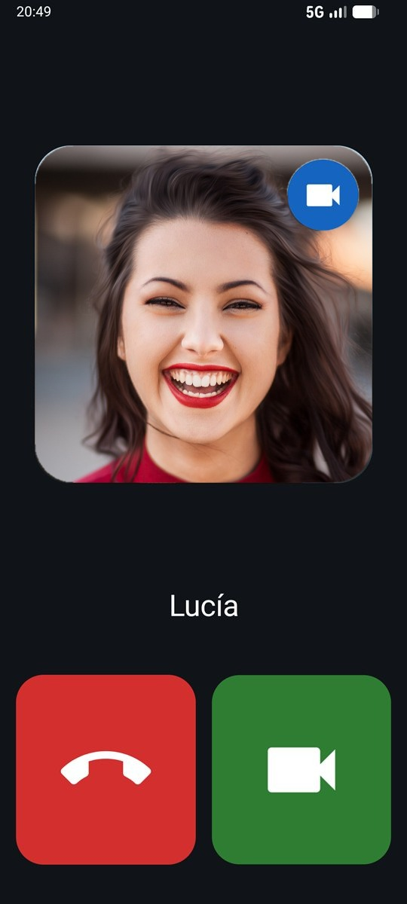

LlamaditApp es la app de Teléfono del móvil, así que todas las llamadas usan su propia pantalla:

- **Foto grande** de quien llama (o una silueta si no está en la agenda).
- **Verde** (que late) para contestar, **rojo** para rechazar. Un solo toque, sin deslizar.
- Durante la llamada: **altavoz** y un botón rojo grande para **colgar**.
- La pantalla se apaga al acercar el teléfono a la oreja.
- El teléfono **siempre vibra** al recibir una llamada, con cualquier volumen. Los botones de volumen no silencian una llamada que está sonando.

Las **videollamadas de WhatsApp** entrantes también se muestran con esta pantalla: verde para contestar y rojo para rechazar.

## 7. Mensajes (SMS)

  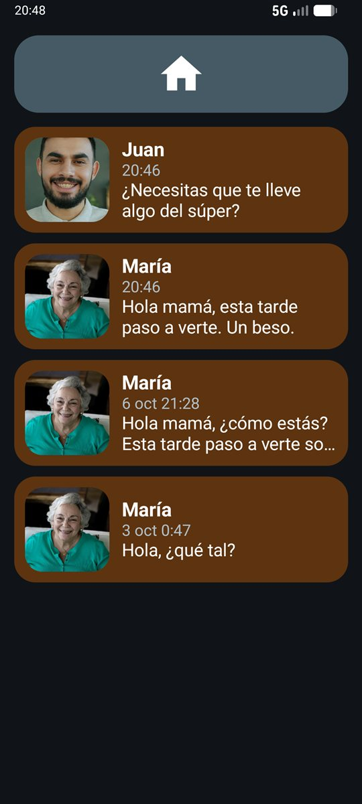
  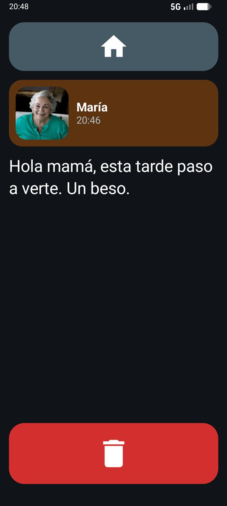

Lista de los SMS recibidos con la foto de quien escribe. Al tocar uno se lee en grande, con una papelera para quitarlo de la lista. Las peticiones de ubicación de los familiares no aparecen.

> Los mensajes "borrados" solo desaparecen de LlamaditApp. Siguen en la app de mensajes del sistema, que es la única que puede borrarlos del teléfono.

## 8. Llamadas perdidas

  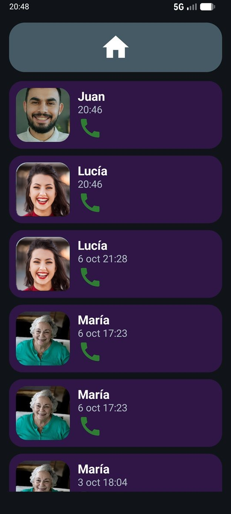
  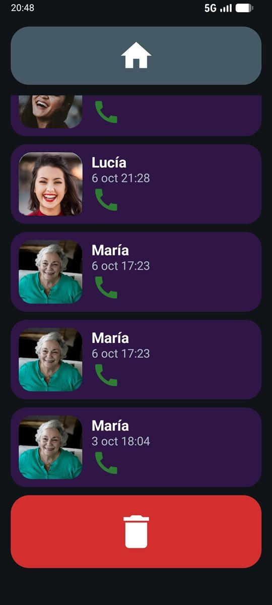
  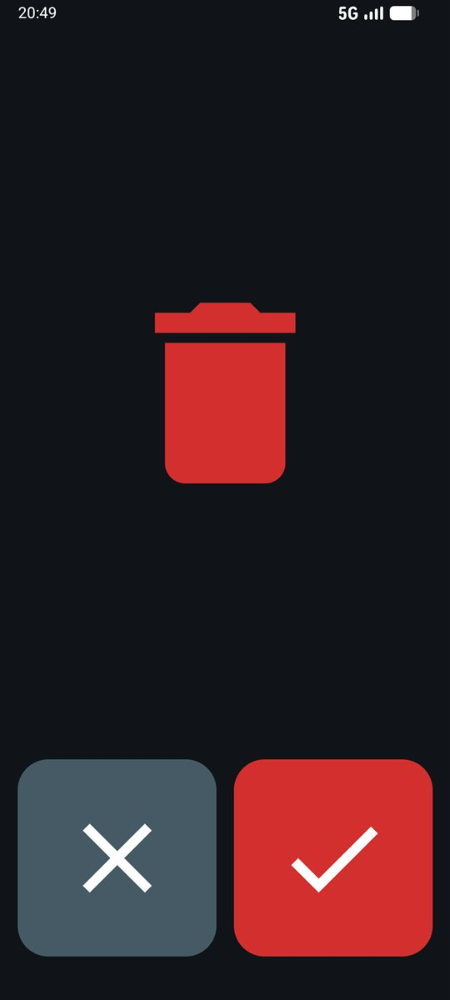

Lista de las llamadas perdidas con foto, nombre y hora. **Tocar una devuelve la llamada.** Al final hay una papelera roja grande para borrar todo el historial de llamadas perdidas, con una confirmación sin texto: ✗ (no) o ✓ (sí).

## 9. Volumen

  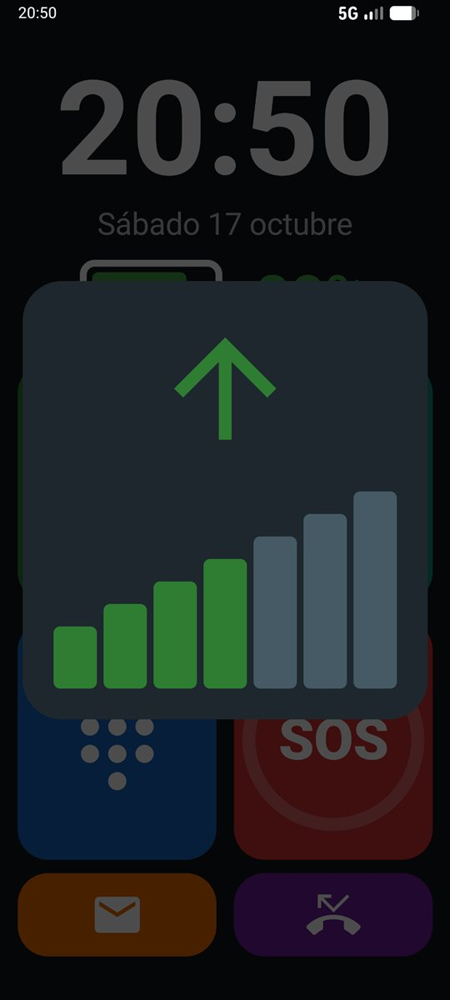

Los botones laterales solo cambian el **volumen del timbre** (o, durante una llamada, el de la voz). Aparece un panel enorme con una flecha verde hacia arriba o ámbar hacia abajo y una escalera de barras. Bajando del todo, el timbre queda en silencio y el móvil **solo vibra**: nunca queda totalmente mudo. El sonido de vídeos y música está a cero.

## 10. Localización bajo demanda

Un familiar autorizado envía al teléfono un SMS con una palabra clave (por defecto `UBICACION` o `DONDE ESTAS`; da igual mayúsculas, tildes o signos). LlamaditApp le responde automáticamente con un SMS:

> Ubicación: https://maps.google.com/?q=40.416775,-3.703790 (±12 m, 10:45) · Batería 64 %

- Solo responde a los **contactos favoritos autorizados** en el panel. Los demás se ignoran sin responder.
- Funciona con la pantalla apagada.
- En el teléfono no se ve nada: la persona no se entera.
- **No hay seguimiento continuo**: el teléfono solo busca su posición cuando alguien la pide.

## 11. Volver a casa

  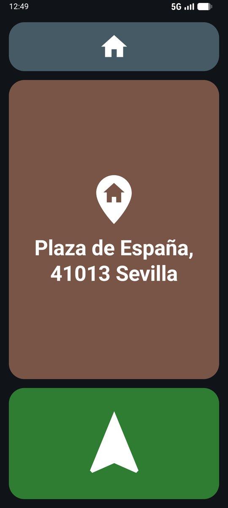
  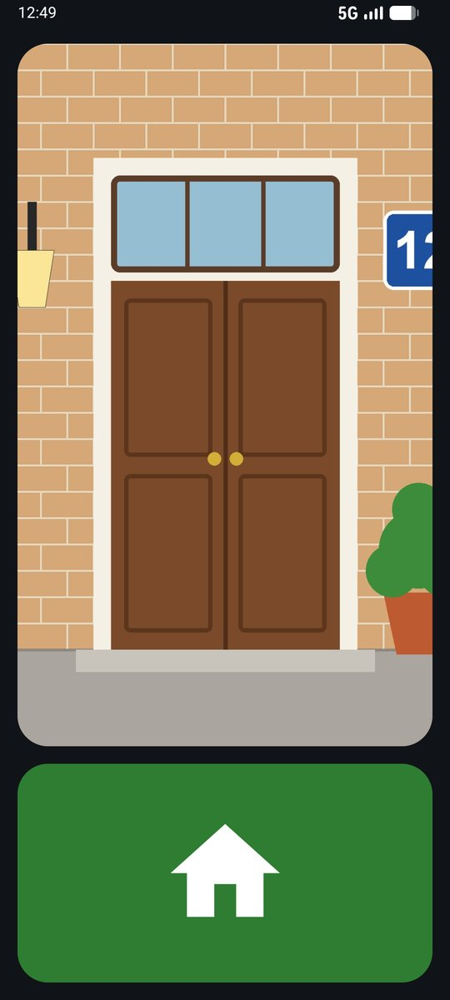

Un botón opcional (marrón, con una chincheta y una casa) para cuando la persona se desoriente en la calle:

1. Al pulsarlo se ve la **dirección de casa en letra grande**: puede enseñársela a la policía o a cualquier persona para que le ayude.
2. La **flecha verde** abre la **ruta a pie de Google Maps, con voz** ("gira a la derecha…"). Para volver a LlamaditApp basta con la flecha de "atrás" de Google Maps.
3. Al llegar a **unos 40 m de casa**, LlamaditApp se pone delante y enseña la **foto del portal** que hizo el cuidador, con una casa verde debajo para volver a la pantalla principal.

Avisos al cuidador (al contacto del SOS), que se activan o desactivan en el panel:

- **Al pulsar el botón marrón**, un SMS con la ubicación:
  > VOLVER A CASA: se ha pulsado el botón para volver a casa. Ubicación: https://maps.google.com/?q=… (±5 m, 18:20) · Batería 70 %
- **Durante la ruta, cada 10 minutos**, la ubicación y lo que le falta para llegar, y un último SMS al llegar:
  > VOLVER A CASA: de camino, a 350 m de casa. Ubicación: https://maps.google.com/?q=… · Batería 68 %
  > VOLVER A CASA: ha llegado a casa. · Batería 66 %

Google Maps no avisa a otras apps de que la ruta ha terminado, así que LlamaditApp mira el GPS del móvil mientras dura la ruta para saber cuándo llega. Deja de mirarlo al llegar o, como mucho, a las 2 horas. Si los avisos cada 10 minutos están desactivados, esa posición no se envía a nadie.

La ruta necesita datos móviles, salvo que se haya descargado el mapa de la ciudad (ver [Consejos](#consejos)).

## 12. Ejercicios

  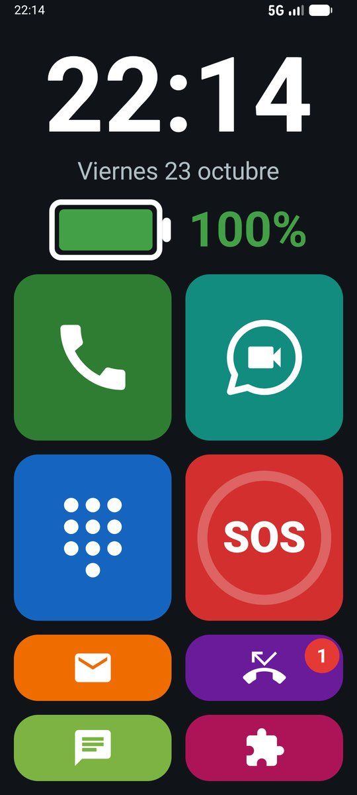
  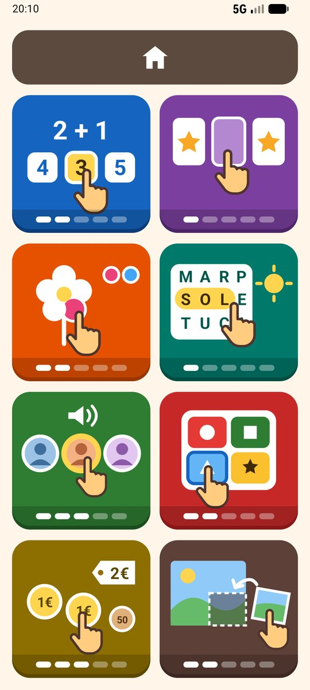

Un botón opcional (rosa, con una pieza de puzle) con ejercicios para mantener la memoria, la atención y el cálculo, pensados para personas mayores o con dificultades cognitivas o de memoria. Al pulsarlo sale un menú con una tarjeta por ejercicio: un dibujo en el que **una mano hace lo que se hace en el juego** (tocar la respuesta, levantar una carta, pintar un pétalo…) y, debajo, cinco barras con su **nivel** (de 1 a 5).

- Los ejercicios **cambian en cada partida**.
- El **nivel sube solo** tras **5 partidas seguidas bien hechas** y **baja** tras 3 con fallos. El cuidador elige en el panel por qué nivel empieza cada uno.
- Se juega en **tandas de 5 partidas**: arriba, unos puntos marcan por cuál va (verdes las hechas, azul la de ahora). Al terminar cada partida sale un **✓ verde**, aunque haya habido fallos, para animar, y al terminar la tanda, un **premio** con confeti y una pegatina por cada partida bien hecha, con dos botones: jugar otra vez o volver a los juegos. Los fallos se notan con una **sacudida** y una vibración, sin texto.
- **No hacen ruido**, salvo *¿Quién es?*, que habla.

| Ejercicio | Cómo se juega | Del nivel 1 al 5 |
|---|---|---|
| 🔢 **Cálculos sencillos** | Sale la operación en grande (con manzanas para contar si los números son pequeños) y se toca la respuesta buena entre tres. Si falla, esa respuesta se apaga y puede probar otra. | De sumas hasta 10 a multiplicaciones y divisiones sencillas |
| 🃏 **Parejas de cartas** | Cartas boca abajo: se levantan de dos en dos hasta encontrar todas las parejas. | De 3 × 3 a 5 × 6 cartas |
| 🎨 **Pintar por números** | Como un cuaderno de colorear: se elige un color de abajo y se toca una zona con su número; se pinta entera. El dibujo se amplía con dos dedos o con **+** y **−**. | De 3 zonas grandes (una manzana) a dibujos con muchas zonas (un gato, una casa con árbol). En los primeros niveles se marcan las zonas del color elegido. |
| 🔤 **Sopa de letras** | Palabras sencillas, solo en horizontal y vertical, cada una con su dibujo. Se marca tocando la primera letra y la última. | De 5 × 5 con 3 palabras a 9 × 9 con 7 |
| 👪 **¿Quién es?** | La voz del móvil pregunta "¿Dónde está María?" y hay que tocar su foto. Usa las fotos de los contactos favoritos. | De 2 fotos a 6 |
| 🎵 **Repetir la secuencia** | Se encienden unos botones de colores (cada uno con una forma) y hay que tocarlos en el mismo orden. Arriba, el ojo se enciende cuando hay que mirar y la mano cuando toca repetir; debajo se va completando la secuencia. | De 2 pasos con 4 botones a 5 pasos con 6 |
| 💶 **Contar dinero** | Sale una cosa de la compra con su precio y hay que poner las monedas y billetes justos. | De monedas de 1 € y 2 € a todo, hasta 50 € |
| 🧩 **Puzle con fotos** | Una foto de la familia (o la del portal) partida en piezas: se toca una pieza y luego otra para cambiarlas de sitio. | De 2 × 2 a 5 × 5 piezas |

  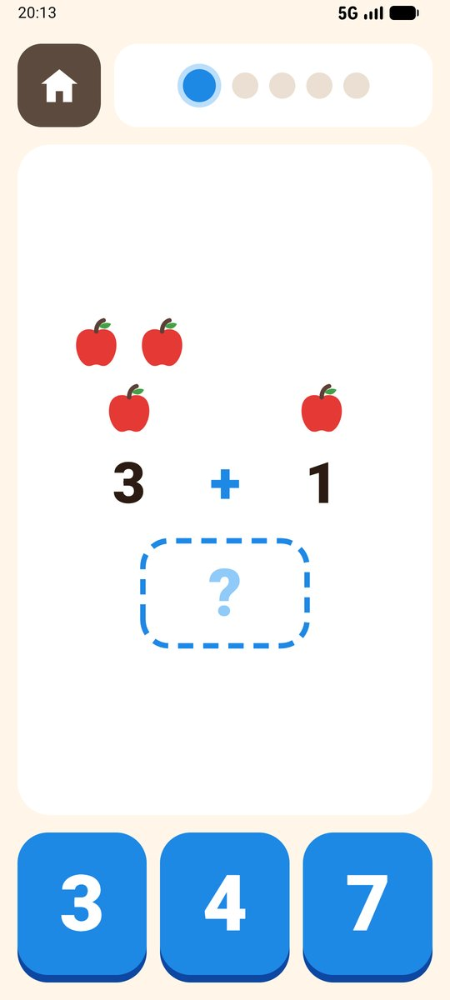
  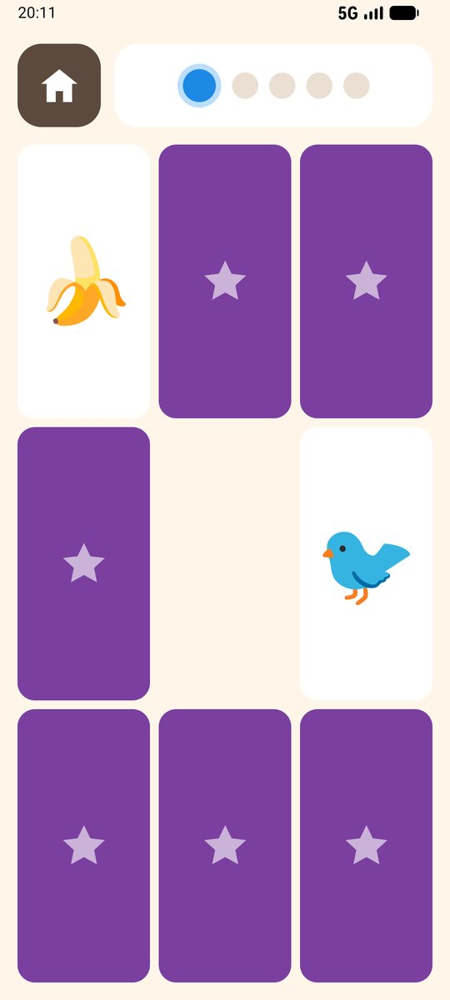
  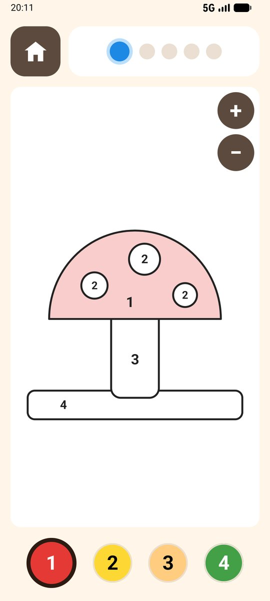
  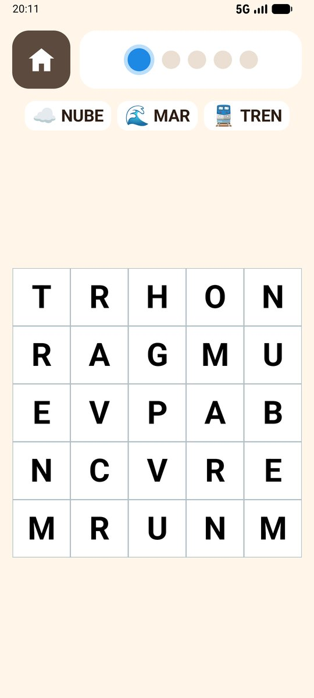

  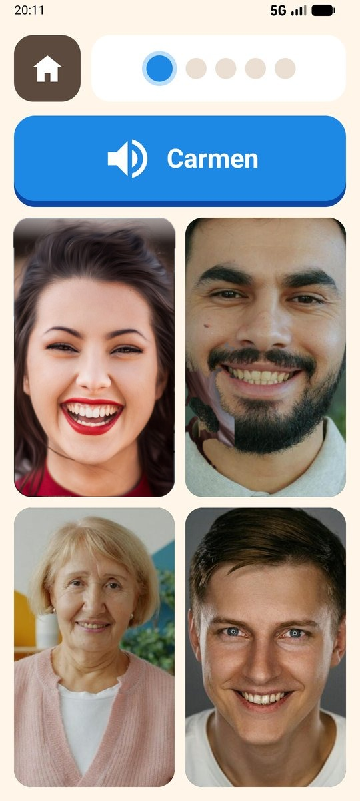
  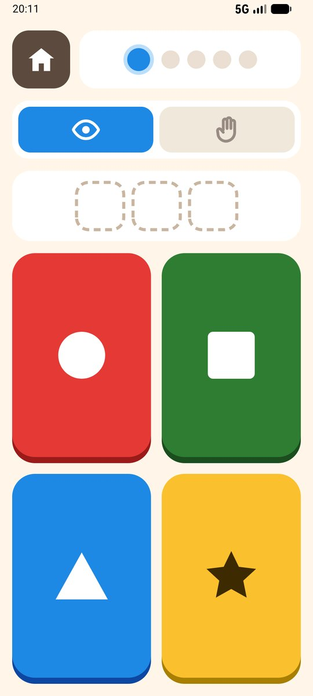
  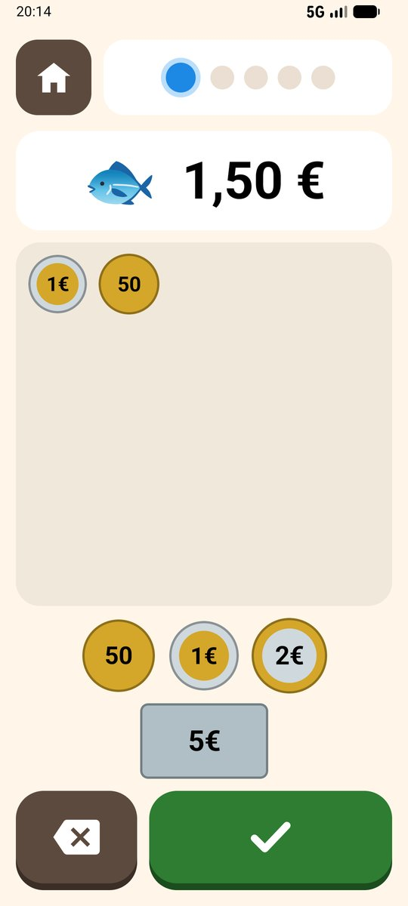
  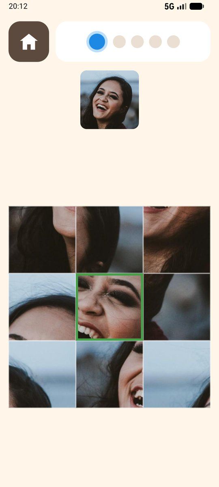

  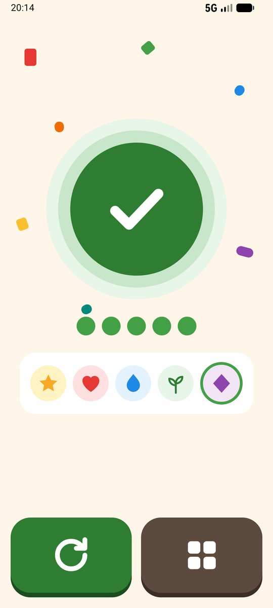

La casa de arriba (o la flecha de abajo) vuelve a la pantalla principal.

## 13. Radio

  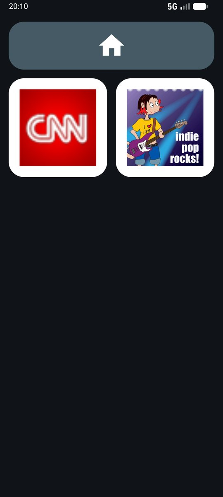

Un botón opcional (añil, con una radio) para escuchar la radio por internet. Al pulsarlo salen, en grande, los **logotipos de las emisoras** que ha elegido el cuidador (o su nombre sobre un color, si la emisora no tiene logotipo; el cuidador puede ponerle cualquier dibujo de la galería).

- **Tocar un logotipo** pone esa emisora: le sale un marco verde y un altavoz, y "late". Tocar otro cambia de emisora.
- **Sigue sonando de fondo**: al volver a la pantalla principal (el botón de la radio sigue latiendo para recordar que está puesta) y con la pantalla apagada.
- El **botón rojo** de abajo la apaga. También se apaga sola tras el tiempo que elige el cuidador (por defecto, 1 hora desde que se eligió la emisora).
- Mientras suena, los **botones de volumen** cambian el volumen de la radio (con el mismo panel grande). Nunca baja a cero: para callarla está el botón rojo.
- **Calla durante las llamadas** (también mientras suena el teléfono) y vuelve sola al colgar.
- Si se corta (por ejemplo, sin cobertura), lo vuelve a intentar unas veces. Si no lo consigue, la emisora queda con un marco rojo y un aspa.
- Gasta **datos móviles**: unos 30 a 60 MB por hora de escucha. Es lo único de LlamaditApp que usa internet.

## 14. Cámara y fotos

  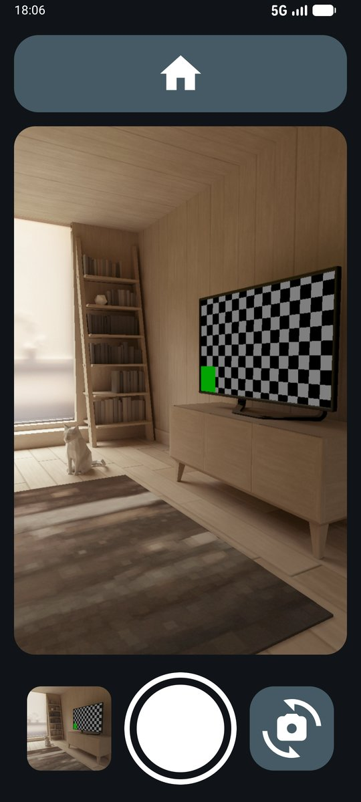
  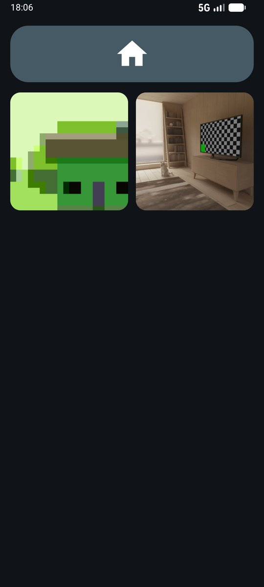
  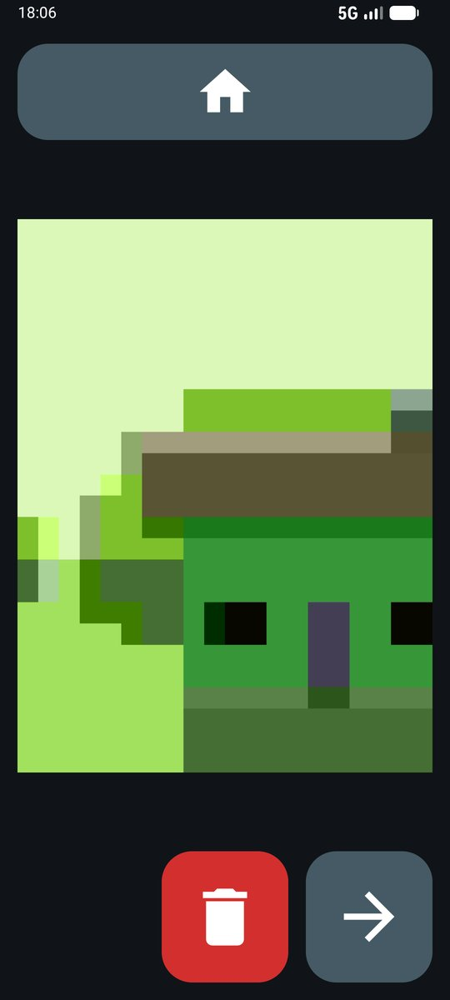

Dos botones opcionales e independientes, desactivados hasta que el cuidador los active en **Pantalla principal** (desde el panel o a distancia):

- **Cámara** (turquesa): se ve lo que enfoca la cámara. El **círculo blanco** hace la foto, con un destello y una vibración, y la foto aparece pequeña a la izquierda. El botón de la derecha cambia entre la cámara **de atrás** y la **de delante**.
- **Fotos** (violeta): las fotos hechas con LlamaditApp en una cuadrícula, las más nuevas primero. Al tocar una se ve en grande, con **flechas** para pasar a otra y una **papelera** roja, que pide confirmar con ✗ gris o ✓ rojo.

No se usan la cámara ni la Galería del móvil, que tienen muchas opciones y texto, y no hace falta internet. Las fotos se guardan en el móvil, en la carpeta **Pictures/LlamaditApp**: también salen en la Galería y el cuidador puede pasarlas al ordenador. Desde el botón **Fotos** solo se ven las hechas con LlamaditApp. Las fotos no se envían a ningún sitio, ni siquiera con la gestión a distancia. La cámara solo funciona con su pantalla abierta.

## 15. Aviso de batería baja

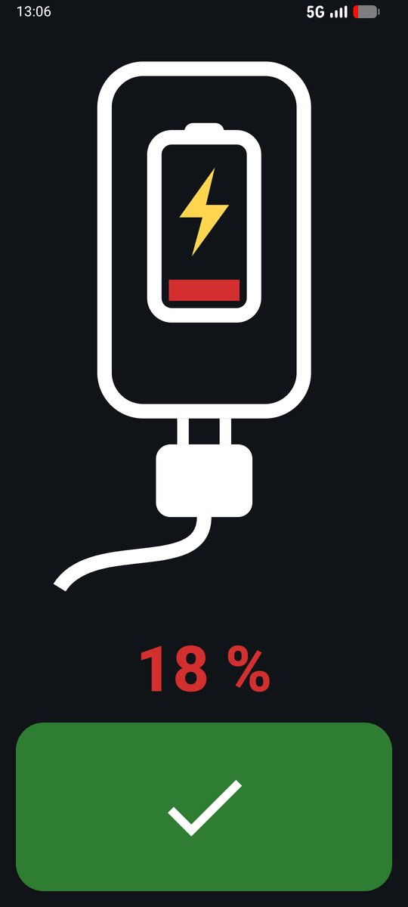

Opcional. Aunque la batería se ve siempre en la pantalla principal, cuando baja del nivel que elige el cuidador (del 10 al 50 %, por defecto el 20 %) y el móvil no está cargando, aparece en grande el **dibujo del móvil con la batería en rojo y el enchufe acercándose**, con un pitido y una vibración. Se quita con el **botón verde** grande, o solo, al **enchufar el cargador**. Sale una vez por cada descarga: vuelve a avisar después de haberlo cargado. Con la pantalla apagada espera a que se encienda, para no despertar a nadie. Con la gestión a distancia, el cuidador ve en la actividad "Batería baja" al llegar a ese nivel.

## 16. Pastillas

  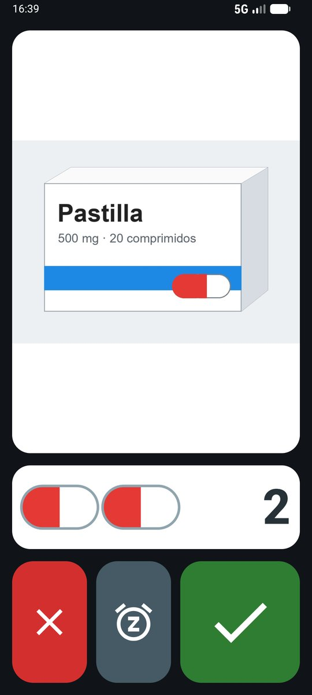
  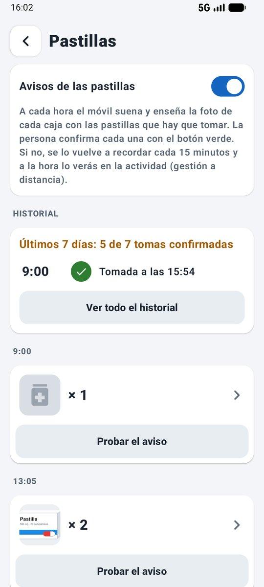
  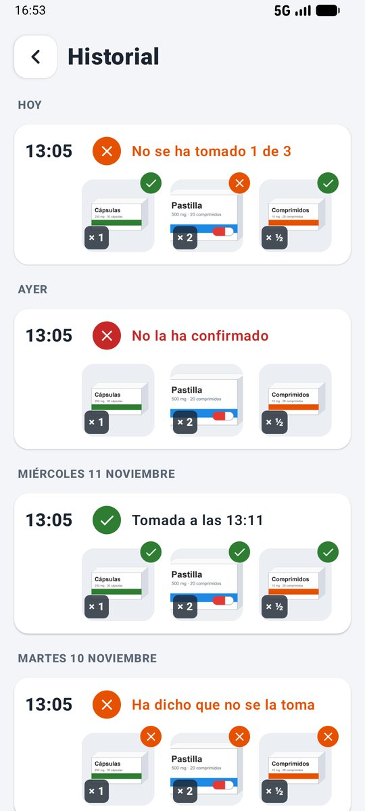

Opcional. El cuidador apunta cada pastilla: la **hora**, cuántas (también **media**) y una **foto de la caja**. A esa hora el móvil enciende la pantalla y **suena** (con el volumen de las alarmas, cada minuto durante 5 minutos) y enseña la **foto de la caja**, las **pastillas dibujadas** y el número. La persona toca el **botón verde** al tomársela; si a esa hora hay más pastillas, pasa a la **siguiente caja** (los puntos de arriba dicen cuántas quedan), y tras la última sale un visto bueno.

- El **botón rojo (✗)** es para decir que **no se la toma**: pasa a la siguiente caja igual, el aviso deja de sonar y queda apuntado en el historial ("Ha dicho que no se la toma", o "No se ha tomado 1 de 3" si solo es una caja). El cuidador lo ve en la actividad.
- El **botón gris del despertador** (con una Z, como el de «posponer» de las alarmas) lo deja para luego. Si no se confirma, el aviso vuelve **cada 15 minutos**, y a la hora el cuidador ve en la actividad "No ha confirmado las pastillas de las 9:00". Cuando las confirma todas, ve "Se ha tomado las pastillas de las 9:00".
- **Historial**: el cuidador ve, en el panel del móvil y a distancia (app o web del cuidador), cada toma de los últimos 30 días: ✓ verde "Tomada a las 9:12" (la hora a la que la confirmó), ✗ naranja "Ha dicho que no se la toma", ✗ roja "No la ha confirmado" (no contestó) o "Avisando ahora". Arriba, el resumen de la semana ("Últimos 7 días: se ha tomado 12 de 14 tomas"); si falta alguna, el apartado Pastillas sale en ámbar en la portada del panel.
- Funciona aunque el móvil esté en reposo, sin internet y tras reiniciar.
- En el panel, **Probar el aviso** lo enseña sin contar como toma.

## 17. Periódicos

  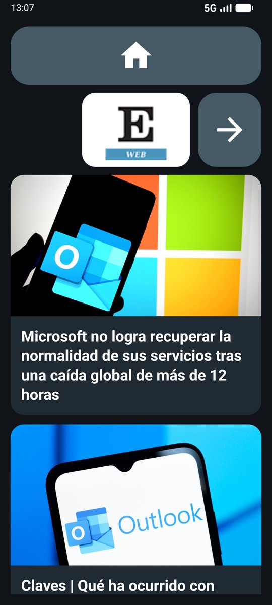
  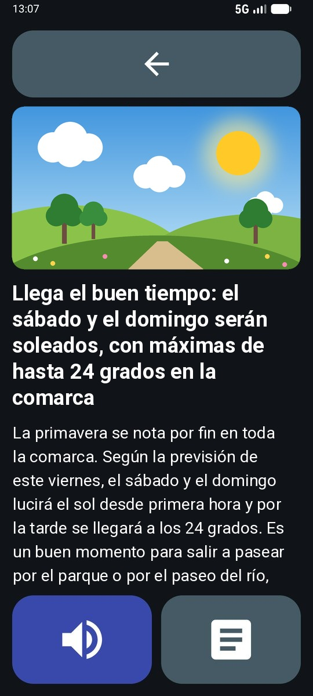

Botón opcional (gris). Si el cuidador ha activado periódicos de varias secciones, primero salen las **secciones** en botones grandes de colores, cada una con su dibujo (📰 actualidad, ⚽ deportes, 💻 tecnología…); con una sola sección se entra directamente. Dentro, arriba se ve el **logotipo del periódico** y, con las **flechas**, se pasa al anterior o al siguiente. Debajo, las noticias del día con su **foto** y el titular en grande, **bajando con el dedo**. Al tocar una se ve en grande con el resumen y dos botones:

- **Escuchar** (altavoz azul): la voz del móvil lee el titular y el resumen, para quien no sabe leer. Otro toque la para.
- **Abrirla entera** (hoja): la noticia en la web del periódico, sin salir de LlamaditApp y con la letra más grande.

La **flecha grande de arriba** vuelve siempre al paso anterior (de la noticia entera a la noticia y de ahí al periódico, en el mismo sitio de la lista); Atrás, desde un periódico, vuelve a las secciones; la casa, a la pantalla principal.

Hay 42 periódicos y revistas gratuitos (sus portadas por RSS, comprobadas en noviembre de 2026). El cuidador elige cuáles se ven; de entrada están activos los de actualidad.

| Sección | Periódicos y revistas |
|---|---|
| 📰 Actualidad | El País, El Mundo, ABC, La Vanguardia, 20minutos, elDiario.es, El Confidencial, La Razón, Europa Press, El Español, El HuffPost, OKDIARIO, Libertad Digital, El Independiente, infoLibre, laSexta, Antena 3 Noticias, Newtral, El Debate, COPE |
| ⚽ Deportes | Marca, AS, Mundo Deportivo, Sport, Relevo |
| 💶 Economía | Cinco Días, El Blog Salmón |
| 💻 Tecnología | Xataka, Genbeta, Xataka Móvil, Applesfera, Hipertextual, Computer Hoy, Andro4all |
| 🔬 Ciencia | Muy Interesante, Xataka Ciencia |
| ❤️ Salud | Vitónica, Salud (El Mundo) |
| 🚗 Motor | Motorpasión |
| 🍳 Cocina | Directo al Paladar |
| 🎬 Cine y televisión | Espinof, Fotogramas |

Algunos (El País, El Mundo, ABC, El Confidencial, Cinco Días…) tienen parte de sus artículos solo para suscriptores: el titular, la foto y el resumen se ven siempre, pero la noticia entera puede pedir suscribirse. No hay fuente que funcione de RTVE, Público, Cadena SER ni elEconomista. **Gasta datos móviles**: unos pocos MB cada vez que se abre un periódico. Al abrir una noticia entera, LlamaditApp **quita sola los avisos de cookies**, los anuncios y las ventanas que tapan la noticia (no acepta nada en nombre de la persona: simplemente no los carga).

## 18. Modo quiosco

- La persona **no puede salir** de LlamaditApp: no hay botón de inicio, ni de apps recientes, ni panel de notificaciones.
- Solo se pueden abrir LlamaditApp, WhatsApp (para las videollamadas) y las pantallas de llamada del sistema.
- Tras reiniciar o quedarse sin batería, el móvil **arranca directamente** en LlamaditApp y sin pantalla de bloqueo.
- **Solo datos móviles** (salvo que el cuidador active el Wi-Fi en el panel): el Wi-Fi está apagado y bloqueado, y el modo avión no se puede activar (dejaría el teléfono sin llamadas ni SOS).
- **Bluetooth apagado** y bloqueado (no se usa y gasta batería).
- **Pantalla siempre en vertical**, también en las videollamadas.
- **Apps innecesarias ocultas** (navegador, mapas, tiendas, juegos…): no se ven ni gastan batería.
- **Actualizaciones del sistema** de madrugada (de 2:00 a 4:00), automáticas.

---

## 19. Gestión a distancia

Opcional, para el cuidador. Desde su **móvil Android**, con la **app del cuidador**, o desde **el ordenador**, con la web del cuidador, puede hacer casi todo lo del panel sin tener delante el móvil de la persona:

- **¿Dónde está?**: la posición en un mapa al momento (sin SMS), con la precisión y la batería.
- **Hacer sonar** el móvil 30 segundos, aunque esté en silencio, para encontrarlo en casa.
- **Activar el modo quiosco**, si se quedó en pausa al devolver el móvil: el botón aparece solo mientras está en pausa. Si la pantalla está apagada, el móvil se bloquea al encenderla.
- **Personas**: añadir, cambiar la foto (con la cámara del cuidador), el nombre o el teléfono, ordenar y quitar; quién es el contacto del SOS, quién tiene WhatsApp y quién puede pedir la ubicación por SMS.
- **Pantalla principal**, dibujo del SOS, botón para volver, **Volver a casa** (dirección y avisos), **ejercicios** y su nivel, **radio** (apagado automático) y **Wi-Fi**.
- La **batería** y cuándo se conectó por última vez, y la **actividad**: si ha pulsado el SOS o Volver a casa, si ha llegado a casa o si tiene la batería baja.

  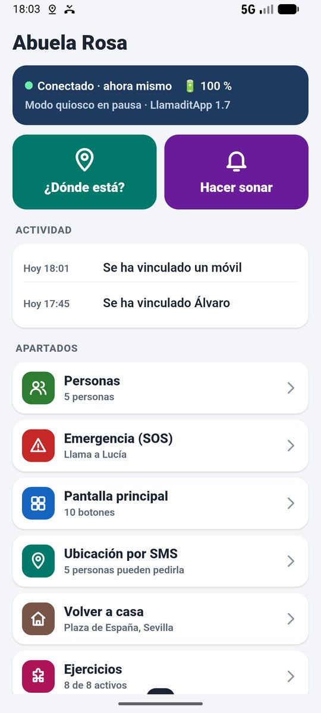
  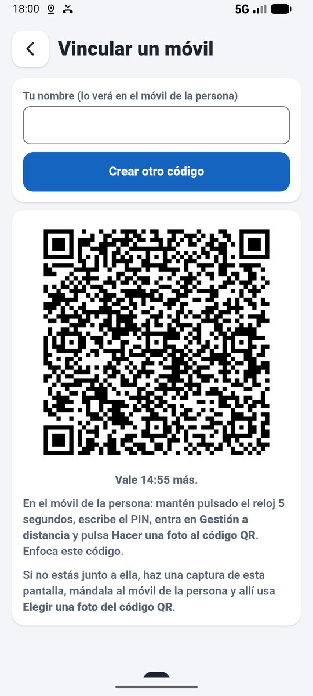
  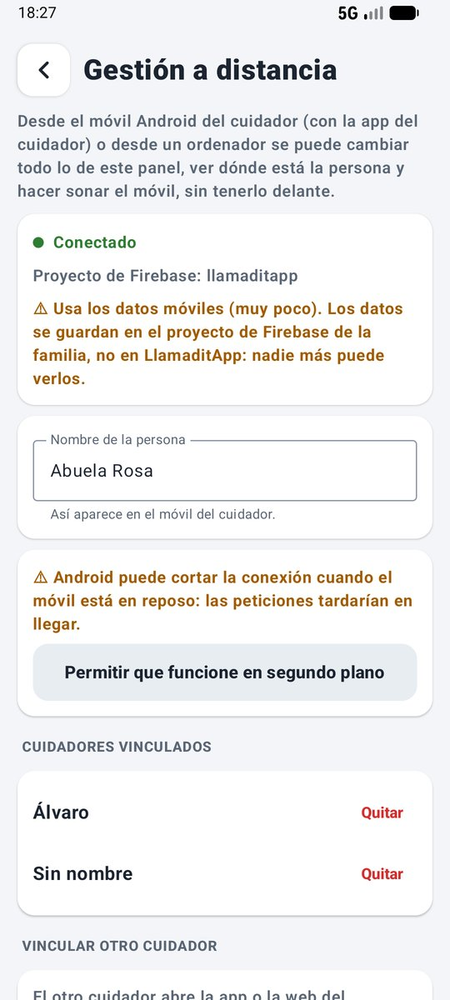
  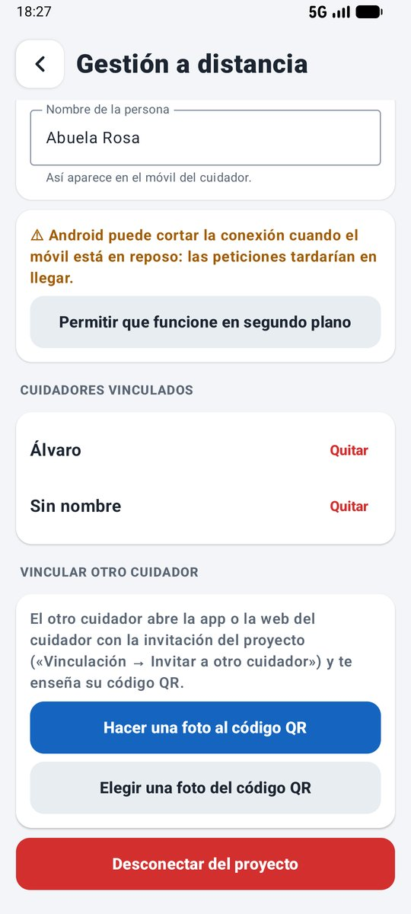

**Sin servidores de LlamaditApp:** cada familia crea **su propio proyecto de Firebase** (un servicio de Google, gratuito para este uso) con su cuenta de Google. Los datos se quedan ahí y solo los ven los cuidadores que la familia vincula. La guía [GESTION-A-DISTANCIA.md](GESTION-A-DISTANCIA.md) lo explica paso a paso (unos 15 minutos, una sola vez).

**Cómo se vincula:** el cuidador pega los datos del proyecto en la app o la web, pulsa **Vincular un móvil** y le sale un **código QR** (vale 15 minutos). En el panel del móvil de la persona, **Gestión a distancia → Hacer una foto al código QR**. Si no está delante, puede mandar una captura del código y usar **Elegir una foto del código QR**. Los demás cuidadores reciben una **invitación** (Vinculación → Invitar a otro cuidador) y vinculan el móvil con su propio código.

**Necesita internet** en el móvil de la persona (datos móviles, muy poco). Conviene pulsar **Permitir que funcione en segundo plano** si el panel lo pide, para que las peticiones lleguen con la pantalla apagada.

**La app del cuidador** (`LlamaditApp-Cuidador-….apk` (los números son la versión), en la [página de versiones](https://github.com/alvsanmun/LlamaditApp/releases)) es para Android. **La web del cuidador** para el ordenador está en el mismo sitio (`Web-Cuidador-LlamaditApp.zip`): en Windows, doble clic en *Abrir la web del cuidador.bat*.

---

## Panel del cuidador

  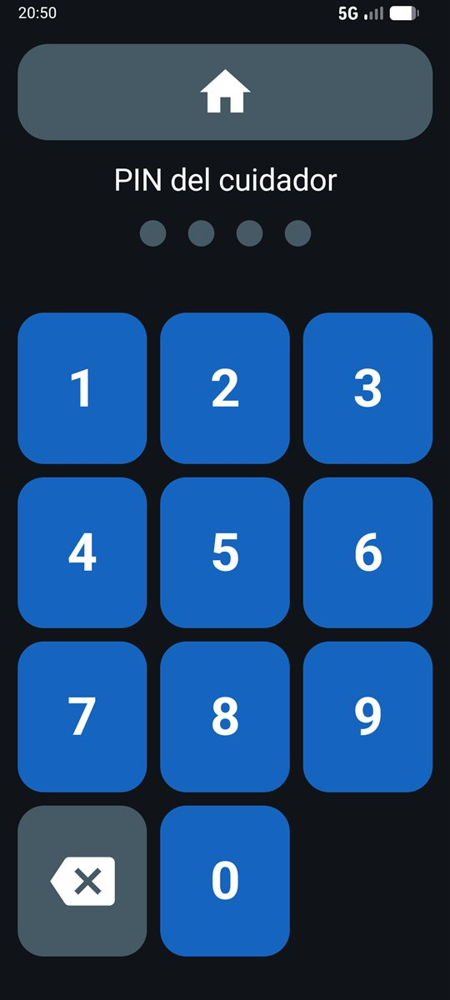
  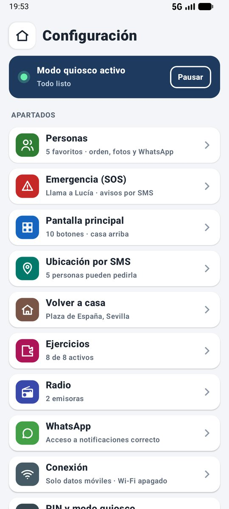
  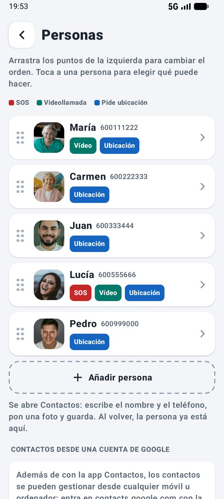
  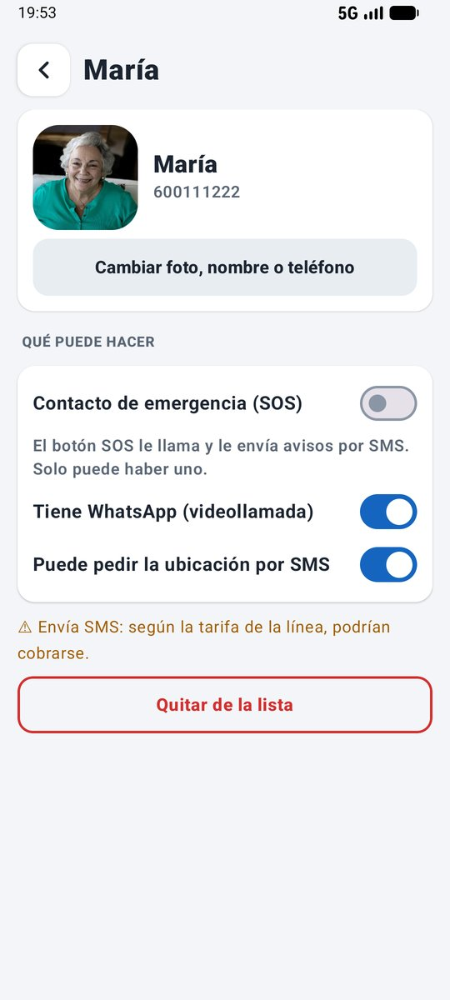
  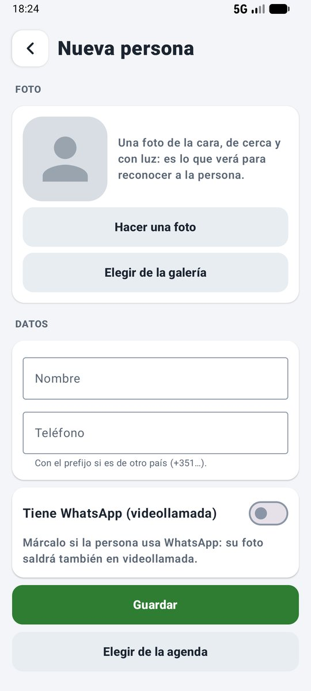

**Cómo entrar:** mantener pulsado el **reloj 5 segundos** (el teléfono vibra) e introducir el PIN de 4 cifras. La primera vez se crea el PIN (dos veces). El panel se cierra solo al apagar la pantalla, salvo mientras el cuidador configura algo fuera de la app.

**La portada** tiene arriba una tarjeta azul oscuro con el estado del **modo quiosco** (activo, en pausa o en pausa mientras se configura algo) y un botón para **pausarlo, activarlo o terminar**; si falta algo, dice cuántas cosas hay **por revisar**. Debajo están los **apartados**, cada uno con un resumen de cómo está (en ámbar lo que falta, por ejemplo "Falta la foto del portal"). Cada apartado se abre en su página; la flecha de arriba vuelve a la portada y la casa de la portada, a la pantalla principal.

**Personas:** los favoritos con su foto y unas etiquetas de colores que dicen qué puede hacer cada uno (**SOS**, **Vídeo**, **Ubicación**) y si le falta la foto. Se **ordenan arrastrando** los seis puntos de la izquierda. Al tocar a una persona se abre su **ficha**, con interruptores para hacerla contacto del SOS, marcar que tiene WhatsApp o dejarle pedir la ubicación; desde ahí también se cambia su foto, su nombre o su teléfono, o se quita de la lista. **"Añadir persona"** abre un formulario dentro del panel, sin salir de LlamaditApp: la **foto** (con la cámara o de la galería, recortada en cuadrado), el **nombre**, el **teléfono**, si **tiene WhatsApp** y dónde se guarda (en la cuenta de Google del móvil, si la hay, o solo en el móvil). La persona se crea ya como favorita y sale al momento. Si el teléfono ya está en la agenda, avisa y ofrece añadir a esa persona en vez de repetirla; **"Elegir de la agenda"** busca entre los contactos que ya hay. **"Cambiar foto, nombre o teléfono"** usa el mismo formulario.

**Pantalla principal, Emergencia y Ejercicios:**

  
  
  
  

  
  
  
  

**Volver a casa, contactos de Google y PIN:**

  
  
  
  

  
  

**Los apartados:**

| Apartado | Para qué sirve |
|---|---|
| **Personas** | Orden (arrastrando), ficha de cada persona (SOS, WhatsApp, ubicación, cambiar foto o teléfono, quitar de la lista) y **Añadir persona**. Abajo, **Contactos desde una cuenta de Google**: las cuentas del móvil, cuántos favoritos (★) trae cada una, si se sincronizan solas, **"Sincronizar ahora"** y **"Añadir una cuenta de Google"**. Así los contactos (nombre, foto y teléfono) se pueden gestionar desde cualquier móvil u ordenador en [contacts.google.com](https://contacts.google.com), marcándolos con la estrella. Conviene una cuenta solo para este móvil. |
| **Emergencia (SOS)** | A quién llama y avisa el botón SOS, y su dibujo: las letras **SOS** (por defecto), una **ambulancia**, una **cruz**, una **sirena**, un **corazón** o una **señal de peligro**. |
| **Pantalla principal** | Vista previa en pequeño y, por cada elemento, flechas ↑ y ↓ para moverlo, su tamaño (**pequeño** y **mediano** ocupan media fila, **grande** la fila entera) y un interruptor para ocultarlo. El reloj no se puede ocultar. "Volver al diseño original" lo deja como venía. Debajo, el **botón para volver**: la **casa grande de arriba** (por defecto) o una **flecha fija abajo a la izquierda**, como el botón Atrás de Android pero más grande. |
| **Ubicación por SMS** | Qué favoritos pueden pedir la ubicación y las **palabras clave** que deben enviar, separadas por comas. Por defecto dependen del idioma del teléfono (`UBICACION` y `DONDE ESTAS` en español, `LOCATION` y `WHERE ARE YOU` en inglés…). |
| **Volver a casa** | Marcar la casa con **"Usar mi ubicación actual"** (estando en ella) o escribiendo la dirección y **"Buscar esta dirección en el mapa"**. La dirección se puede corregir (piso, puerta). **"Probar la ruta"** abre la navegación una vez para aceptar las pantallas iniciales de Google Maps. **Foto del portal** (con la cámara o de la galería), **"Avisar por SMS al pulsar el botón"** (al contacto del SOS, activado por defecto) y **"Enviar la ubicación cada 10 minutos durante la ruta"** (desactivado por defecto). Al activar una función que envía SMS, el panel avisa de que podrían cobrarse. |
| **Ejercicios** | Un interruptor por ejercicio, su **nivel** (el actual; tocar otro número lo cambia) y cuántas partidas lleva y cuántas bien hechas. |
| **Radio** | Aviso del consumo de datos. Las **emisoras elegidas**, con flechas ↑ y ↓ para el orden, una ✕ para quitarlas y, tocando el logotipo, otro dibujo de la galería. **"Apagar sola después de"**: 30 min, 1 h (por defecto), 2 h, 3 h o nunca. **Añadir emisoras**: "Las más escuchadas del país" (el de la SIM) o buscando por nombre, y el botón **+** de cada una. Las emisoras salen del directorio libre [radio-browser.info](https://www.radio-browser.info). |
| **WhatsApp** | **Instalar WhatsApp** (si falta: abre Play Store en su ficha), quién **tiene WhatsApp** para la videollamada, el "acceso a notificaciones" para ver las **videollamadas entrantes** con la pantalla propia y el permiso de la pestaña de **WhatsApp completo**. |
| **Conexión** | Wi-Fi apagado y bloqueado por defecto (solo la SIM). Al encenderlo aparece **"Elegir una red Wi-Fi"**, que abre los Ajustes de Android para conectarse. Al apagarlo se vuelve a bloquear; las redes guardadas se recuerdan. |
| **Gestión a distancia** | Conectar el móvil al proyecto de Firebase de la familia con una **foto al código QR** que enseña la app o la web del cuidador, el **nombre** con el que sale la persona, los **cuidadores vinculados** (con **Quitar**), **vincular otro cuidador** y **Desconectar del proyecto**. Avisa si Android puede cortar la conexión en reposo. Ver [la sección 15](#19-gestión-a-distancia). |
| **PIN y modo quiosco** | Cambiar el PIN; **pausar** el modo quiosco (el móvil queda como uno normal, ver abajo) y **activarlo** de nuevo, sin ordenador; abrir **Contactos** o los **Ajustes de Android**; **quitar el Device Owner** (solo para desinstalar LlamaditApp o entregar el móvil: volver a activar el quiosco exige un ordenador) y **Acerca de** (versión, copyright, licencia GNU AGPL v3 y código fuente). |

Los botones de la pantalla principal (Volver a casa, Ejercicios, Radio, WhatsApp completo…) se activan en **Pantalla principal**. Mientras el cuidador configura algo fuera de la app (Contactos, la cuenta de Google, Play Store, los Ajustes…), el modo quiosco queda en pausa y la portada lo dice; el botón Inicio vuelve al panel sin cortar nada, y el quiosco regresa al salir del panel, al pulsar **Terminar** o a los 30 minutos sin volver al panel.

**Con el modo quiosco en pausa**, el móvil funciona como uno normal hasta que el cuidador lo active, también tras reiniciar: sale su pantalla de inicio de siempre, con todas sus apps; Inicio y Atrás ya no llevan a LlamaditApp, y se pueden usar el Wi-Fi, el Bluetooth y el modo avión. Las llamadas siguen entrando por la pantalla de LlamaditApp y, al colgar, se vuelve a donde se estaba. Un aviso fijo recuerda que está en pausa: al tocarlo, o al abrir el icono de LlamaditApp, se puede activar de un toque, sin PIN (el panel sí lo pide), y se recupera todo lo que había (Wi-Fi según lo elegido, apps ocultas, Bluetooth apagado). **En pausa el móvil no tiene el botón SOS a la vista: actívalo antes de devolverlo a la persona** (si se te olvida y tienes la gestión a distancia, puedes activarlo desde la app o la web del cuidador).

> ⚠️ **Apunta el PIN en un sitio seguro.** En la versión final no hay otra forma de entrar al panel: si se olvida, solo queda restablecer el teléfono de fábrica.

> 💶 **SMS:** el SOS, la ubicación por SMS y los avisos de *Volver a casa* envían SMS. Según el contrato de la línea, podrían cobrarse y aumentar la factura. El panel lo recuerda con una nota y pide confirmación al activar los avisos opcionales.

---

## Consejos

- **Descarga el mapa de tu ciudad en Google Maps**, para que la ruta de *Volver a casa* funcione aunque no haya datos (en un sótano, en el metro o en una zona sin cobertura). El GPS funciona siempre; lo que necesita internet es dibujar el mapa y calcular la ruta. Cómo hacerlo:
  1. En el panel, activa un momento el **Wi-Fi** y conéctate a tu red (el mapa ocupa bastante y es mejor no gastar datos).
  2. Pulsa **Probar la ruta** para abrir Google Maps.
  3. En Google Maps, cierra la navegación con la **X** y toca la **foto de perfil** (el círculo de arriba a la derecha) → **Mapas sin conexión** → **Selecciona tu propio mapa**, encuadra la ciudad y pulsa **Descargar**.
  4. Vuelve a LlamaditApp y, si quieres, apaga otra vez el Wi-Fi. Google Maps actualiza el mapa solo de vez en cuando.
- **Usa una cuenta de Google solo para este móvil** si vas a gestionar los contactos desde contacts.google.com. Con tu cuenta personal también aparecerían tus propios contactos favoritos.
- **Pulsa una vez "Probar la ruta"** después de marcar la casa y acepta las pantallas de bienvenida de Google Maps, para que la persona no se las encuentre.
- **Haz la foto del portal de día y desde la acera**, como lo vería la persona al llegar: que se vea la puerta, el número y algo reconocible (una tienda, un árbol, el color de la fachada).
- **Comprueba la tarifa** con el operador: que incluya SMS (para el SOS y los avisos) y algo de datos móviles (para WhatsApp, Google Maps y la sincronización de contactos). Si se usa la radio, bastante más: 1 a 2 GB al mes escuchando una hora al día.
- **Configura el número de este móvil en el teléfono del cuidador** para que sus llamadas y SMS suenen aunque esté en silencio (ver la [configuración recomendada](CONFIGURACION.md)).

---

Capturas hechas en el emulador de Android con contactos inventados (los dibujos de los ejercicios son propios); la dirección de ejemplo es la Plaza de España de Sevilla y el portal es un dibujo. La lista de chats es de una app de prueba, no del WhatsApp real. Fotos de los contactos: [Daniel Lara](https://unsplash.com/es/fotos/t9tDSXN2U2E), [Vitaly Gariev](https://unsplash.com/es/fotos/4HNK1yce-Vg), [Sergey Mikheev](https://unsplash.com/es/fotos/H982yXJ7vOk) y [Vitaly Gariev](https://unsplash.com/es/fotos/IihDS3WZGlY) en Unsplash (licencia de Unsplash), y [Michael Dam](https://commons.wikimedia.org/wiki/File:Happy_daughter_(Unsplash).jpg) (dominio público, CC0, en Wikimedia Commons).
