# Funciones de LlamaditApp

LlamaditApp tiene dos partes:

- **Lo que ve la persona**: solo imágenes, colores y botones grandes. No hace falta leer.
- **El panel del cuidador**: oculto y protegido con PIN. Aquí sí hay texto.

---

## 1. Pantalla principal

  

- **Reloj**: hora en grande y fecha en el idioma del teléfono.
- **Batería**: verde por encima del 50 %, ámbar por encima del 20 %, roja por debajo. Un rayo indica que está cargando.
- Los botones pequeños de abajo muestran un **número rojo** cuando hay mensajes nuevos o llamadas perdidas.
- No hay barra de navegación abajo: la pantalla entera es para los botones. Si alguien desliza desde el borde inferior, la flecha de "atrás" aparece unos segundos y se vuelve a esconder.

Desde cualquier pantalla, la **casa** grande de arriba vuelve a la pantalla principal o, si el cuidador lo prefiere, una **flecha** fija abajo a la izquierda, como el botón Atrás de Android pero más grande.

  

 Tras hacer una llamada o videollamada, al colgar se vuelve también a la pantalla principal.

### Diseño a medida

  

El cuidador puede adaptar la pantalla a la persona desde el panel:

- **Mover** cualquier botón, el reloj y la batería.
- Hacer cada botón **pequeño**, **mediano** o **grande**, y **ocultar** los que no use. En la captura, el teclado está oculto y se ha añadido el botón marrón de *Volver a casa*.
- Cambiar el **dibujo del botón SOS** por una ambulancia, una cruz, una sirena, un corazón o una señal de peligro, para quien no reconozca las letras.
- El **reloj siempre se ve**, porque mantenerlo pulsado es la entrada al panel del cuidador.

## 2. Llamar

  

Cuadrícula con las **fotos de los contactos favoritos** (★). Tocar una foto = llamar. El nombre aparece pequeño, solo como ayuda para el cuidador. Si un contacto no tiene foto, sale una silueta.

Los contactos, sus fotos y quién es favorito se gestionan en la app **Contactos** del sistema, que se abre desde el panel del cuidador. El orden se elige en el panel.

## 3. Videollamada de WhatsApp

  

Las mismas fotos, en el mismo orden, pero solo de las personas marcadas como "Tiene WhatsApp". Una cámara pequeña en la esquina indica que es videollamada. Tocar la foto **inicia la videollamada directamente**, sin pasar por los chats de WhatsApp.

- Solo videollamadas: las llamadas de voz se hacen con el botón verde normal.
- Durante la videollamada se ve la pantalla de WhatsApp, con su botón rojo para colgar. Al colgar se vuelve sola a LlamaditApp.
- Requiere WhatsApp (no WhatsApp Business) instalado y con la sesión iniciada.

### WhatsApp completo (opcional)

  
  

Un botón aparte, verde claro con un bocadillo, para quien quiera usar **WhatsApp entero**: chats, notas de voz, fotos y vídeos. Lleva un **número rojo** con los mensajes sin leer, que baja solo al leerlos.

- Al tocarlo se abre WhatsApp, con el sonido de audios y vídeos activado.
- Mientras se usa, una **pestaña pequeña con una casa**, pegada al borde derecho de la pantalla, vuelve a LlamaditApp con un toque. Es pequeña y semitransparente para tapar lo mínimo, y está por debajo de la barra de arriba de WhatsApp y por encima del teclado.
- Si entra una llamada mientras tanto, la pestaña se esconde para no tapar la pantalla de la llamada; al colgar se vuelve a la pantalla principal.
- Dentro del modo quiosco no se abren enlaces web ni otras apps desde WhatsApp.
- La pestaña necesita el permiso "Mostrar sobre otras aplicaciones": lo da el instalador, o el cuidador desde el panel. Sin él, WhatsApp se abre igual y se sale con la flecha de atrás.

## 4. Teclado

  

Números enormes, un botón para borrar (mantenerlo pulsado borra todo) y el verde para llamar. Hacen falta al menos 3 cifras (con menos, Android lo interpreta como un código especial).

## 5. SOS

  

Para emergencias. **Hay que mantenerlo pulsado 2 segundos** (un anillo se va llenando), así no se activa sin querer. Al activarse:

1. **Llama en el acto** al contacto de confianza (el elegido en el panel o, si no se ha elegido, el primero de la lista).
2. A la vez le **envía un SMS** con un enlace de Google Maps a la posición del teléfono y el nivel de batería:
   > SOS: necesito ayuda. Estoy aquí: https://maps.google.com/?q=… (±10 m, 10:45) · Batería 64 %
3. Le envía **3 actualizaciones más, cada 10 minutos** (30 minutos en total). Después se para solo.

Si no hay ningún contacto favorito, abre el marcador con el **112** ya escrito (Android no permite que una app llame al 112 sin un toque más).

## 6. Llamadas entrantes

  
  
  

LlamaditApp es la app de Teléfono del móvil, así que todas las llamadas usan su propia pantalla:

- **Foto grande** de quien llama (o una silueta si no está en la agenda).
- **Verde** (que late) para contestar, **rojo** para rechazar. Un solo toque, sin deslizar.
- Durante la llamada: **altavoz** y un botón rojo grande para **colgar**.
- La pantalla se apaga al acercar el teléfono a la oreja.
- El teléfono **siempre vibra** al recibir una llamada, con cualquier volumen. Los botones de volumen no silencian una llamada que está sonando.

Las **videollamadas de WhatsApp** entrantes también se muestran con esta pantalla: verde para contestar y rojo para rechazar.

## 7. Mensajes (SMS)

  
  

Lista de los SMS recibidos con la foto de quien escribe. Al tocar uno se lee en grande, con una papelera para quitarlo de la lista. Las peticiones de ubicación de los familiares no aparecen.

> Los mensajes "borrados" solo desaparecen de LlamaditApp. Siguen en la app de mensajes del sistema, que es la única que puede borrarlos del teléfono.

## 8. Llamadas perdidas

  
  
  

Lista de las llamadas perdidas con foto, nombre y hora. **Tocar una devuelve la llamada.** Al final hay una papelera roja grande para borrar todo el historial de llamadas perdidas, con una confirmación sin texto: ✗ (no) o ✓ (sí).

## 9. Volumen

  

Los botones laterales solo cambian el **volumen del timbre** (o, durante una llamada, el de la voz). Aparece un panel enorme con una flecha verde hacia arriba o ámbar hacia abajo y una escalera de barras. Bajando del todo, el timbre queda en silencio y el móvil **solo vibra**: nunca queda totalmente mudo. El sonido de vídeos y música está a cero.

## 10. Localización bajo demanda

Un familiar autorizado envía al teléfono un SMS con una palabra clave (por defecto `UBICACION` o `DONDE ESTAS`; da igual mayúsculas, tildes o signos). LlamaditApp le responde automáticamente con un SMS:

> Ubicación: https://maps.google.com/?q=40.416775,-3.703790 (±12 m, 10:45) · Batería 64 %

- Solo responde a los **contactos favoritos autorizados** en el panel. Los demás se ignoran sin responder.
- Funciona con la pantalla apagada.
- En el teléfono no se ve nada: la persona no se entera.
- **No hay seguimiento continuo**: el teléfono solo busca su posición cuando alguien la pide.

## 11. Volver a casa

  
  

Un botón opcional (marrón, con una chincheta y una casa) para cuando la persona se desoriente en la calle:

1. Al pulsarlo se ve la **dirección de casa en letra grande**: puede enseñársela a la policía o a cualquier persona para que le ayude.
2. La **flecha verde** abre la **ruta a pie de Google Maps, con voz** ("gira a la derecha…"). Para volver a LlamaditApp basta con la flecha de "atrás" de Google Maps.
3. Al llegar a **unos 40 m de casa**, LlamaditApp se pone delante y enseña la **foto del portal** que hizo el cuidador, con una casa verde debajo para volver a la pantalla principal.

Avisos al cuidador (al contacto del SOS), que se activan o desactivan en el panel:

- **Al pulsar el botón marrón**, un SMS con la ubicación:
  > VOLVER A CASA: se ha pulsado el botón para volver a casa. Ubicación: https://maps.google.com/?q=… (±5 m, 18:20) · Batería 70 %
- **Durante la ruta, cada 10 minutos**, la ubicación y lo que le falta para llegar, y un último SMS al llegar:
  > VOLVER A CASA: de camino, a 350 m de casa. Ubicación: https://maps.google.com/?q=… · Batería 68 %
  > VOLVER A CASA: ha llegado a casa. · Batería 66 %

Google Maps no avisa a otras apps de que la ruta ha terminado, así que LlamaditApp mira el GPS del móvil mientras dura la ruta para saber cuándo llega. Deja de mirarlo al llegar o, como mucho, a las 2 horas. Si los avisos cada 10 minutos están desactivados, esa posición no se envía a nadie.

La ruta necesita datos móviles, salvo que se haya descargado el mapa de la ciudad (ver [Consejos](#consejos)).

## 12. Modo quiosco

- La persona **no puede salir** de LlamaditApp: no hay botón de inicio, ni de apps recientes, ni panel de notificaciones.
- Solo se pueden abrir LlamaditApp, WhatsApp (para las videollamadas) y las pantallas de llamada del sistema.
- Tras reiniciar o quedarse sin batería, el móvil **arranca directamente** en LlamaditApp y sin pantalla de bloqueo.
- **Solo datos móviles** (salvo que el cuidador active el Wi-Fi en el panel): el Wi-Fi está apagado y bloqueado, y el modo avión no se puede activar (dejaría el teléfono sin llamadas ni SOS).
- **Bluetooth apagado** y bloqueado (no se usa y gasta batería).
- **Pantalla siempre en vertical**, también en las videollamadas.
- **Apps innecesarias ocultas** (navegador, mapas, tiendas, juegos…): no se ven ni gastan batería.
- **Actualizaciones del sistema** de madrugada (de 2:00 a 4:00), automáticas.

---

## Panel del cuidador

  
  
  
  
  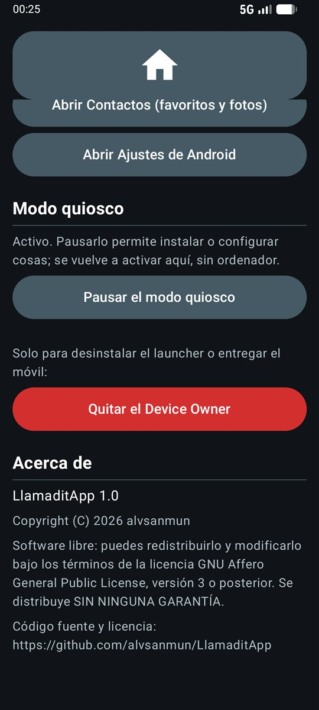

**Cómo entrar:** mantener pulsado el **reloj 5 segundos** (el teléfono vibra) e introducir el PIN de 4 cifras. La primera vez se crea el PIN (dos veces). El panel se cierra solo al apagar la pantalla.

**Diseño de la pantalla y dibujo del SOS:**

  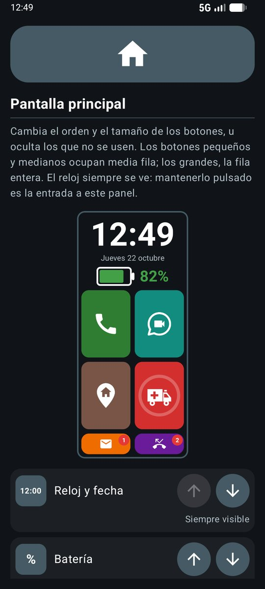
  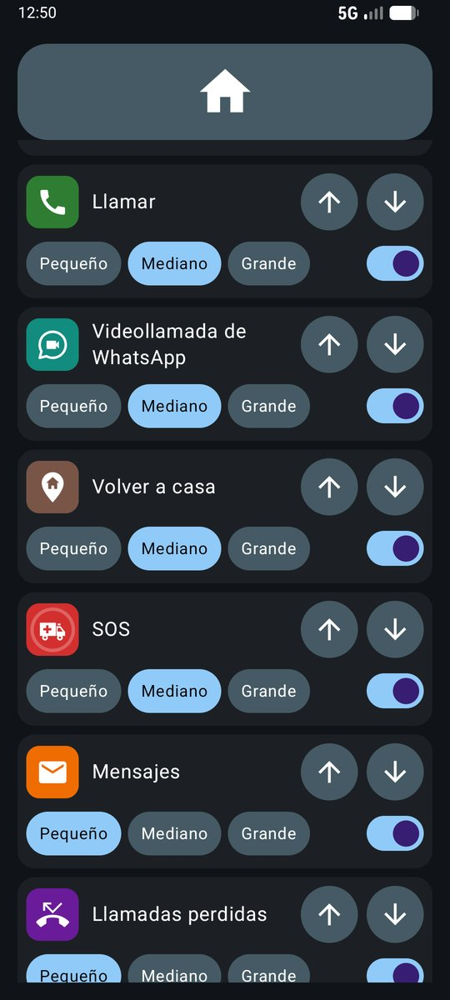
  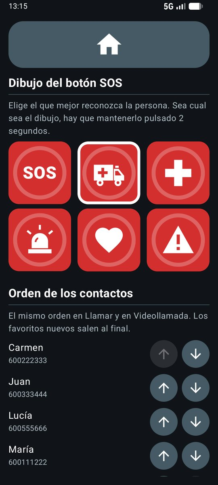

**Botón para volver y WhatsApp completo:**

  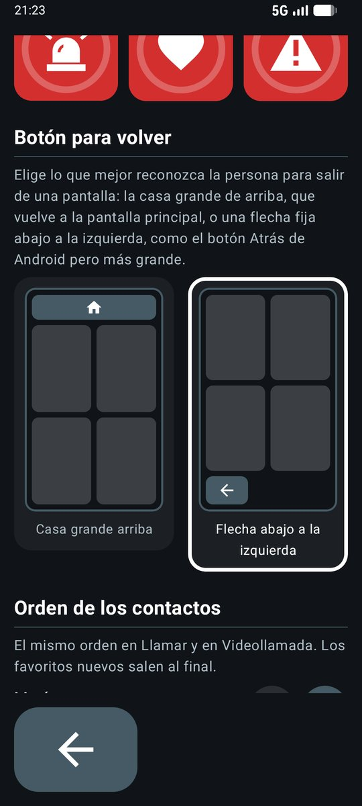
  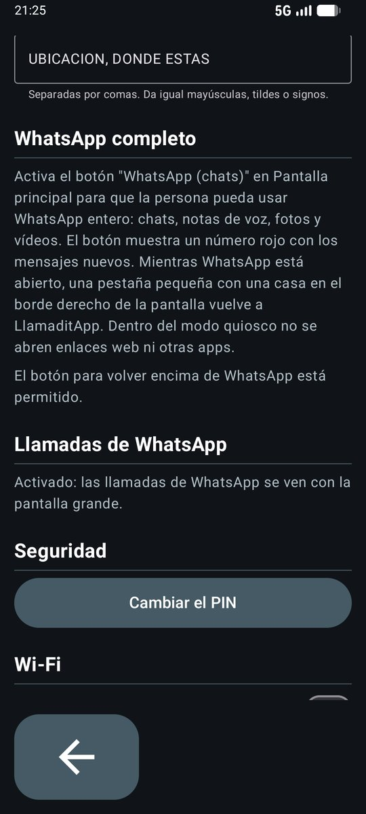

**Volver a casa, contactos de Google y Wi-Fi:**

  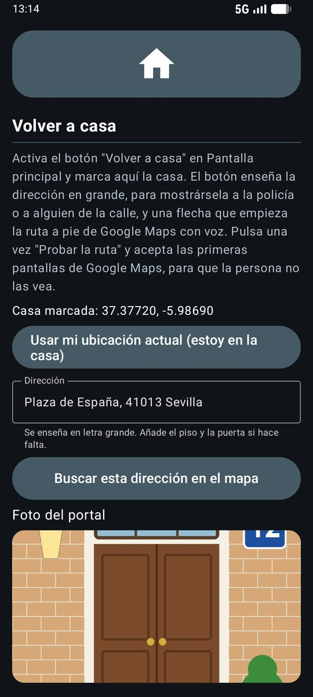
  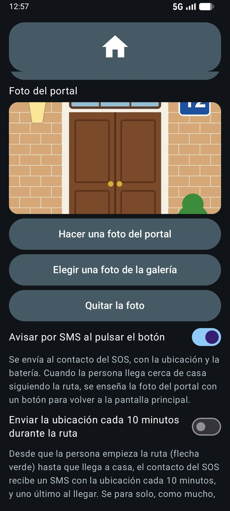
  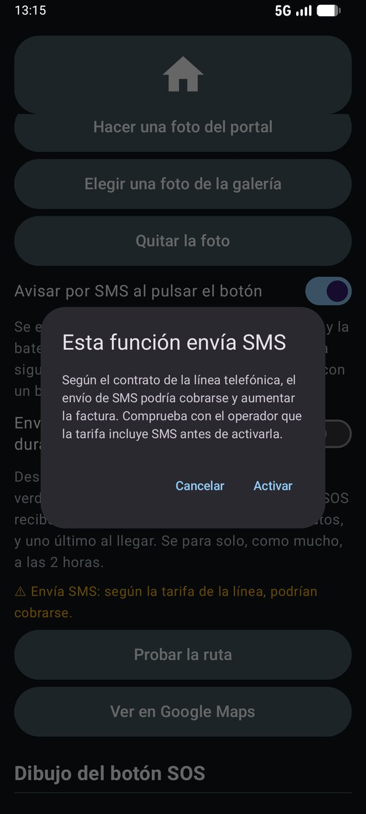

  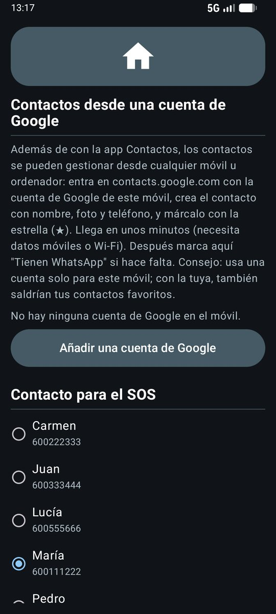
  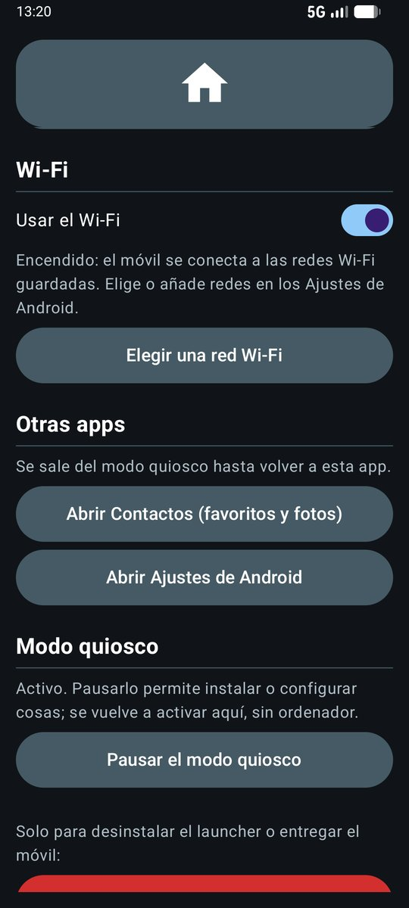

**El resto del panel:**

| Sección | Para qué sirve |
|---|---|
| **Pantalla principal** | Vista previa en pequeño y, por cada elemento, flechas ↑ y ↓ para moverlo, su tamaño (**pequeño** y **mediano** ocupan media fila, **grande** la fila entera) y un interruptor para ocultarlo. El reloj no se puede ocultar. "Volver al diseño original" lo deja como venía. |
| **Volver a casa** | Marcar la casa con **"Usar mi ubicación actual"** (estando en ella) o escribiendo la dirección y **"Buscar esta dirección en el mapa"**. La dirección se puede corregir (piso, puerta). **"Probar la ruta"** abre la navegación una vez para aceptar las pantallas iniciales de Google Maps. El botón se activa en *Pantalla principal*. **Foto del portal** (hacerla con la cámara o elegirla de la galería) y **"Avisar por SMS al pulsar el botón"** (al contacto del SOS, activado por defecto) y **"Enviar la ubicación cada 10 minutos durante la ruta"** (desactivado por defecto). Al activar una función que envía SMS, el panel avisa de que, según la tarifa de la línea, los SMS podrían cobrarse. |
| **Dibujo del botón SOS** | Las letras **SOS** (por defecto), una **ambulancia**, una **cruz**, una **sirena**, un **corazón** o una **señal de peligro**: el que mejor reconozca la persona. |
| **Botón para volver** | Cómo se sale de cada pantalla: la **casa grande de arriba** (por defecto), que vuelve a la pantalla principal, o una **flecha fija abajo a la izquierda**, como el botón Atrás de Android pero más grande (en un mensaje abierto vuelve a la lista). El cambio se ve al momento. |
| **Orden de los contactos** | Flechas ↑ y ↓ para elegir el orden. Es el mismo en Llamar y en Videollamada. Los favoritos nuevos salen al final. |
| **Contactos desde una cuenta de Google** | Las cuentas de Google del móvil, cuántos favoritos (★) trae cada una y si sus contactos se sincronizan solos; botones **"Sincronizar ahora"** y **"Añadir una cuenta de Google"**. Así los contactos (nombre, foto y teléfono) se pueden gestionar desde cualquier móvil u ordenador en [contacts.google.com](https://contacts.google.com), marcándolos con la estrella. Conviene una cuenta solo para este móvil. |
| **Contacto para el SOS** | A quién llama y avisa el botón SOS. |
| **Pueden pedir la ubicación por SMS** | Qué favoritos pueden pedir la ubicación. |
| **Tienen WhatsApp (videollamada)** | Marcar quién usa WhatsApp: aparecerá en el botón de videollamada. |
| **Palabras clave** | Las palabras que deben enviar para pedir la ubicación, separadas por comas. Por defecto dependen del idioma del teléfono (`UBICACION` y `DONDE ESTAS` en español, `LOCATION` y `WHERE ARE YOU` en inglés…). |
| **WhatsApp completo** | Explica el botón "WhatsApp (chats)" (se activa en *Pantalla principal*) y comprueba el permiso de la pestaña para volver, con un botón para darlo si falta. |
| **Llamadas de WhatsApp** | Activar el "acceso a notificaciones", necesario para ver las videollamadas entrantes con la pantalla propia. |
| **Seguridad** | Cambiar el PIN. |
| **Wi-Fi** | Apagado y bloqueado por defecto (solo la SIM). Al encenderlo aparece **"Elegir una red Wi-Fi"**, que abre los Ajustes de Android para conectarse. Al apagarlo se vuelve a bloquear; las redes guardadas se recuerdan. |
| **Otras apps** | Abrir **Contactos** (añadir personas, fotos y favoritos ★) o los **Ajustes de Android**. El quiosco se pausa mientras tanto y vuelve al regresar. |
| **Modo quiosco** | **Pausar** (el móvil se usa con normalidad, por ejemplo para instalar algo) y **Activar** de nuevo, sin ordenador. |
| **Quitar el Device Owner** | Solo para desinstalar LlamaditApp o entregar el móvil a otra persona. Volver a activar el quiosco exige un ordenador. |
| **Acerca de** | Versión de la app, copyright, licencia (GNU AGPL v3) y dirección del código fuente. |

> ⚠️ **Apunta el PIN en un sitio seguro.** En la versión final no hay otra forma de entrar al panel: si se olvida, solo queda restablecer el teléfono de fábrica.

> 💶 **SMS:** el SOS, la ubicación por SMS y los avisos de *Volver a casa* envían SMS. Según el contrato de la línea, podrían cobrarse y aumentar la factura. El panel lo recuerda con una nota y pide confirmación al activar los avisos opcionales.

---

## Consejos

- **Descarga el mapa de tu ciudad en Google Maps**, para que la ruta de *Volver a casa* funcione aunque no haya datos (en un sótano, en el metro o en una zona sin cobertura). El GPS funciona siempre; lo que necesita internet es dibujar el mapa y calcular la ruta. Cómo hacerlo:
  1. En el panel, activa un momento el **Wi-Fi** y conéctate a tu red (el mapa ocupa bastante y es mejor no gastar datos).
  2. Pulsa **Probar la ruta** para abrir Google Maps.
  3. En Google Maps, cierra la navegación con la **X** y toca la **foto de perfil** (el círculo de arriba a la derecha) → **Mapas sin conexión** → **Selecciona tu propio mapa**, encuadra la ciudad y pulsa **Descargar**.
  4. Vuelve a LlamaditApp y, si quieres, apaga otra vez el Wi-Fi. Google Maps actualiza el mapa solo de vez en cuando.
- **Usa una cuenta de Google solo para este móvil** si vas a gestionar los contactos desde contacts.google.com. Con tu cuenta personal también aparecerían tus propios contactos favoritos.
- **Pulsa una vez "Probar la ruta"** después de marcar la casa y acepta las pantallas de bienvenida de Google Maps, para que la persona no se las encuentre.
- **Haz la foto del portal de día y desde la acera**, como lo vería la persona al llegar: que se vea la puerta, el número y algo reconocible (una tienda, un árbol, el color de la fachada).
- **Comprueba la tarifa** con el operador: que incluya SMS (para el SOS y los avisos) y algo de datos móviles (para WhatsApp, Google Maps y la sincronización de contactos).
- **Configura el número de este móvil en el teléfono del cuidador** para que sus llamadas y SMS suenen aunque esté en silencio (ver la [configuración recomendada](CONFIGURACION.md)).

---

Capturas hechas en el emulador de Android con contactos inventados; la dirección de ejemplo es la Plaza de España de Sevilla y el portal es un dibujo. La lista de chats es de una app de prueba, no del WhatsApp real. Fotos de los contactos: [Daniel Lara](https://unsplash.com/es/fotos/t9tDSXN2U2E), [Vitaly Gariev](https://unsplash.com/es/fotos/4HNK1yce-Vg), [Igor Rodrigues](https://unsplash.com/es/fotos/6IGd3-F3Cao), [Sergey Mikheev](https://unsplash.com/es/fotos/H982yXJ7vOk) y [Vitaly Gariev](https://unsplash.com/es/fotos/IihDS3WZGlY) en Unsplash (licencia de Unsplash).
