# Gestión a distancia: guía paso a paso

Con la gestión a distancia, la persona que cuida puede hacer desde su propio móvil Android (con la **app del cuidador**) o desde el ordenador (con la **web del cuidador**) casi todo lo que hace en el panel del cuidador, sin tener delante el móvil de la persona:

- **¿Dónde está?**: la posición en un mapa al momento, con la batería.
- **Hacer sonar** el móvil 30 segundos, aunque esté en silencio, para encontrarlo en casa.
- **Batería baja**, **pastillas** (con la foto de cada caja) y **periódicos**; en la actividad verás si ha confirmado las pastillas, y en el apartado Pastillas, el historial de los últimos 30 días.
- **Activar el modo quiosco**, si se quedó en pausa al devolver el móvil: el botón aparece solo mientras está en pausa.
- **Personas**: añadir, cambiar la foto, el nombre o el teléfono, ordenar y quitar; quién es el contacto del SOS, quién tiene WhatsApp y quién puede pedir la ubicación por SMS.
- **Pantalla principal**, dibujo del SOS, **Volver a casa**, **ejercicios**, **radio** y **Wi-Fi**.
- La **actividad** del móvil: si ha pulsado el SOS o Volver a casa, si ha llegado a casa o si tiene la batería baja.

  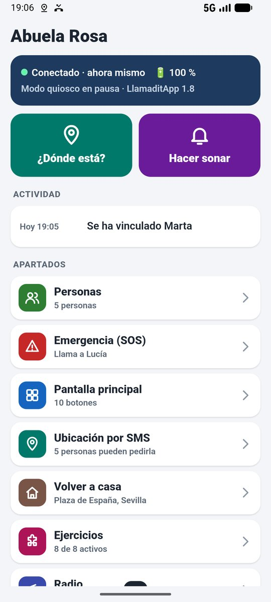
  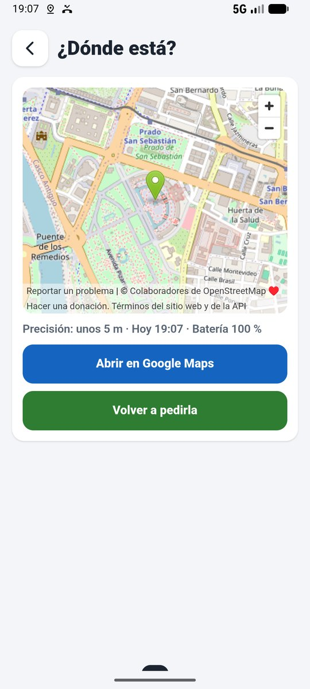

**LlamaditApp no tiene servidores y sus autores no guardan datos de nadie.** Para que los dos móviles se comuniquen, cada familia usa **su propio proyecto de Firebase**, un servicio de Google gratuito para este uso. Los datos (nombres y teléfonos de las personas, sus fotos pequeñas, la configuración, la batería y las ubicaciones que se piden) se quedan en vuestro proyecto, con vuestra cuenta de Google, y solo los ven los cuidadores que vinculéis.

La gestión a distancia es **opcional**: sin ella, LlamaditApp funciona igual, y la ubicación por SMS también.

---

## Índice

1. [Lo que necesitas](#1-lo-que-necesitas)
2. [Crear el proyecto de Firebase de la familia](#2-crear-el-proyecto-de-firebase-de-la-familia) (una sola vez, en un ordenador)
3. [Elegir cómo vas a gestionar el móvil](#3-elegir-cómo-vas-a-gestionar-el-móvil)
   - [3.1. App del cuidador en tu móvil Android](#31-app-del-cuidador-en-tu-móvil-android)
   - [3.2. Web del cuidador en el ordenador](#32-web-del-cuidador-en-el-ordenador)
4. [Vincular el móvil de la persona](#4-vincular-el-móvil-de-la-persona)
5. [Más cuidadores](#5-más-cuidadores)
6. [Preguntas](#6-preguntas)

---

## 1. Lo que necesitas

- Una **cuenta de Google** (la de la persona de la familia que vaya a encargarse; un Gmail sirve).
- Un **ordenador** con navegador para crear el proyecto (unos 15 minutos, solo la primera vez).
- El **móvil de la persona** con LlamaditApp 1.8 o posterior, con **datos móviles** (gasta muy poco) y el **PIN del cuidador**.
- Para gestionarlo: un **móvil Android** (para la app del cuidador) o un **ordenador** (para la web del cuidador).
- No hace falta tarjeta de crédito: el plan gratuito de Firebase (Spark) sobra para una familia.

---

## 2. Crear el proyecto de Firebase de la familia

Se hace **una sola vez**, mejor desde un ordenador. Las pantallas de Firebase cambian de vez en cuando: si algún botón no está exactamente igual, busca uno con un nombre parecido.

### 2.1. Crear el proyecto

1. Entra en **<https://console.firebase.google.com>** con la cuenta de Google y pulsa **Crear un proyecto de Firebase nuevo**.
2. Escribe un **nombre**, por ejemplo `LlamaditApp Familia`, y pulsa **Continuar**. Si te pide aceptar las condiciones de Firebase, léelas y acéptalas.
3. **Gemini en Firebase:** desactívalo (no hace falta) y pulsa **Continuar**.
4. **Google Analytics:** desactívalo también y pulsa **Crear proyecto**. Espera unos segundos y pulsa **Continuar**.

<table><tr>
<td>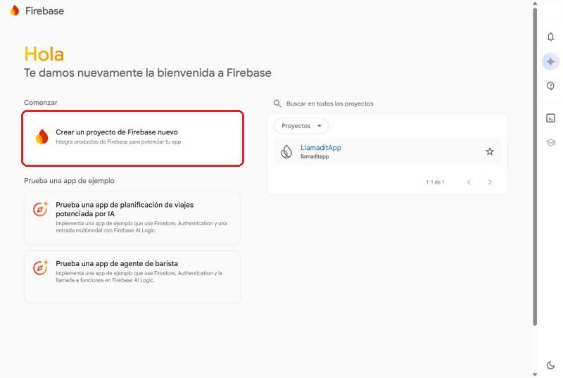</td>
<td>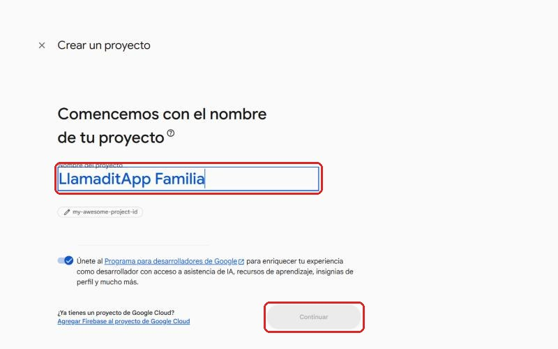</td>
</tr><tr>
<td align="center">① <b>Crear un proyecto de Firebase nuevo</b></td><td align="center">② Nombre → <b>Continuar</b></td>
</tr><tr>
<td>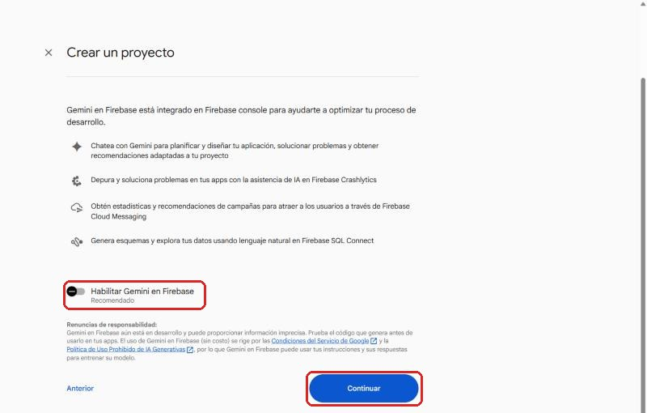</td>
<td>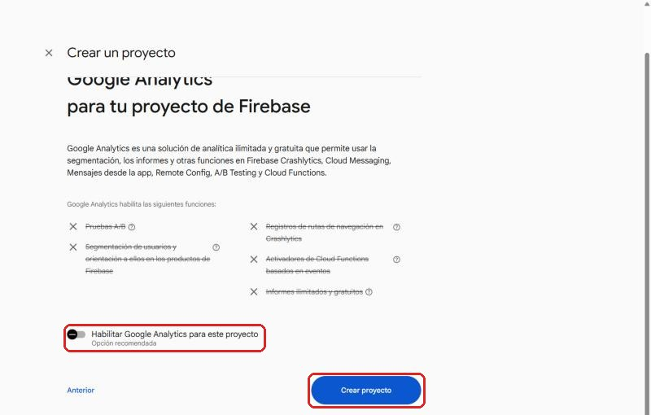</td>
</tr><tr>
<td align="center">③ Gemini desactivado → <b>Continuar</b></td><td align="center">④ Analytics desactivado → <b>Crear proyecto</b></td>
</tr></table>

### 2.2. Activar el acceso anónimo

Los móviles entran en el proyecto sin correo ni contraseña, con un "usuario anónimo".

1. En el menú de la izquierda, abre **Seguridad** (o **Compilación**) → **Authentication** y pulsa **Comenzar**.
2. En la lista de proveedores, elige **Anónimo**.
3. Activa **Habilitar**. **Importante:** deja **sin marcar** "Habilitar la limpieza automática". Si se marca, a los 30 días se borrarían las vinculaciones y habría que repetirlas.
4. Pulsa **Guardar**. En la lista debe salir **Anónimo · Habilitada**.

<table><tr>
<td>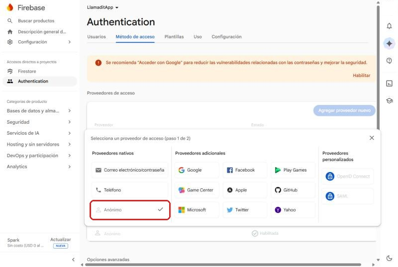</td>
<td>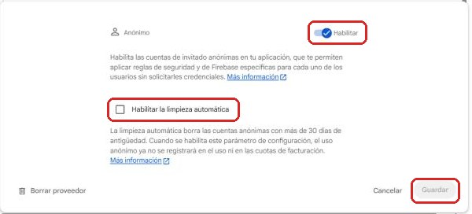</td>
</tr><tr>
<td align="center">① Proveedor <b>Anónimo</b></td><td align="center">② <b>Habilitar</b>, limpieza automática <b>sin marcar</b>, <b>Guardar</b></td>
</tr><tr>
<td colspan="2" align="center">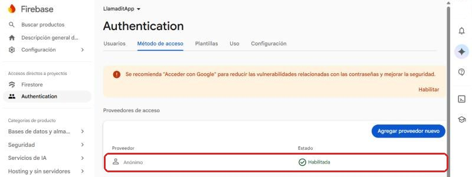 ③ Queda <b>Habilitada</b></td>
</tr></table>

### 2.3. Crear la base de datos

1. En el menú de la izquierda, abre **Bases de datos y almacenamiento** (o **Compilación**) → **Firestore Database** y pulsa **Crear base de datos**.
2. Edición **Standard** (si te pregunta).
3. **Ubicación:** elige **europe-southwest1 (Madrid)** o la más cercana. No se puede cambiar después.
4. Elige **Comenzar en modo de producción** y pulsa **Crear**.

### 2.4. Pegar las reglas de seguridad

Las reglas deciden quién puede leer y escribir: cada móvil solo lo ven los cuidadores que ha aceptado.

1. Abre las reglas de LlamaditApp en otra pestaña: **<https://raw.githubusercontent.com/alvsanmun/LlamaditApp/main/firebase/firestore.rules>**. Selecciónalo todo (**Ctrl + A**) y cópialo (**Ctrl + C**).
2. En Firebase, en **Firestore Database**, abre la pestaña **Reglas**.
3. Borra todo lo que hay en el editor (**Ctrl + A** y **Suprimir**), pega las reglas (**Ctrl + V**) y pulsa **Publicar**.

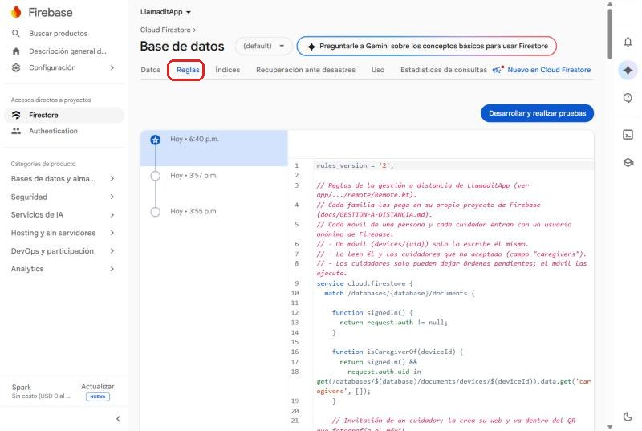

### 2.5. Registrar la app web y copiar sus datos

Estos datos son los que se pegan en la app o la web del cuidador. No son secretos: solo dicen cuál es vuestro proyecto; la seguridad la dan las reglas del paso anterior.

1. Vuelve a la **Descripción general del proyecto** (arriba a la izquierda) y pulsa **Agregar app** (o, si es la primera, el icono **`</>`** del centro de la página).
2. Elige **Web**, el icono **`</>`**.
3. Escribe un **alias**, por ejemplo `Cuidador`. **No** marques Firebase Hosting. Pulsa **Registrar app**.
4. Aparece un bloque que empieza por `const firebaseConfig = {` con `apiKey`, `projectId`, `appId`… Pulsa el botón de **copiar** que tiene al lado y guárdalo (pégalo en un correo o una nota para ti). Lo necesitarás en el paso 3.

Si más adelante vuelves a necesitarlo: rueda dentada (arriba a la izquierda) → **Configuración del proyecto** → **Tus apps** → la app web → **Config**.

<table><tr>
<td>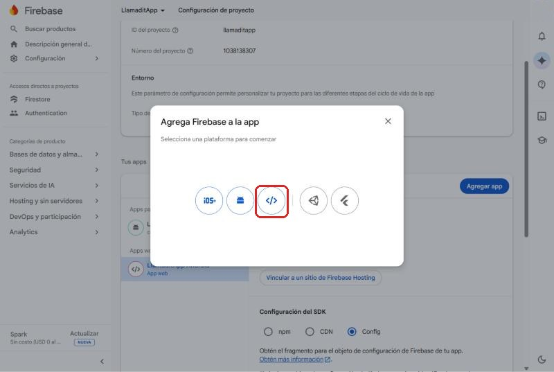</td>
<td>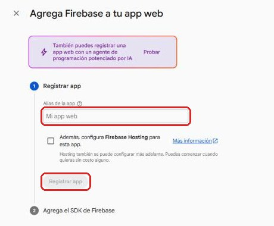</td>
<td>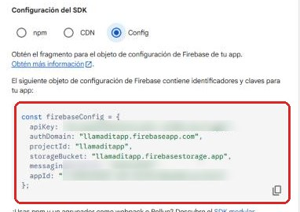</td>
</tr><tr>
<td align="center">① <b>Agregar app</b> → <b>&lt;/&gt;</b></td><td align="center">② Alias → <b>Registrar app</b></td><td align="center">③ Copia el bloque <code>firebaseConfig</code></td>
</tr></table>

✅ **El proyecto está listo.** No hay que volver a la consola de Firebase salvo para consultar esos datos.

---

## 3. Elegir cómo vas a gestionar el móvil

Hay dos formas, iguales por dentro. Se pueden usar las dos a la vez (por ejemplo, la app en el móvil y la web en el ordenador de casa).

| | App del cuidador | Web del cuidador |
|---|---|---|
| **Dónde** | Tu móvil **Android** | Un **ordenador** con Windows, Mac o Linux |
| **Se descarga** | `LlamaditApp-Cuidador-….apk` (los números son la versión) | `Web-Cuidador-LlamaditApp.zip` |
| **Fotos de las personas** | Con la cámara del móvil o de la galería | De los archivos del ordenador |
| **Cómo se abre** | Como cualquier app | Doble clic en *Abrir la web del cuidador.bat* (Windows) |

Las dos se descargan de la **[página de versiones de LlamaditApp](https://github.com/alvsanmun/LlamaditApp/releases/latest)**, en el apartado **Assets** del final:

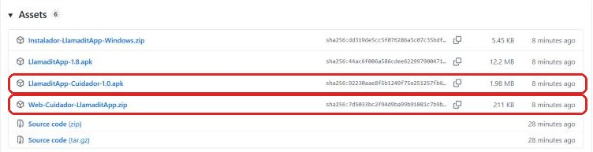

> 📱 **¿Tienes iPhone?** De momento, la app del cuidador es solo para Android. Desde un iPhone se podrá usar la web cuando esté publicada; mientras tanto, usa la web en un ordenador.

### 3.1. App del cuidador en tu móvil Android

Esta app se instala en **tu** móvil (el del cuidador), **no** en el de la persona. Como no está en Play Store, Android pide un par de permisos la primera vez.

**Solo en Samsung:** si tu móvil tiene el **Bloqueador automático** activado, no deja instalar apps descargadas. Desactívalo un momento en **Ajustes → Seguridad y privacidad → Bloqueador automático**, instala la app y vuelve a activarlo.

1. En tu móvil, abre **Chrome** y entra en **<https://github.com/alvsanmun/LlamaditApp/releases/latest>**.
2. Baja hasta **Assets** y toca **LlamaditApp-Cuidador-….apk** (los números son la versión). Si Chrome avisa de que el archivo puede ser dañino, toca **Descargar de todas formas**.
3. Cuando termine, toca **Abrir** en el aviso de la descarga (o abre la app **Archivos** → **Descargas** y toca el archivo).
4. La primera vez, Android dice que por seguridad no puede instalar apps de esta fuente: toca **Ajustes**, activa **Permitir de esta fuente** y vuelve atrás. Puede salir también un aviso de que las apps desconocidas pueden ser dañinas: toca **Continuar**.
5. Toca **Instalar**. Si sale un aviso de **Play Protect** porque la app es nueva y aún no la conoce, toca **Más detalles → Instalar de todas formas** (o **Instalar sin analizar**).
6. Toca **Abrir**.

<table><tr>
<td>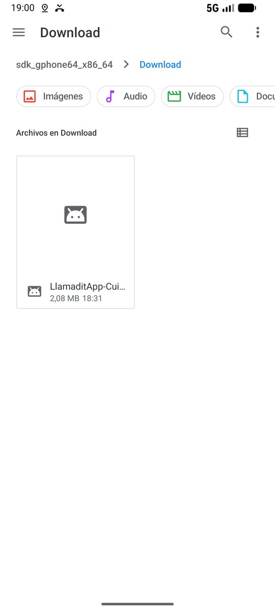</td>
<td>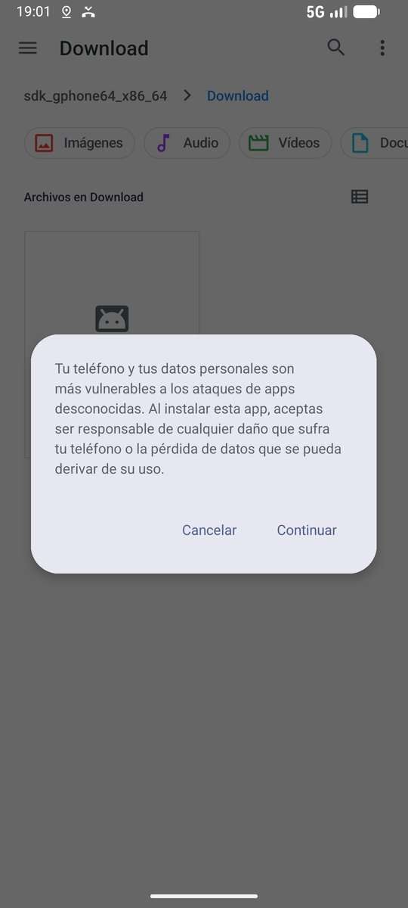</td>
<td>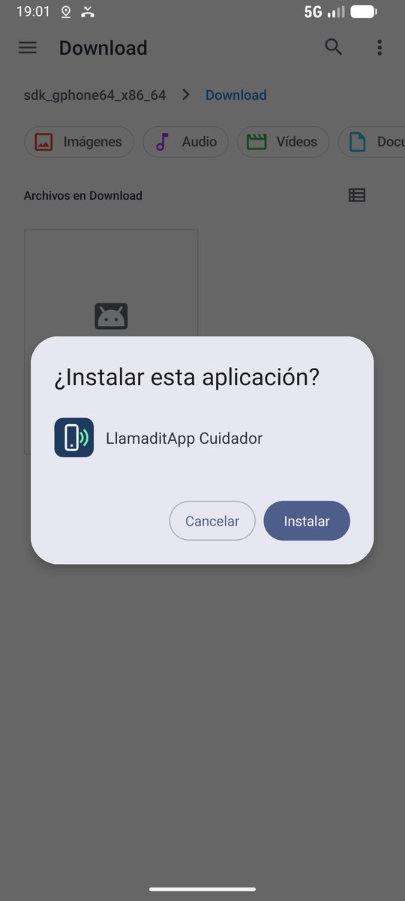</td>
<td>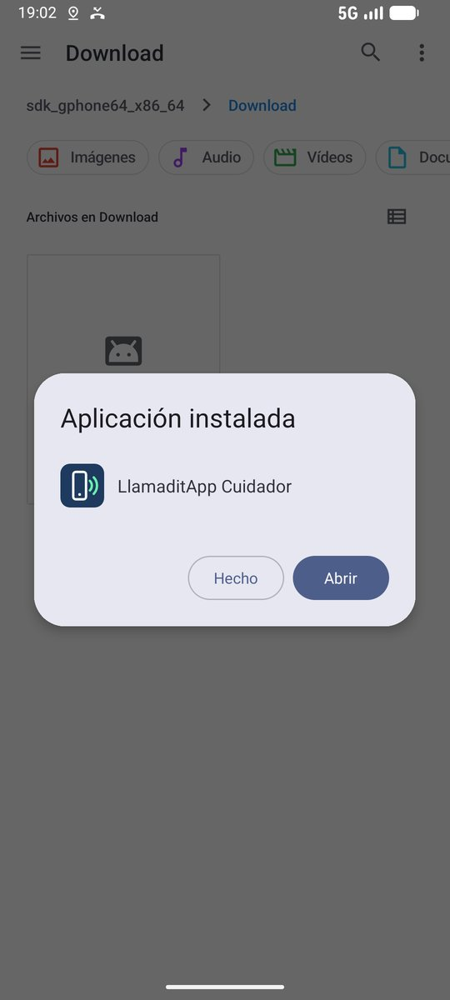</td>
</tr><tr>
<td align="center">① El archivo descargado</td><td align="center">② <b>Continuar</b></td><td align="center">③ <b>Instalar</b></td><td align="center">④ <b>Abrir</b></td>
</tr></table>

7. La primera vez, la app pide los **datos del proyecto**. Pega el bloque `firebaseConfig` que copiaste en el paso 2.5 (por ejemplo, te lo mandas por correo o WhatsApp desde el ordenador y lo copias en el móvil) y toca **Guardar**. Si otro cuidador ya tiene el proyecto, pega en su lugar la **invitación** que te mande (paso 5).
8. Sale la pantalla principal de la app, todavía sin ningún móvil. Sigue en el [paso 4](#4-vincular-el-móvil-de-la-persona).

<table><tr>
<td>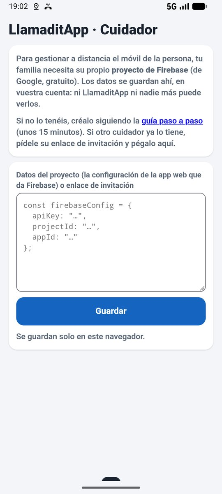</td>
<td>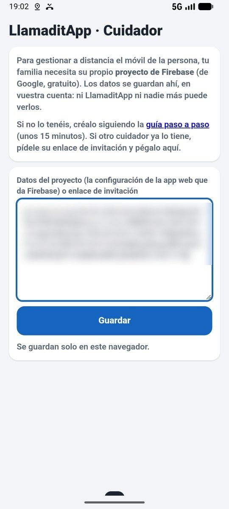</td>
<td>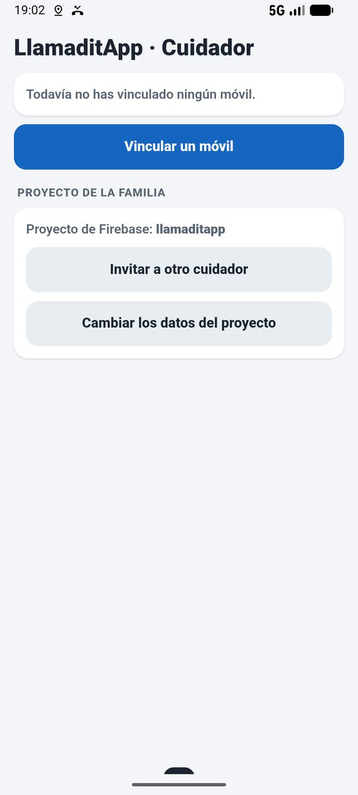</td>
</tr><tr>
<td align="center">① Datos del proyecto</td><td align="center">② Pegados → <b>Guardar</b></td><td align="center">③ Lista para vincular</td>
</tr></table>

Los datos se guardan solo en tu móvil: la próxima vez la app se abre directamente.

### 3.2. Web del cuidador en el ordenador

1. En la **[página de versiones](https://github.com/alvsanmun/LlamaditApp/releases/latest)**, descarga **Web-Cuidador-LlamaditApp.zip**.
2. En la carpeta **Descargas**, haz clic derecho sobre el zip → **Extraer todo** → **Extraer**. Sale la carpeta **LlamaditApp-Web-Cuidador** (puedes moverla a Documentos o al Escritorio).
3. Dentro, haz doble clic en **Abrir la web del cuidador.bat**. Si Windows avisa con "Windows protegió su PC", pulsa **Más información → Ejecutar de todas formas**.
4. Se abre una **ventana negra** y, enseguida, el navegador con la web. **No cierres la ventana negra** mientras uses la web; al terminar, ciérrala.
5. La primera vez, pega los **datos del proyecto** (el bloque del paso 2.5, o la invitación de otro cuidador) y pulsa **Guardar**. Se guardan en ese navegador: la próxima vez ya no los pide.

<table><tr>
<td>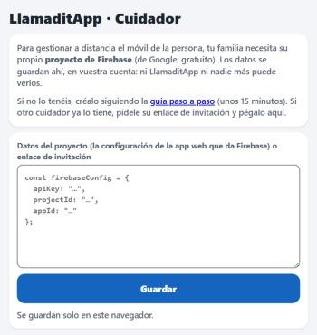</td>
<td>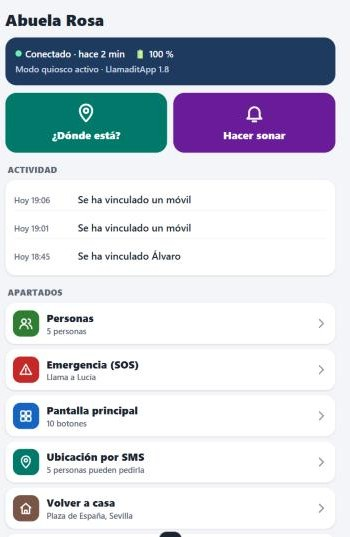</td>
</tr><tr>
<td align="center">① Primera vez: datos del proyecto</td><td align="center">② Después de vincular, el móvil de la persona</td>
</tr></table>

**En Mac o Linux:** abre una terminal en la carpeta y escribe `python3 -m http.server 8766`; después abre <http://localhost:8766> en el navegador.

> 💡 Usa siempre la misma dirección (`http://localhost:8766`) y el mismo navegador: los datos del proyecto se guardan para esa dirección exacta.

---

## 4. Vincular el móvil de la persona

Se hace una vez por cada cuidador. Lo más fácil es tener los dos móviles delante.

### 4.1. En la app o la web del cuidador

1. Pulsa **Vincular un móvil**.
2. Escribe **tu nombre** (así aparecerás en el móvil de la persona) y pulsa **Crear el código QR**. El código vale **15 minutos** y solo sirve una vez.

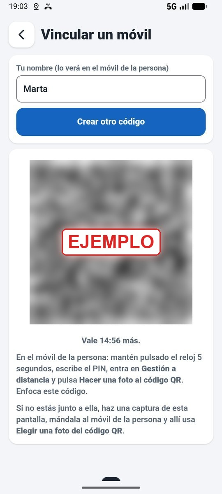

### 4.2. En el móvil de la persona

1. Mantén pulsado el **reloj 5 segundos**, escribe el **PIN** y entra en el apartado **Gestión a distancia**.
2. Pulsa **Hacer una foto al código QR** y fotografía el código que enseña la app o la web del cuidador (de cerca, sin reflejos, y pulsa el botón de aceptar la foto).
   - **Si no estás junto a la persona:** haz una **captura de pantalla** del código, mándala al móvil de la persona (por WhatsApp, por ejemplo) y allí usa **Elegir una foto del código QR**.
3. En unos segundos sale **Conectado** y tu nombre en **Cuidadores vinculados**. La app o la web del cuidador abre sola la ficha del móvil.

<table><tr>
<td>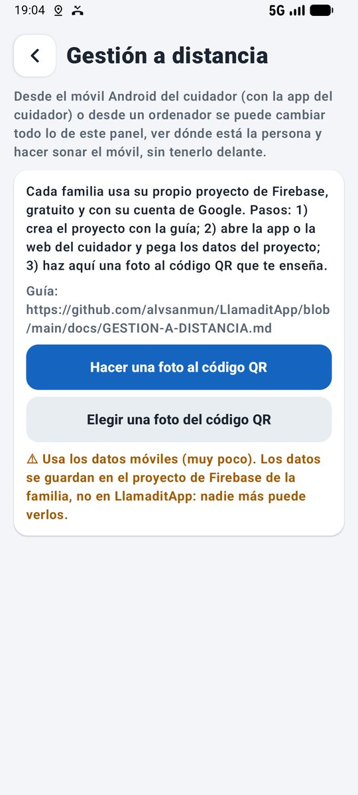</td>
<td>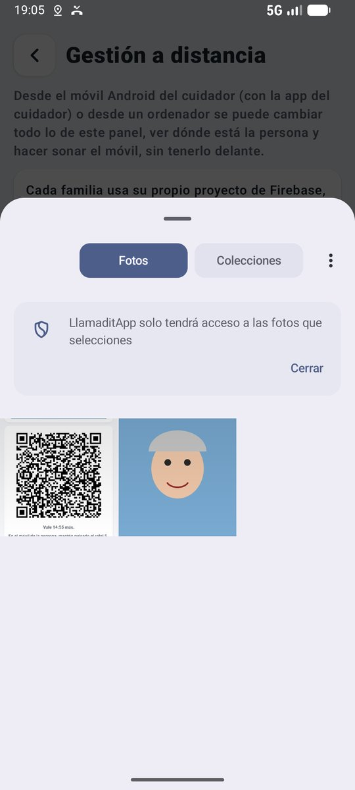</td>
<td>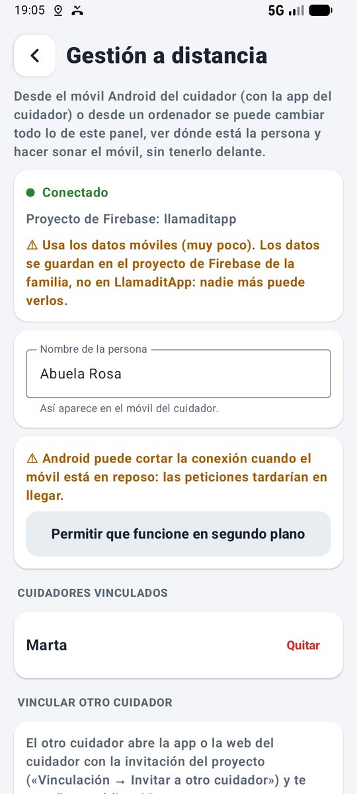</td>
<td>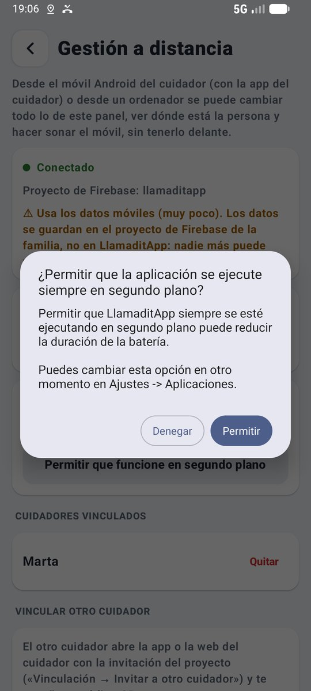</td>
</tr><tr>
<td align="center">① <b>Hacer una foto al código QR</b></td><td align="center">② (o elegir la captura)</td><td align="center">③ <b>Conectado</b> y vinculado</td><td align="center">④ <b>Permitir</b></td>
</tr></table>

4. Si en el panel aparece el aviso **"Android puede cortar la conexión cuando el móvil está en reposo"**, pulsa **Permitir que funcione en segundo plano** y después **Permitir**. Así las peticiones llegan aunque la pantalla esté apagada.
5. En **Nombre de la persona**, escribe cómo quieres que aparezca en la app o la web (por ejemplo, "Abuela Rosa").
6. Sal del panel con la casa o la flecha.

### 4.3. Comprobar que funciona

En la app o la web del cuidador, pulsa **¿Dónde está?**. En unos segundos sale el mapa con la posición del móvil y su batería. Prueba también con la pantalla del móvil de la persona apagada.

Si el móvil no responde, la orden se queda guardada y se hace en cuanto tenga conexión.

---

## 5. Más cuidadores

Cada cuidador tiene su propia app o web, conectada al mismo proyecto.

1. Quien ya tiene la gestión a distancia: en la app o la web, **Vinculación → Invitar a otro cuidador → Compartir la invitación** (por WhatsApp, por correo…).
2. El nuevo cuidador instala la app (paso 3.1) o abre la web (paso 3.2) y, cuando le pida los datos del proyecto, **pega la invitación**. No tiene que crear nada en Firebase.
3. Después vincula el móvil de la persona igual que en el paso 4, con su propio código QR.

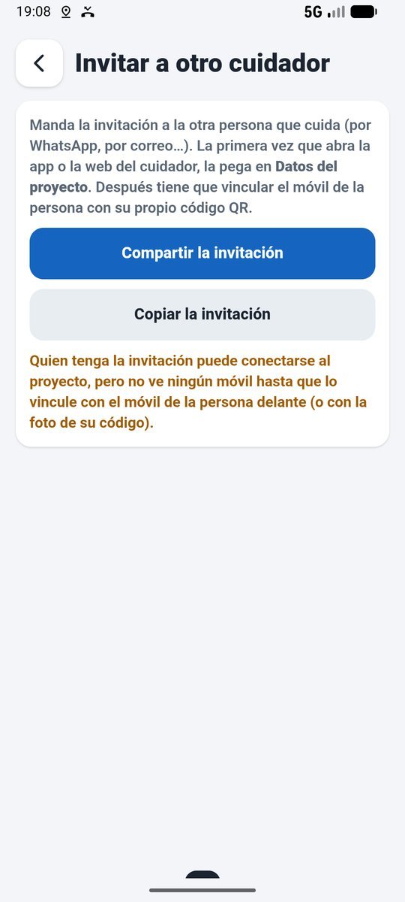

Todos los cuidadores vinculados aparecen en el panel del móvil, en **Gestión a distancia → Cuidadores vinculados**, y se pueden quitar desde ahí. Cada uno también puede desvincularse desde su app o web (**Vinculación → Desvincular este móvil**).

---

## 6. Preguntas

**¿Cuánto cuesta?** Nada. El plan gratuito de Firebase permite 50 000 lecturas y 20 000 escrituras al día; un móvil con varios cuidadores usa una pequeña parte. Sin tarjeta de crédito no puede cobrar nada: si algún día se superara, dejaría de responder hasta el día siguiente.

**¿Quién es responsable de los datos?** Vuestra familia: el proyecto es vuestro. Si borráis el proyecto en la consola de Firebase (**Configuración del proyecto → Borrar proyecto**), se borra todo.

**¿Gasta muchos datos el móvil de la persona?** Muy pocos: unos pocos kilobytes por cada cambio y por cada petición.

**¿Y si cambio de proyecto?** En el panel del móvil, **Gestión a distancia → Desconectar del proyecto**, y vincúlalo de nuevo con el código QR de una app o web conectada al proyecto nuevo.

**La app o la web dice "No se puede conectar con el proyecto".** Revisa que el acceso anónimo está activado (paso 2.2) y que los datos pegados son los de la app **web** del proyecto (paso 2.5).

**El móvil dice "No se ha podido conectar".** Comprueba que tiene datos móviles y que la base de datos y las reglas están creadas (pasos 2.3 y 2.4).

**El móvil dice que el código ya no vale.** Han pasado más de 15 minutos o ya se usó: crea otro en la app o la web del cuidador.

**No encuentra el código en la foto.** Hazla más de cerca, con el código entero dentro de la foto y sin reflejos. También puedes subir el brillo de la pantalla que enseña el código.
