# Guía de instalación paso a paso

Esta guía explica, con capturas de cada pantalla, cómo dejar un móvil Android listo con LlamaditApp, **empezando desde cero**. Está pensada para alguien que no sabe nada de informática: solo hay que seguir los pasos en orden.

**Tiempo:** alrededor de una hora la primera vez.

> 📱 Las capturas son de un **Samsung Galaxy A16** y de un móvil Android "puro" (como los Google Pixel). Si tu móvil es de otra marca, los menús se parecen mucho: cuando no encuentres algo, usa la **lupa de Ajustes** y escribe el nombre de lo que buscas.

---

## Índice

1. [Lo que necesitas](#1-lo-que-necesitas)
2. [Borrar el móvil (restablecer de fábrica)](#2-borrar-el-móvil-restablecer-de-fábrica)
3. [Encender el móvil por primera vez](#3-encender-el-móvil-por-primera-vez)
4. [Quitar el PIN de la tarjeta SIM](#4-quitar-el-pin-de-la-tarjeta-sim)
5. [Activar la "Depuración USB"](#5-activar-la-depuración-usb)
6. [Instalar LlamaditApp desde el ordenador](#6-instalar-llamaditapp-desde-el-ordenador)
7. [Crear el PIN del cuidador](#7-crear-el-pin-del-cuidador)
8. [Añadir los contactos con su foto](#8-añadir-los-contactos-con-su-foto)
9. [Configurar el panel del cuidador](#9-configurar-el-panel-del-cuidador)
10. [WhatsApp (opcional)](#10-whatsapp-opcional)
11. [Ajuste de batería recomendado](#11-ajuste-de-batería-recomendado)
12. [Comprobar que todo funciona y entregar el móvil](#12-comprobar-que-todo-funciona-y-entregar-el-móvil)
13. [Si algo sale mal](#13-si-algo-sale-mal)

---

## 1. Lo que necesitas

- ✅ El **móvil Android** (Android 8.0 o más nuevo) con su **tarjeta SIM** puesta.
- ✅ El **PIN de la tarjeta SIM** (viene en la tarjeta de plástico donde venía la SIM).
- ✅ Un **ordenador con Windows** y conexión a internet.
- ✅ Un **cable USB** que sirva para pasar datos (el del cargador del móvil suele valer).
- ✅ Las **fotos de las personas** a las que va a llamar. Se pueden hacer con el propio móvil.
- ✅ Opcional: una **cuenta de Google** y WhatsApp, si va a hacer videollamadas.

> ⚠️ **Importante:** en el paso 2 se borra todo lo que hay en el móvil (fotos, contactos, aplicaciones). Si es un móvil usado, guarda antes lo que quieras conservar.

---

## 2. Borrar el móvil (restablecer de fábrica)

LlamaditApp solo puede tomar el control del móvil si está **recién borrado**, como nuevo. Si el móvil es nuevo y nunca lo has encendido, **salta al paso 3**.

### En un Samsung

1. Abre **Ajustes** (el icono de la rueda dentada) y baja hasta **Administración general**.
2. Entra en **Restablecer**.
3. Baja hasta el final y pulsa **Restablecer todos los datos**. Después pulsa el botón **Restablecer** y confirma.

<table><tr>
<td>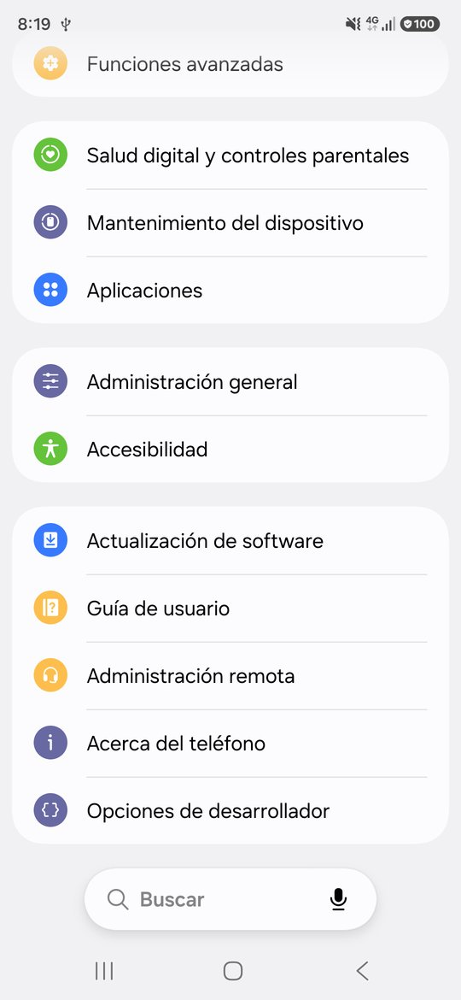</td>
<td>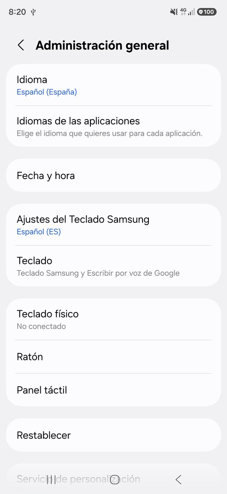</td>
<td>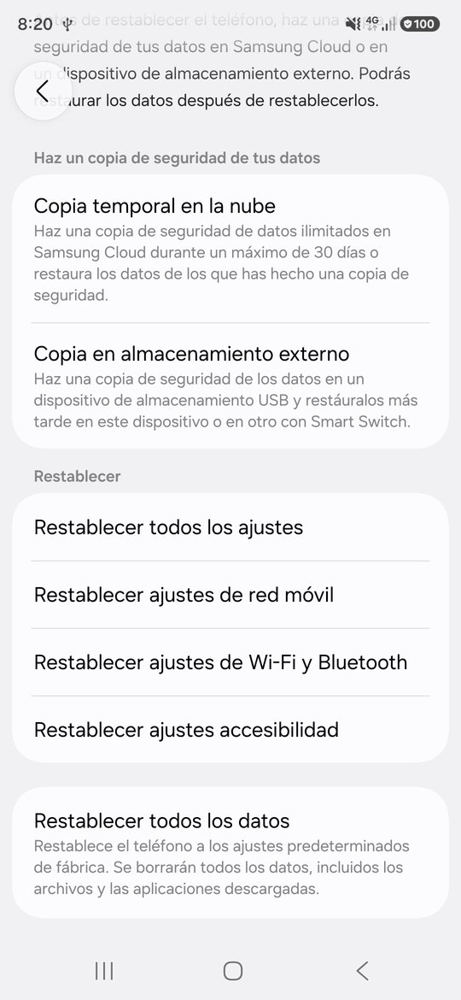</td>
</tr><tr>
<td align="center">① Administración general</td><td align="center">② Restablecer</td><td align="center">③ Restablecer todos los datos</td>
</tr></table>

### En otros móviles

Abre **Ajustes**, pulsa la **lupa** de arriba, escribe **fabrica** y elige **Volver al estado de fábrica (borrar todo)**. Después pulsa **Borrar todos los datos**.

<table><tr>
<td>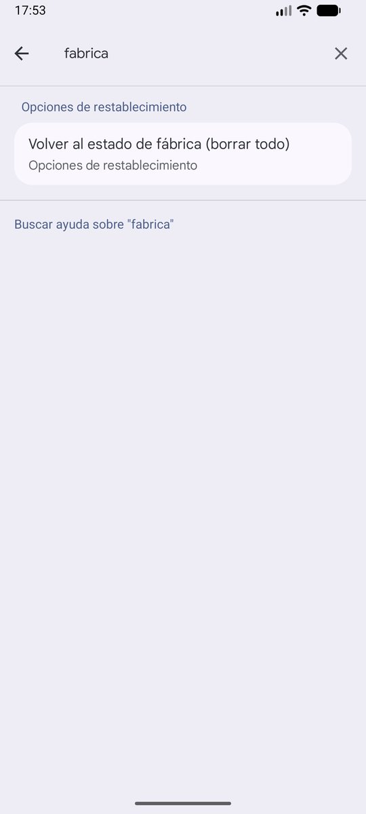</td>
<td>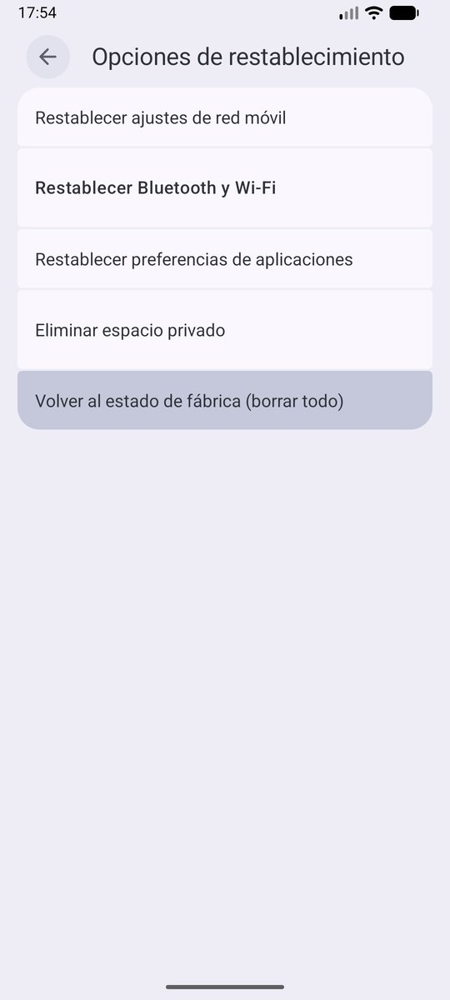</td>
<td>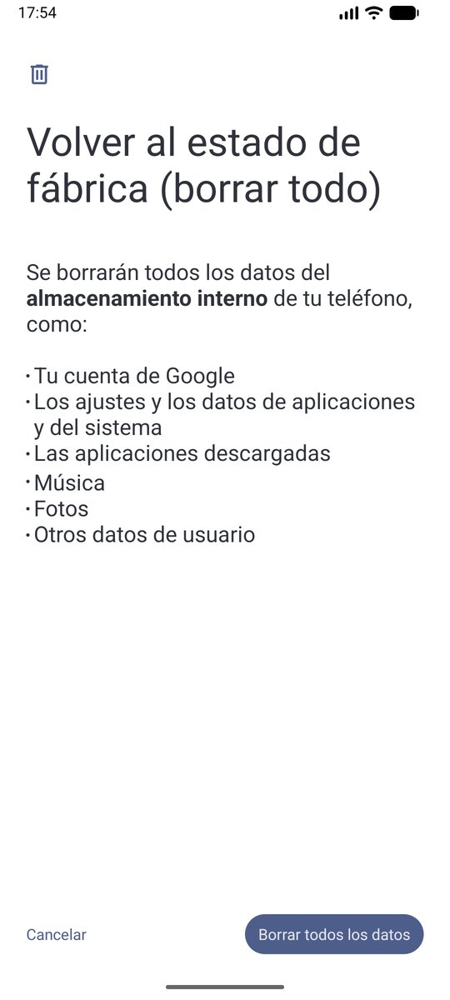</td>
</tr><tr>
<td align="center">① Busca "fabrica"</td><td align="center">② Volver al estado de fábrica</td><td align="center">③ Borrar todos los datos</td>
</tr></table>

El móvil se apagará y tardará unos minutos en volver a encenderse.

---

## 3. Encender el móvil por primera vez

Al encenderse aparece el **asistente de bienvenida**, que hace varias preguntas. Contesta así:

| Pregunta | Qué hacer |
|---|---|
| Idioma | Elige **Español** (o el idioma de la persona). |
| Conectarse a una red Wi-Fi | Puedes conectarte o **Saltar**. LlamaditApp apagará el Wi-Fi después. |
| Copiar aplicaciones y datos | **No copiar**. |
| **Cuenta de Google** | **Saltar / Omitir**. ⚠️ No añadas ninguna cuenta ahora: si la añades, LlamaditApp no podrá activarse. Se puede añadir al final (paso 10). |
| Cuenta de Samsung | **Omitir**. |
| **Proteger el teléfono** (PIN, patrón, huella, cara) | **Omitir / Ahora no**. ⚠️ No pongas ningún bloqueo: LlamaditApp quita la pantalla de bloqueo para que la persona no tenga que desbloquear nada. |
| Servicios de Google, ubicación | Puedes **Aceptar**. Deja la **ubicación activada**: la necesita el botón SOS. |
| Cualquier otra pregunta | **Omitir**, **Ahora no** o **Siguiente**. |

Al terminar verás la pantalla de inicio normal del móvil.

---

## 4. Quitar el PIN de la tarjeta SIM

Así, si el móvil se apaga y se vuelve a encender, funcionará solo, sin que nadie tenga que escribir el PIN.

**Samsung:** **Ajustes → Seguridad y privacidad → Más ajustes de seguridad → Seguridad de tarjeta SIM** y **apaga** el interruptor **Bloquear tarjeta SIM**. Te pedirá el PIN actual de la SIM.

<table><tr>
<td>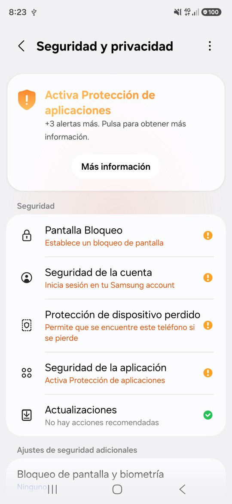</td>
<td>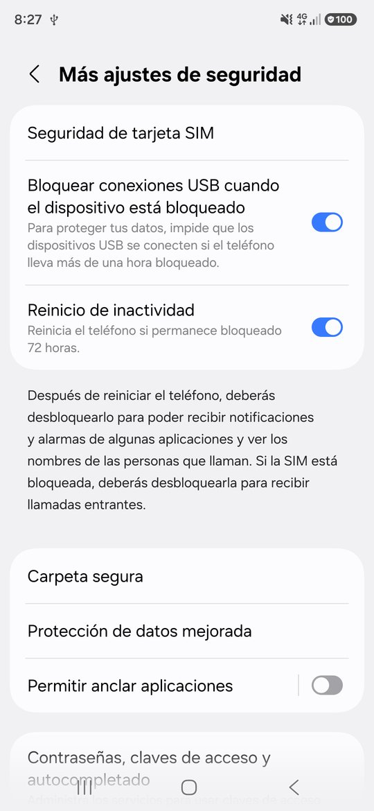</td>
<td>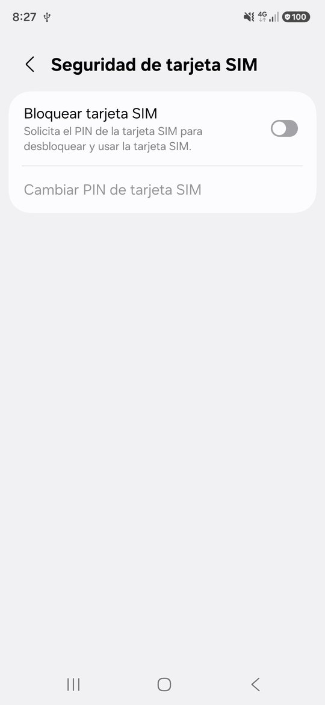</td>
</tr><tr>
<td align="center">① Seguridad y privacidad (baja hasta "Más ajustes de seguridad")</td><td align="center">② Seguridad de tarjeta SIM</td><td align="center">③ Así debe quedar: <b>apagado</b></td>
</tr></table>

**Otros móviles:** en **Ajustes**, pulsa la **lupa** y escribe **SIM**. Busca **Bloqueo de SIM** o **Bloquear tarjeta SIM** y apágalo.

---

## 5. Activar la "Depuración USB"

Es un permiso que deja al ordenador instalar LlamaditApp. Se hace en tres partes.

### 5.1. Solo en Samsung: desactivar el "Bloqueador automático"

Si está activado, no deja activar la Depuración USB. **Ajustes → Seguridad y privacidad → Bloqueador automático → Desactivado.**

> Si no lo encuentras, pulsa la lupa de Ajustes y escribe **Bloqueador automático**. Si no aparece, es que tu móvil no lo tiene: sigue con el paso 5.2.

### 5.2. Activar las "Opciones de desarrollador"

1. En **Ajustes**, entra en **Acerca del teléfono** (en Samsung está al final de la lista).
2. Entra en **Información de software**.
3. Busca **Número de compilación** y **tócalo 7 veces seguidas**. El móvil irá avisando ("Te quedan 3 pasos…") hasta que diga **"Ahora eres desarrollador"**. Si pide el PIN de la pantalla, escríbelo (no debería, porque no pusimos ninguno).

<table><tr>
<td>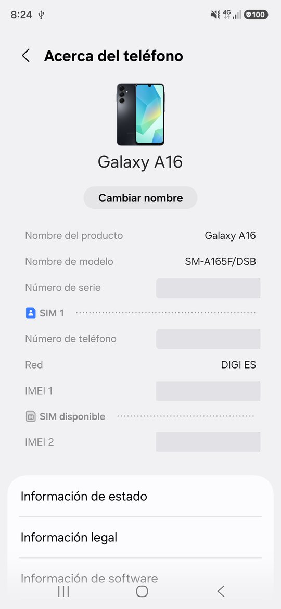</td>
<td>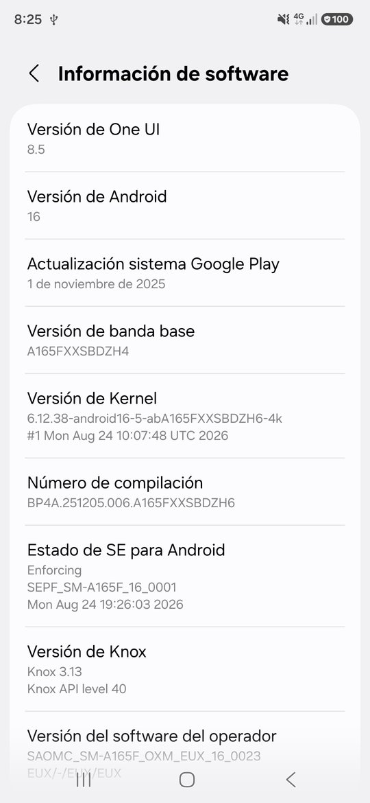</td>
<td>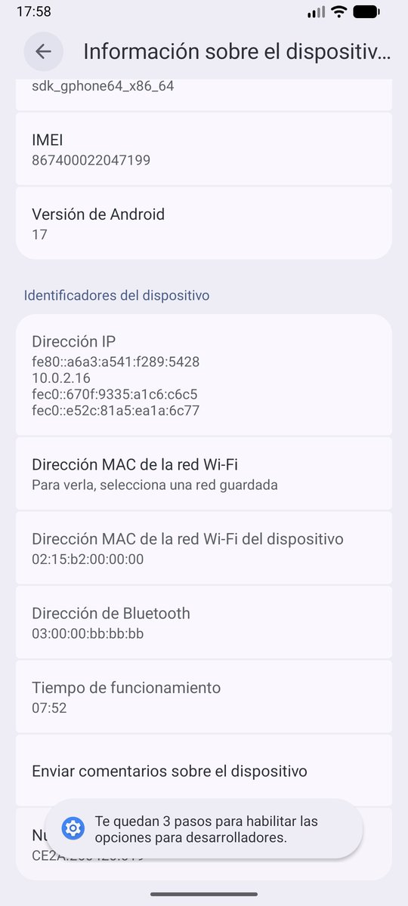</td>
<td>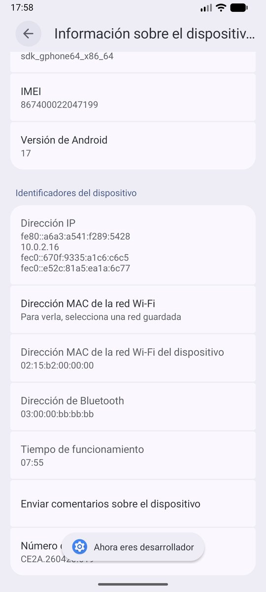</td>
</tr><tr>
<td align="center">① Acerca del teléfono → Información de software</td><td align="center">② Toca 7 veces <b>Número de compilación</b></td><td align="center">③ Va avisando…</td><td align="center">④ …hasta "Ahora eres desarrollador"</td>
</tr></table>

### 5.3. Activar la "Depuración por USB"

Vuelve atrás a **Ajustes**. Al final de la lista ha aparecido **Opciones de desarrollador**. Entra, baja hasta el apartado **Depuración** y **enciende** **Depuración por USB**. Acepta el aviso que aparece.

<table><tr>
<td></td>
<td></td>
<td></td>
</tr><tr>
<td align="center">① Opciones de desarrollador (al final de Ajustes)</td><td align="center">② Baja hasta "Depuración"</td><td align="center">③ Enciende <b>Depuración por USB</b></td>
</tr></table>

---

## 6. Instalar LlamaditApp desde el ordenador

### 6.1. Descargar el instalador

En el ordenador, abre esta página: **<https://github.com/alvsanmun/LlamaditApp/releases/latest>**

Baja hasta **Assets** y pulsa **Instalador-LlamaditApp-Windows.zip**. Se descargará en tu carpeta **Descargas**.

### 6.2. Descomprimir el instalador

1. Abre la carpeta **Descargas** (en el Explorador de archivos de Windows).
2. Haz **clic derecho** sobre **Instalador-LlamaditApp-Windows.zip** y elige **Extraer todo…**
3. Pulsa **Extraer**.

<table><tr>
<td>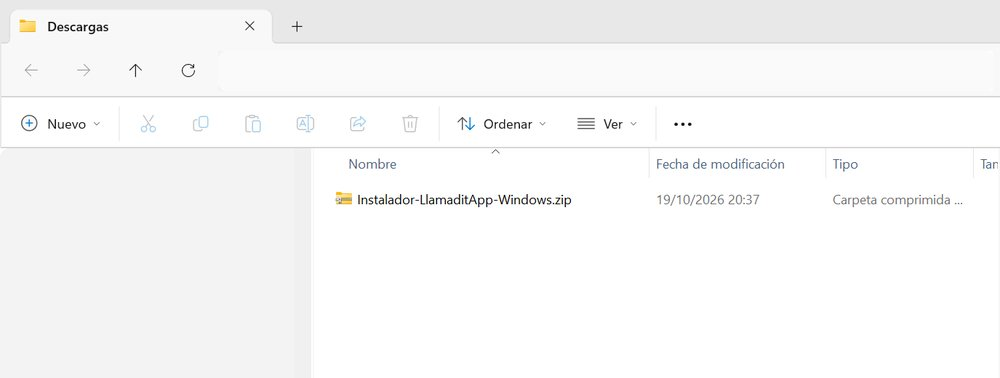</td>
<td></td>
</tr><tr>
<td align="center">① Clic derecho → <b>Extraer todo…</b></td><td align="center">② Pulsa <b>Extraer</b></td>
</tr></table>

Se abrirá una carpeta con tres archivos:

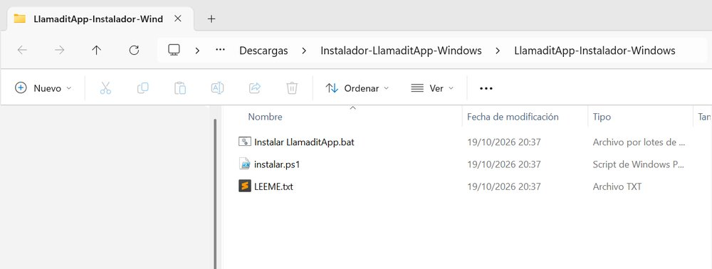

### 6.3. Conectar el móvil

1. Conecta el móvil al ordenador con el **cable USB**.
2. Si el móvil pregunta qué hacer con el USB, elige **Transferir archivos**.

### 6.4. Ejecutar el instalador

1. Haz **doble clic** en **Instalar LlamaditApp.bat**.
2. Si Windows muestra **"Windows protegió su PC"**, pulsa **Más información** y después **Ejecutar de todas formas**. (Windows avisa con cualquier programa que no conoce; el instalador es seguro y su código es público.)
3. Se abre una ventana negra. Lee lo que pone y pulsa la tecla **Intro** del teclado.

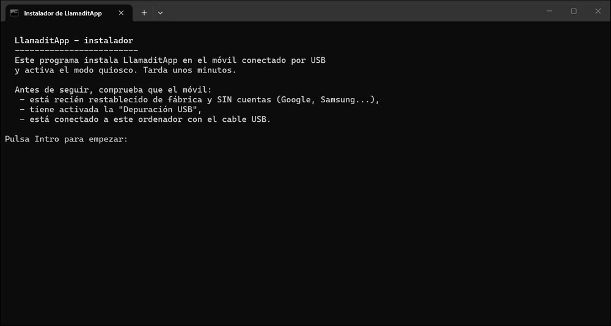

4. **Mira el móvil:** aparecerá el aviso **"¿Permitir depuración USB?"**. Marca **Permitir siempre desde este ordenador** y pulsa **Permitir**.
5. Espera. El instalador descarga lo necesario e instala LlamaditApp. Tarda uno o dos minutos. Al final verás **"¡Listo!"**:

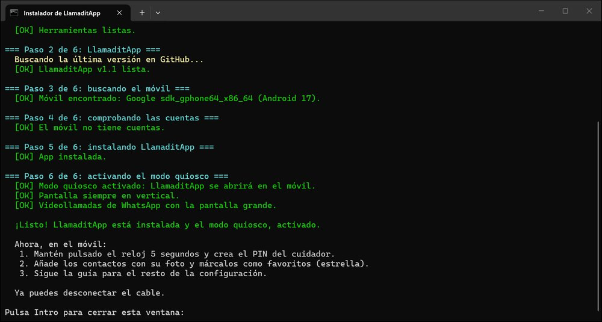

En el móvil, LlamaditApp se abre sola y ya no se puede salir de ella:

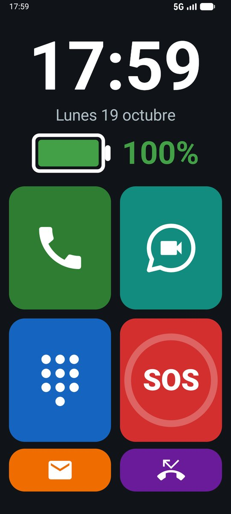

Ya puedes **desconectar el cable**. Pulsa Intro para cerrar la ventana del instalador.

> ❌ ¿El instalador ha mostrado un error en rojo? Lee lo que dice: suele explicar qué hacer. Lo más habitual es que el móvil tenga alguna **cuenta** añadida: quítala o vuelve a borrar el móvil (paso 2). Consulta también el [apartado 13](#13-si-algo-sale-mal).

---

## 7. Crear el PIN del cuidador

El **panel del cuidador** es donde se configura todo. Está escondido para que la persona no entre sin querer.

1. **Mantén el dedo pulsado sobre la hora** (el reloj grande) durante **5 segundos**, hasta que el móvil vibre.
2. Escribe un **PIN de 4 cifras** que solo sepas tú.
3. Escríbelo **otra vez** para confirmarlo.

<table><tr>
<td>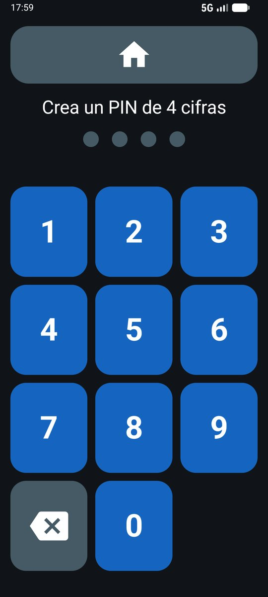</td>
<td>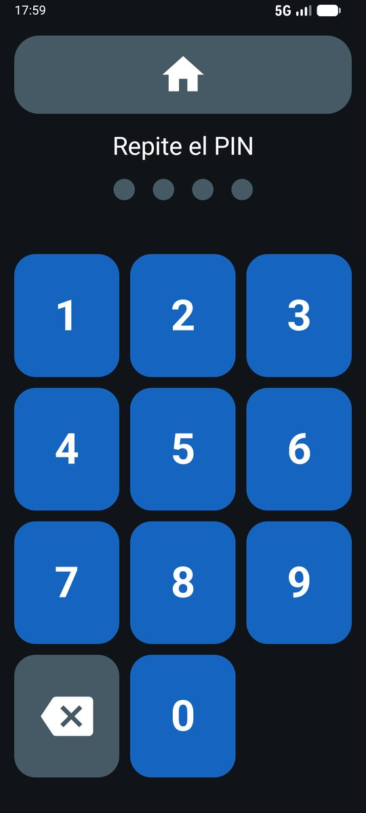</td>
<td>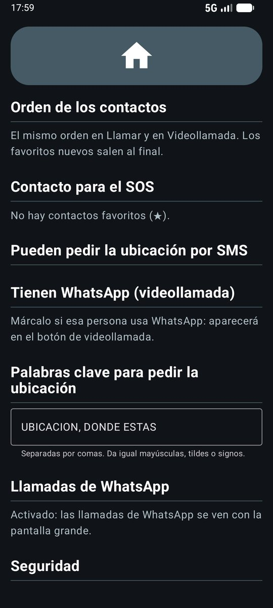</td>
</tr><tr>
<td align="center">① Crea el PIN</td><td align="center">② Repítelo</td><td align="center">③ Ya estás en el panel</td>
</tr></table>

> ⚠️ **Apunta el PIN en un lugar seguro.** Sin él no se puede volver a entrar al panel, y la única solución sería borrar el móvil y empezar de nuevo.

---

## 8. Añadir los contactos con su foto

La persona verá **solo las fotos** de los contactos marcados con una **estrella** (favoritos).

1. En el panel del cuidador, baja hasta **Otras apps** y pulsa **Abrir Contactos (favoritos y fotos)**.
2. Pulsa el botón **+** (abajo a la derecha) para crear un contacto.
3. Escribe el **nombre** y el **teléfono**. Comprueba que la bandera es la de **España** (o la del país correspondiente).

<table><tr>
<td>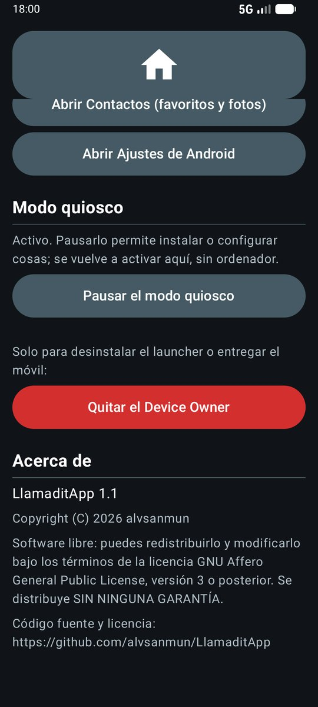</td>
<td>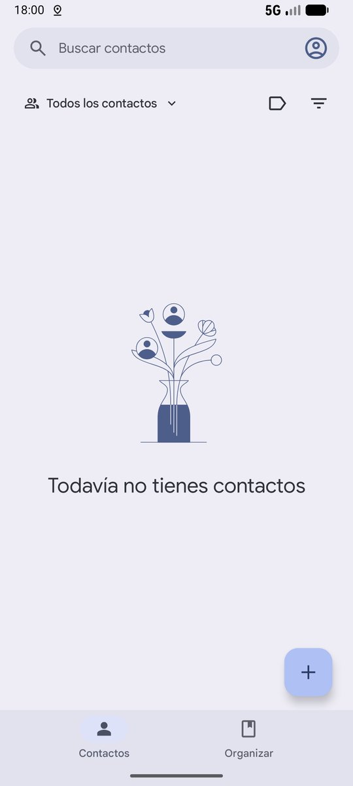</td>
<td>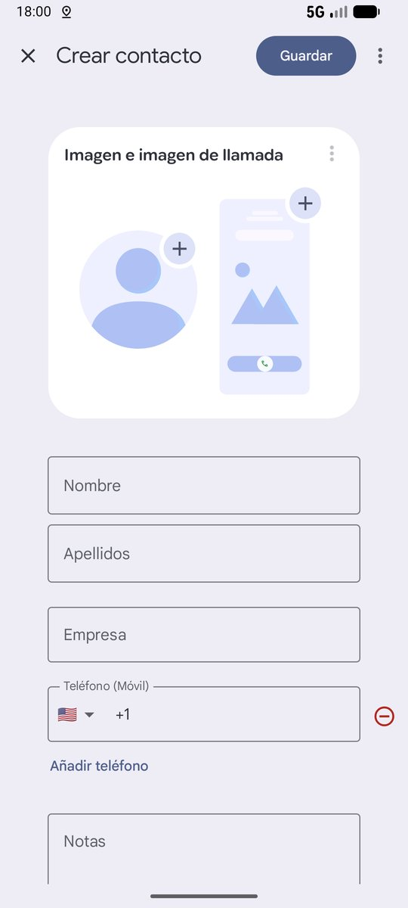</td>
<td>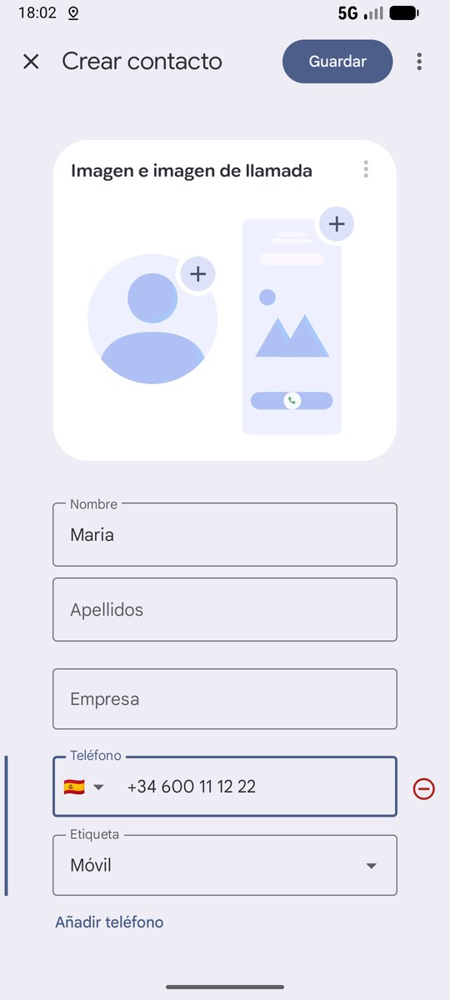</td>
</tr><tr>
<td align="center">① Abrir Contactos</td><td align="center">② Pulsa <b>+</b></td><td align="center">③ Formulario vacío</td><td align="center">④ Nombre y teléfono</td>
</tr></table>

4. **La foto:** pulsa el **+** de la silueta, elige **Galería** (o **Cámara** para hacerla en ese momento), toca la foto, pulsa **Hecho** y después **Elegir**.

<table><tr>
<td></td>
<td>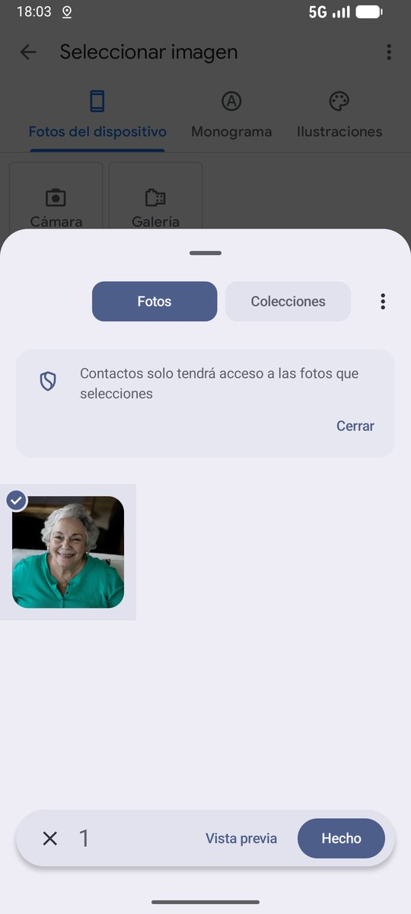</td>
<td>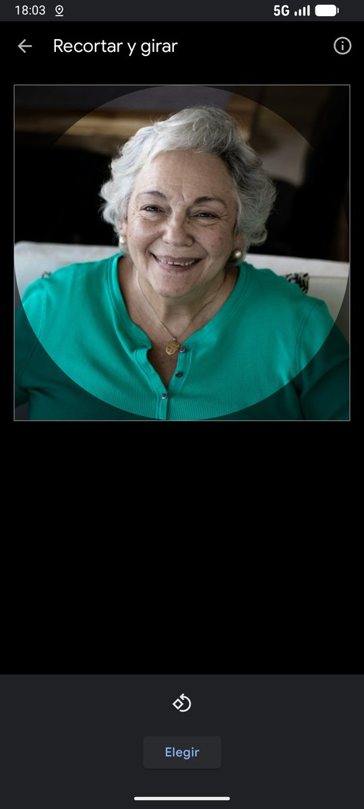</td>
<td>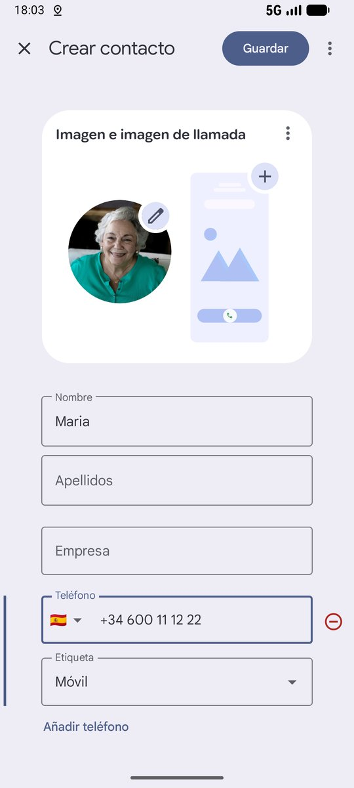</td>
</tr><tr>
<td align="center">① Galería o Cámara</td><td align="center">② Toca la foto → <b>Hecho</b></td><td align="center">③ <b>Elegir</b></td><td align="center">④ Ya tiene foto</td>
</tr></table>

> 💡 Usa una foto **de cerca de la cara**, con buena luz y que se reconozca bien. Es lo único que verá la persona.

5. Pulsa **Guardar**.
6. **Muy importante:** pulsa la **estrella ☆** de arriba para marcarlo como **favorito ★**. Sin la estrella, no aparecerá en LlamaditApp.

<table><tr>
<td>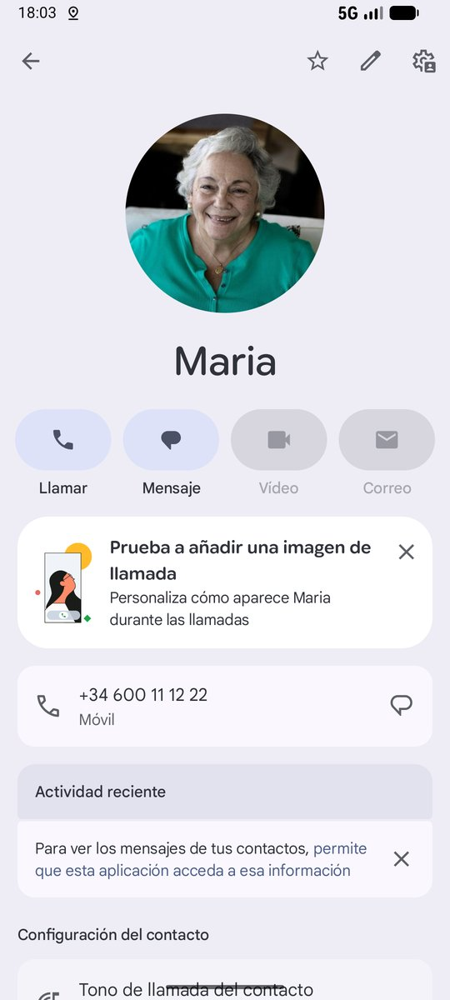</td>
<td>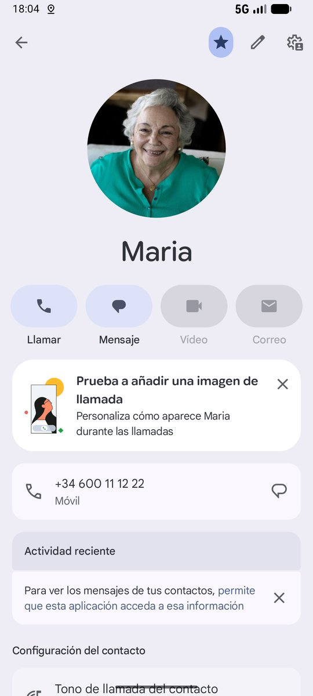</td>
</tr><tr>
<td align="center">① Guardado: pulsa la estrella ☆</td><td align="center">② Estrella rellena ★ = favorito</td>
</tr></table>

7. Repite para cada persona (lo ideal son entre 4 y 6).
8. Cuando termines, pulsa el botón **Atrás** del móvil hasta volver a LlamaditApp. El modo quiosco se vuelve a activar solo.

---

## 9. Configurar el panel del cuidador

De vuelta en el panel ya aparecen los contactos. Configura:

- **Orden de los contactos:** con las flechas ↑ ↓, pon arriba a quien más va a llamar.
- **Contacto para el SOS:** a quién llama y avisa el botón rojo de emergencia.
- **Pueden pedir la ubicación por SMS:** qué familiares pueden saber dónde está el móvil enviando la palabra **UBICACION** por SMS.
- **Tienen WhatsApp (videollamada):** marca a quien use WhatsApp (ver paso 10).

<table><tr>
<td>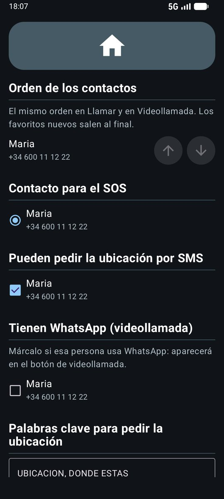</td>
<td></td>
</tr><tr>
<td align="center">Panel del cuidador</td><td align="center">Lo que verá la persona en <b>Llamar</b></td>
</tr></table>

Pulsa la **casa** de arriba para volver a la pantalla principal.

---

## 10. WhatsApp (opcional)

Solo si la persona va a hacer **videollamadas de WhatsApp**.

1. En el panel del cuidador pulsa **Pausar el modo quiosco**. El móvil se podrá usar con normalidad mientras tanto.
2. Pulsa **Abrir Ajustes de Android** y añade una **cuenta de Google**: **Cuentas y copia de seguridad → Administrar cuentas → Añadir cuenta → Google**.
3. Abre **Play Store**: en Ajustes ve a **Aplicaciones → Google Play Store → Abrir**. Busca e instala **WhatsApp**, ábrelo y regístralo con el número de la SIM (llegará un SMS con un código).
4. En Play Store, toca tu foto de perfil → **Ajustes → Preferencias de red → Actualizar aplicaciones automáticamente → Usando cualquier red**.
5. Pulsa el botón de **inicio** del móvil para volver a LlamaditApp, entra en el panel (reloj 5 segundos y PIN) y pulsa **Activar el modo quiosco**.
6. En **Tienen WhatsApp (videollamada)**, marca a las personas que usan WhatsApp.

---

## 11. Ajuste de batería recomendado

Samsung "duerme" las aplicaciones que se usan poco para ahorrar batería. Si duerme WhatsApp, las videollamadas pueden llegar tarde. LlamaditApp no hace falta añadirla: Android ya la protege.

**Samsung:** con el quiosco en pausa, **Ajustes → Batería → Límites de uso en segundo plano → Aplicaciones sin autoinactivación**, pulsa **+**, marca **WhatsApp** y pulsa **Añadir**.

<table><tr>
<td>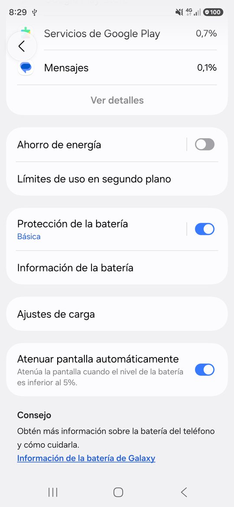</td>
<td>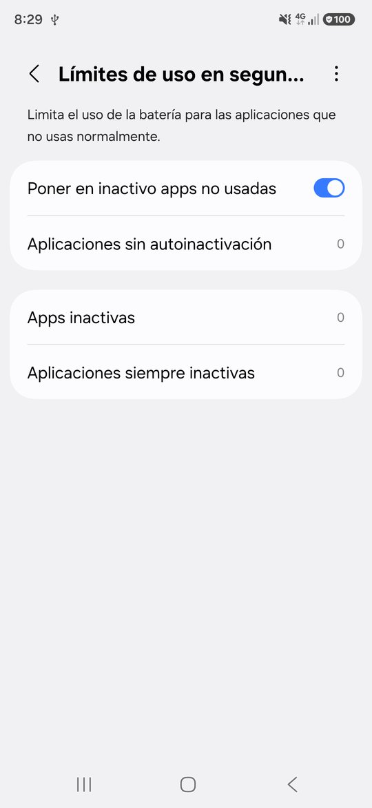</td>
<td>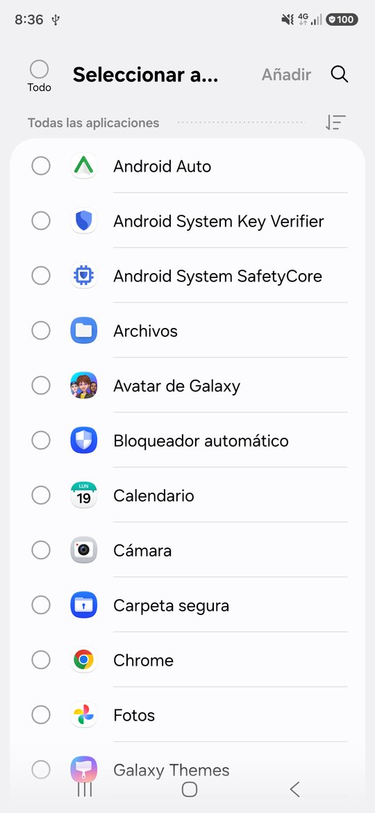</td>
<td>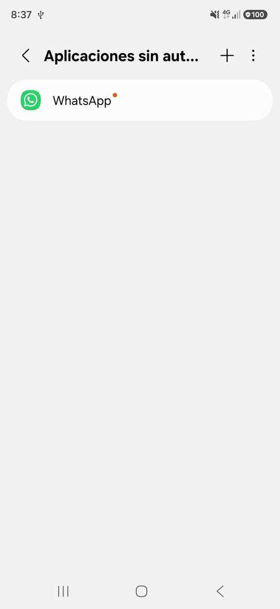</td>
</tr><tr>
<td align="center">① Límites de uso en segundo plano</td><td align="center">② Aplicaciones sin autoinactivación</td><td align="center">③ Pulsa <b>+</b>, marca WhatsApp → <b>Añadir</b></td><td align="center">④ Así debe quedar</td>
</tr></table>

Hay más ajustes que conviene revisar ("No molestar" desactivado, ubicación encendida, etc.). Están todos en la **[configuración recomendada](CONFIGURACION.md)**.

Al terminar, **activa el modo quiosco** otra vez desde el panel.

---

## 12. Comprobar que todo funciona y entregar el móvil

Prueba cada cosa antes de entregarlo:

- [ ] **Llamar:** toca una foto y comprueba que llama. Cuelga con el botón rojo.
- [ ] **Recibir una llamada:** llama al móvil desde otro teléfono. Debe salir la foto en grande, vibrar, cogerse con el botón verde y colgarse con el rojo.
- [ ] **SOS** (avisa antes a la persona de confianza): mantén pulsado el botón rojo 2 segundos. Debe llamar y enviarle un SMS con la ubicación.
- [ ] **Ubicación:** desde el móvil de un familiar, envía un SMS con la palabra **UBICACION**. Debe llegar la respuesta con un enlace de Google Maps.
- [ ] **Volumen:** pulsa los botones de volumen; debe aparecer un panel grande.
- [ ] **WhatsApp** (si se usa): haz una videollamada desde la foto y recibe otra.
- [ ] **Reinicio:** apaga y enciende el móvil. Debe arrancar directamente en LlamaditApp.
- [ ] **Bloqueo:** intenta salir con los botones de inicio y de aplicaciones recientes. No debe dejar.

Antes de entregarlo:

- En el panel del cuidador, comprueba que aparece el botón **Pausar el modo quiosco** (eso significa que el quiosco está **activo**).
- Configura los **móviles de los familiares** para que las llamadas y SMS del SOS suenen aunque estén en silencio: en **iPhone**, en el contacto → **Tono** → **Saltar silencio**; en **Android**, marca el contacto como favorito y permítelo en **No molestar**.

🎉 **¡Listo!** El móvil ya está preparado.

---

## 13. Si algo sale mal

| Problema | Solución |
|---|---|
| No encuentro "Número de compilación" | En Ajustes, pulsa la lupa y escribe **compilación**. |
| No me deja activar la Depuración USB | En Samsung, desactiva antes el **Bloqueador automático** (paso 5.1). |
| El instalador dice "No encuentro el móvil" | Prueba **otro cable** (muchos solo cargan). Comprueba que la **Depuración por USB** está encendida. Desbloquea el móvil y mira si pide **Permitir**. |
| El instalador dice que el móvil tiene **cuentas** | Quita las cuentas en **Ajustes → Cuentas y copia de seguridad → Administrar cuentas**, o vuelve a borrar el móvil (paso 2). |
| "Windows protegió su PC" | Pulsa **Más información → Ejecutar de todas formas**. |
| Un contacto no aparece en LlamaditApp | Comprueba que tiene la **estrella ★** en Contactos. |
| He olvidado el PIN del cuidador | Hay que borrar el móvil (paso 2) y empezar de nuevo. |

Más soluciones en **[PROBLEMAS.md](PROBLEMAS.md)**. ¿Prefieres hacerlo con comandos, sin el instalador? Consulta la **[guía técnica](INSTALACION.md)**.

---

Capturas de un Samsung Galaxy A16 (One UI 8.5) y del emulador de Android, con contactos inventados. Datos del teléfono tapados. Foto del contacto de ejemplo: Daniel Lara en Unsplash.
